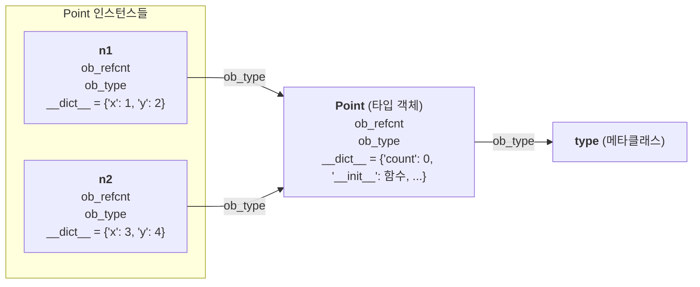

# Python Class

## 클래스의 생성자와 소멸자

```python
class ClassName1:
    def __init__(self):      # 초기화 메서드(흔히 '생성자'라 부름), 객체 생성 직후 호출
        print('constructor')

    def __del__(self):       # 소멸자(finalizer), 객체가 회수될 때 호출
        print('destructor')

c1 = ClassName1()            # constructor 출력
del c1                       # 참조 횟수가 0이 되므로 (CPython 기준) 즉시 destructor 출력

class ClassName2:
    def __init__(self, a, b, c):  # 생성자는 인자를 가질 수 있다
        print(f'constructor({a},{b},{c})')

    def __del__(self):
        print('destructor')

c2 = ClassName2(1, 2, 3)     # constructor(1,2,3)
```

- 생성자(constructor): 클래스 객체가 생성될 때 호출된다. `__init__`이라는 미리 정해진 이름을 사용해야 하며, 첫 번째 인자로 생성된 객체 자신을 받는다. 필요하다면 `def __init__(self, a, b, c)`처럼 self 뒤에 인자를 더 추가할 수 있다.
- 소멸자(destructor): 클래스 객체가 회수될 때 호출된다. `__del__`이라는 미리 정해진 이름을 사용해야 하며, 첫 번째 인자로 객체 자신을 받는다.

> - 첫 번째 인자는 **반드시 있어야** 하지만, 이름이 꼭 `self`일 필요는 없다. `self`는 문법이 아니라 강력한 관례(PEP 8)다.
> - 엄밀히 말하면 객체를 **만드는** 것은 `__new__`이고, `__init__`은 이미 만들어진 객체를 **초기화**하는 메서드다. 호출 순서는 `ClassName()` → `__new__(cls)` → `__init__(self)`이다. 보통은 `__new__`를 직접 구현할 일이 없으므로 `__init__`을 생성자라고 불러도 무방하다.
> - `__init__`은 `None`만 반환해야 한다. 다른 값을 반환하면 `TypeError`가 난다.

### 소멸자

클래스 소멸자는 보통 작성하지 않는데, 그 이유는 다음과 같다.

- 자동 메모리 관리: CPython은 **참조 횟수(reference counting)** 로 대부분의 객체를 즉시 회수하고, 참조 횟수만으로 처리할 수 없는 **순환 참조**는 보조 수단인 **순환 GC(`gc` 모듈)** 가 주기적으로 회수한다. C++처럼 개발자가 직접 메모리를 해제할 필요가 없다.
- 호출 시점이 정해져 있지 않음:
  - `del obj`는 객체를 삭제하는 것이 아니라 **이름(참조) 하나를 지우는 것**이다. 다른 참조가 남아 있으면 `__del__`은 호출되지 않는다.
  - 순환 참조에 묶인 객체는 GC가 돌 때까지 회수가 미뤄진다. (Python 3.4 이후 PEP 442로 `__del__`이 있는 순환 참조도 회수는 되지만, 언제 될지는 알 수 없다.)
  - 인터프리터가 종료될 때 아직 살아 있는 객체의 `__del__`은 **호출이 보장되지 않는다**. 호출되더라도 순서를 예측할 수 없고, 그 시점에 전역 변수나 모듈이 이미 정리되어 있을 수 있다.
  - PyPy 등 다른 구현체는 참조 횟수를 쓰지 않으므로 호출 시점이 더욱 늦다.
- 예외 처리 불가: `__del__` 안에서 발생한 예외는 호출한 쪽으로 전달되지 않고 경고 메시지만 출력된 뒤 무시된다.
- 객체 부활 위험: `__del__`에서 `self`를 전역 변수 등에 다시 저장하면 소멸하던 객체가 되살아나는 등 동작을 파악하기 어려워진다.

#### 외부 자원(파일, 네트워크 등)을 정리할 때의 대안

파일 닫기, 데이터베이스 연결 종료, 네트워크 소켓 해제처럼 반드시 정리해야 하는 작업이 있다면 소멸자 대신 아래 방법을 사용하는 것이 파이썬의 표준이다.

- 컨텍스트 매니저(`with` 문) 사용: 클래스에 `__enter__`와 `__exit__` 메서드를 구현하여 `with` 블록이 끝날 때 자원이 즉시, 그리고 확실하게 해제되도록 만든다. 블록 안에서 예외가 나도 `__exit__`은 호출된다.
- 명시적 종료 메서드 제공: `close()`나 `cleanup()` 같은 일반 메서드를 만들어 사용자가 직접 호출하게 하거나 `try ... finally` 구문과 함께 사용하도록 유도한다.

```python
# 권장되는 방식: 컨텍스트 매니저 활용
class ResourceHandler:
    def __enter__(self):
        # 자원 할당 (예: 파일 열기, DB 연결)
        return self              # as 뒤의 변수(handler)에 바인딩되는 값

    def __exit__(self, exc_type, exc_val, exc_tb):
        # 자원 해제 (블록 종료 시 예외 여부와 관계없이 실행됨)
        self.close()
        return False             # False/None 반환 시 블록 안의 예외는 그대로 전파된다
                                 # (True를 반환하면 예외를 삼키므로 주의)

    def close(self):
        print("자원이 안전하게 해제되었습니다.")

with ResourceHandler() as handler:
    # 작업 수행
    pass
```

> **간단한 경우엔 `contextlib`**
>
> ```python
> from contextlib import contextmanager
>
> @contextmanager
> def resource():
>     print("할당")
>     try:
>         yield "자원"
>     finally:
>         print("해제")
>
> with resource() as r:
>     print(r)
> ```

#### 소멸자(`__del__`)가 예외적으로 필요한 경우

- C 확장 모듈 래핑: C나 C++로 작성된 외부 라이브러리의 포인터나 메모리를 직접 할당받아 파이썬 객체로 감싼 경우, 해당 C 메모리를 해제하기 위한 최후의 안전장치로 사용한다.
- 디버깅 및 로깅: 객체가 메모리에서 실제로 언제 소멸하는지 추적하기 위한 임시 테스트 용도로 활용할 수 있다.

> **`__del__` 대신 `weakref.finalize`**
> "최후의 안전장치"가 필요할 때도 `__del__`보다 `weakref.finalize`가 권장된다. 인터프리터 종료 시에도 호출이 보장되고(`atexit` 연동), 한 번만 실행되며, 객체 부활 문제가 없다.
>
> ```python
> import weakref
>
> class Wrapper:
>     def __init__(self):
>         self._handle = allocate()                       # 예: C 자원 할당
>         self._finalizer = weakref.finalize(self, free, self._handle)
>
>     def close(self):                                     # 명시적 해제도 함께 제공
>         self._finalizer()                                # 이미 호출됐다면 아무 일도 안 함
> ```
>
> 주의: `finalize`에 넘기는 콜백과 인자는 `self`를 참조하면 안 된다(참조하면 객체가 영원히 회수되지 않음).

## 인스턴스 변수

- 각 객체마다 따로 보관되는 데이터를 말하며, 관례상 클래스의 인스턴스 필드는 생성자(`__init__`)에서 일괄적으로 초기화한다.
- 파이썬은 인스턴스 필드를 위해 미리 정해진 고정 구조를 두지 않고, 기본적으로 객체의 `__dict__` 어트리뷰트(딕셔너리)에 저장한다. (예외: 아래의 `__slots__`)
- 파이썬 공식 용어로는 필드보다 **인스턴스 변수(instance variable)** 또는 **인스턴스 어트리뷰트(instance attribute)** 라고 부른다.

```python
class ClassName:
    def __init__(self):
        self.x = 0
        self.y = 0

c1 = ClassName()
c1.x = 10
c2 = ClassName()
c2.y = 20

print(c1.x, c2.y)        # 10 20
print(c1.__dict__)       # {'x': 10, 'y': 0}
print(c2.__dict__)       # {'x': 0, 'y': 20}
```

## 인스턴스 변수 vs 클래스 변수 (instance vs static)

- 인스턴스 변수: 객체별로 따로 가지고 있는 데이터
- 클래스 변수: 모든 객체가 공유하는 데이터

> 용어 정리: "스태틱(정적) 필드"는 Java/C++ 용어다. 파이썬에서는 **클래스 변수(class variable) / 클래스 어트리뷰트(class attribute)** 라고 부른다. 파이썬의 `@staticmethod`는 "정적 메서드"라는 별개의 개념이므로 혼동하지 않도록 한다.

```python
class Point:
    def __init__(self, x: int = 0, y: int = 0):
        self.x = x
        self.y = y

n1 = Point(1, 2)
n2 = Point(3, 4)
```

- 위와 같이 인스턴스 변수 x, y를 가진 Point 클래스 객체를 두 개 생성하면, 각 객체의 변수들은 객체의 `__dict__` 어트리뷰트에 각각 저장된다.
- 그럼 클래스 변수는 어디에 저장되는 것일까? 모든 객체는 자신의 타입을 나타내는 "타입 객체(클래스 객체)"를 가리킨다(`ob_type`). 그림으로 표현하면 아래와 같다.



- 같은 타입의 객체들은 동일한 "타입 객체"를 가리키고 있다.
- 파이썬에서는 클래스도 객체이므로, 타입 객체 역시 `__dict__` 어트리뷰트를 가지고 있다. (클래스 자신의 타입은 `type`이다.)
- 타입 객체의 `__dict__`가 바로 클래스 변수가 저장되는 공간이다. 클래스 변수뿐 아니라 **메서드(`__init__` 등)도 여기에 함께 저장**된다.
- 클래스의 `__dict__`는 일반 dict가 아니라 읽기 전용인 `mappingproxy`이다. 따라서 `Point.__dict__['count'] = 1`은 불가능하고, `Point.count = 1` 또는 `setattr(Point, 'count', 1)`로 변경해야 한다.

### 클래스 변수의 문법

`Point.count = 0`처럼 클래스 이름을 통해 어트리뷰트를 생성하면 모든 Point 객체가 공유하는 클래스 변수가 타입 객체에 만들어진다.

- 보통은 아래와 같이 클래스 몸체에 선언한다.

```python
class Point:

    count = 0  # 클래스 정의가 끝난 뒤 Point.count = 0 을 실행한 것과 결과가 같다

    def __init__(self, x: int = 0, y: int = 0):
        self.x = x
        self.y = y
```

- 클래스 변수는 보통 클래스 이름을 통해 접근한다.
- 객체를 통해 어트리뷰트를 **읽으면**, 먼저 객체의 `__dict__`에서 count를 검색하고, 찾지 못하면 타입 객체의 `__dict__`에서 검색한다. 거기에도 없으면 부모 클래스들을 MRO(`Point.__mro__`) 순서대로 검색한다.
  - (엄밀히는 property 같은 "데이터 디스크립터"가 클래스에 있으면 그것이 인스턴스 `__dict__`보다 우선한다.)

#### 주의 1: 객체를 통해 "대입"하면 클래스 변수가 아니라 인스턴스 변수가 생긴다

읽기와 달리 **쓰기는 항상 객체의 `__dict__`에** 한다. 그래서 아래 코드는 의도대로 동작하지 않는다.

```python
class Point:
    count = 0
    def __init__(self):
        self.count += 1          # self.count = self.count + 1
                                 # 읽기: 클래스의 0 → 쓰기: 인스턴스 __dict__에 1 생성

p = Point()
print(Point.count, p.count)      # 0 1   ← 클래스 변수는 그대로!
print(p.__dict__)                # {'count': 1}

# 올바른 방법
class Point:
    count = 0
    def __init__(self):
        Point.count += 1         # 또는 type(self).count += 1
```

#### 주의 2: 변경 가능한(mutable) 클래스 변수

```python
class Dog:
    tricks = []                  # 모든 객체가 같은 리스트를 공유

    def __init__(self, name):
        self.name = name

    def add_trick(self, trick):
        self.tricks.append(trick)    # 대입이 아니라 '수정'이므로 클래스의 리스트가 바뀜

a, b = Dog('a'), Dog('b')
a.add_trick('roll')
print(b.tricks)                  # ['roll']  ← b에도 들어가 있다
```

객체별 리스트가 필요하면 `__init__`에서 `self.tricks = []`로 만든다.

## dict vs slots

### `__dict__`

- 어트리뷰트를 `__dict__`에 저장하는 방식의 특징이자 단점은, 외부에서 "새로운 어트리뷰트"를 자유롭게 추가할 수 있다는 것이다. 즉, 유연하지만 오타(`p.cuont = 1`) 같은 버그가 에러 없이 지나갈 수 있다.
- 또한 객체마다 딕셔너리가 하나씩 따로 붙기 때문에 객체당 메모리 오버헤드가 크다. 작은 객체를 수십만~수백만 개 만드는 경우 차이가 커진다.
  - (참고: CPython은 같은 클래스 객체들끼리 dict의 키를 공유하고(PEP 412), 3.11 이후로는 `__dict__`를 실제로 접근하기 전까지 만들지 않는 등 최적화를 계속해 왔다. 그래도 `__slots__`가 더 작다.)

### `__slots__`

- `__slots__` 클래스 어트리뷰트를 이용하면 어트리뷰트 생성을 제한하고 메모리를 절약할 수 있다.
- `__slots__`는 아래와 같이 클래스 변수를 만드는 것처럼 클래스 몸체에 선언하고, 사용할 어트리뷰트 이름들을 나열한다. 리스트도 되지만 보통은 튜플을 쓴다.

```python
class Bar:

    __slots__ = ('x', 'y')

    def __init__(self, x, y):
        self.x = x
        self.y = y

bar = Bar(1, 2)
bar.z = 10
# AttributeError: 'Bar' object has no attribute 'z'
# (Python 3.13: ... has no attribute 'z' and no __dict__ for setting new attributes)
```

- `__slots__`를 사용해 클래스를 정의하면 객체에 `__dict__`가 만들어지지 않고, x, y 값은 객체 메모리 안의 고정된 칸(slot)에 저장된다.
- 이 칸에 접근하는 수단으로 클래스에 `x`, `y`라는 디스크립터(`member_descriptor`)가 자동으로 생성된다. `type(Bar.x)` → `<class 'member_descriptor'>`

### `__dict__` vs `__slots__`

`__slots__`를 사용했을 때와 그렇지 않았을 때를 비교하기 위해, 객체의 어트리뷰트 목록을 반환하는 `dir` 내장 함수로 살펴보면 아래와 같은 차이가 있다.

```python
class Foo:                       # __slots__ 미사용
    def __init__(self, x, y):
        self.x = x
        self.y = y

foo = Foo(1, 2)
foo.z = 3                        # 새 어트리뷰트 추가 가능
```

- `__slots__`를 사용하지 않았을 때

```python
print(dir(foo))
# ['__class__', '__delattr__', '__dict__', '__dir__', '__doc__', '__eq__', '__format__',
#  '__ge__', '__getattribute__', '__gt__', '__hash__', '__init__', '__init_subclass__',
#  '__le__', '__lt__', '__module__', '__ne__', '__new__', '__reduce__', '__reduce_ex__',
#  '__repr__', '__setattr__', '__sizeof__', '__str__', '__subclasshook__', '__weakref__',
#  'x', 'y', 'z']
```

- `__slots__`를 사용했을 때

```python
print(dir(bar))
# ['__class__', '__delattr__', '__dir__', '__doc__', '__eq__', '__format__',
#  '__ge__', '__getattribute__', '__gt__', '__hash__', '__init__', '__init_subclass__',
#  '__le__', '__lt__', '__module__', '__ne__', '__new__', '__reduce__', '__reduce_ex__',
#  '__repr__', '__setattr__', '__sizeof__', '__slots__', '__str__', '__subclasshook__',
#  'x', 'y']
```

> 참고: 위 출력은 Python 3.10 기준이다. 3.11+에서는 `__getstate__`, 3.13+에서는 `__firstlineno__`, `__static_attributes__`가 추가로 보인다.

- `__slots__` 사용 시 객체의 `__dict__`와 `__weakref__` 어트리뷰트가 사라지고 `__slots__`가 생긴 것을 볼 수 있다.

### 약한 참조(weak reference)란?

일반 변수 대입(`b = a`)은 **강한 참조**다. 강한 참조가 하나라도 남아 있으면 객체는 회수되지 않는다.
**약한 참조**는 객체를 가리키기는 하지만 **참조 횟수를 늘리지 않는** 참조다. 그래서 약한 참조만 남은 객체는 그대로 회수되고, 회수된 뒤 약한 참조를 따라가면 `None`이 나온다.

```python
import weakref, sys

class Node:
    def __init__(self, name):
        self.name = name

a = Node('a')
print(sys.getrefcount(a))   # 2  (a + getrefcount 호출 인자로 잠깐 생긴 참조)

r = weakref.ref(a)          # 약한 참조 생성
print(sys.getrefcount(a))   # 2  ← 약한 참조는 참조 횟수를 늘리지 않는다

print(r().name)             # a   ← r()을 호출하면 원래 객체를 돌려준다
del a                       # 마지막 강한 참조 제거 → 객체 회수
print(r())                  # None ← 객체가 사라졌으므로 None
```

**언제 쓰는가?**

- **캐시**: 다른 곳에서 객체를 쓰는 동안만 캐시에 남기고, 아무도 안 쓰면 저절로 캐시에서 빠지게 하고 싶을 때 쓴다. 캐시가 객체를 붙잡아 메모리가 새는 것을 막는다.
  ```python
  cache = weakref.WeakValueDictionary()
  x = Node('x')
  cache['x'] = x
  print(list(cache))   # ['x']
  del x
  print(list(cache))   # []  ← 객체가 회수되면서 항목도 자동 삭제
  ```
- **순환 참조 끊기**: 트리에서 부모가 자식을 강하게 참조하고 자식은 부모를 **약하게** 참조하면 순환이 생기지 않아, 참조 횟수만으로 즉시 회수된다.
- **옵저버/콜백 목록**: 이벤트 구독자 목록이 구독자 객체를 계속 붙잡아 두지 않게 할 때 쓴다(`weakref.WeakSet`, `weakref.WeakMethod`).
- **소멸 감지**: 앞에서 본 `weakref.finalize`도 약한 참조를 이용해 "객체가 회수되는 순간"을 감지하는 방식이다.

**`__weakref__`와의 관계**: 어떤 객체를 약하게 참조할 수 있으려면 그 객체에 "자신을 가리키는 약한 참조 목록"을 저장할 자리가 있어야 한다. 그 자리가 `__weakref__`다. 일반 클래스는 자동으로 갖고 있지만, `__slots__` 클래스에는 없다. (`int`, `str`, `tuple`, `list`, `dict` 같은 내장 타입 객체도 약한 참조를 지원하지 않는다.)

### `__slots__` 사용 시 주의사항 (보충)

- **약한 참조 불가**: `__weakref__`가 없으므로 `weakref.ref(bar)`는 `TypeError: cannot create weak reference to 'Bar' object`가 난다. 필요하면 `__slots__ = ('x', 'y', '__weakref__')`처럼 추가한다. (`'__dict__'`를 넣으면 동적 어트리뷰트도 다시 허용된다.)
- **클래스 변수로 기본값을 줄 수 없다**: 같은 이름의 클래스 변수와 함께 쓰면 클래스 정의 시점에 에러가 난다. 기본값은 `__init__`에서 준다.
  ```python
  class Q:
      __slots__ = ('x',)
      x = 0          # ValueError: 'x' in __slots__ conflicts with class variable
  ```
- **상속**: 부모가 `__slots__`를 써도 **자식 클래스가 `__slots__`를 선언하지 않으면 자식 객체에는 `__dict__`가 다시 생긴다.** 자식도 `__slots__`를 선언하되, 부모에 이미 있는 이름은 다시 적지 않고 새로 추가하는 이름만 적는다.
  ```python
  class Bar3D(Bar):
      __slots__ = ('z',)     # x, y는 부모에서 상속
  ```
- **dataclass와 함께**: Python 3.10+에서는 `@dataclass(slots=True)`로 간단히 만들 수 있다.
- 일반적인 클래스에는 굳이 쓰지 않아도 된다. 객체를 대량으로 생성하는 경우나 어트리뷰트를 엄격히 고정하고 싶을 때 사용한다.
