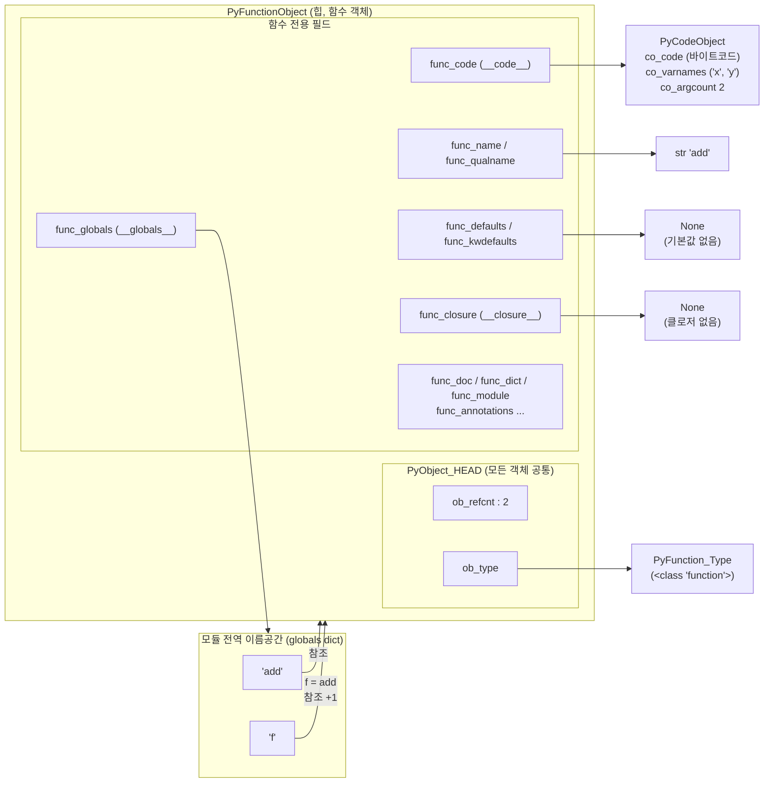
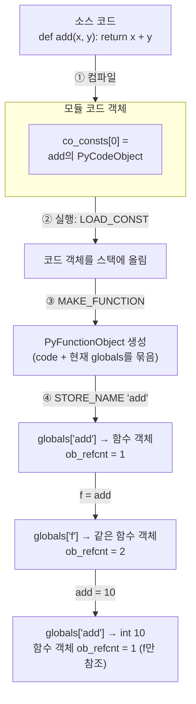

# 함수 객체

## 함수도 객체다

함수도 객체이기 때문에 예시와 같이 리스트에 담거나, 다른 함수의 인자로 넘기거나, 호출 가능한 객체인지 확인할 수 있다.

```python
def square(n): return n * n
def apply(func, value): return func(value)

funcs = [add, square]          # 리스트에 담을 수 있다
print(apply(square, 5))        # 25 ← 인자로 넘길 수 있다
print(callable(square))        # True ← 호출 가능한 객체인지 확인
```


```python
import sys

def add(x, y):
    return x + y

print(hex(id(add)))         # 함수 객체의 주소
print(sys.getrefcount(add)) # 함수 객체의 레퍼런스 카운트
print(sys.getsizeof(add))   # 함수 객체의 사이즈

f = add
print(f(10, 20))   
# 0x26daa835640
# 2 - getrefcount() 함수에서 내부적으로 객체의 레퍼런스 카운트를 1 증가 시킴
# 168 ~ 버전에 따라 다를 수 있음
# 30

add = 10
print(add)   # 10
```

## 어떻게 함수가 객체일 수 있을까?

위에서 add는 단지 함수 객체를 가리키는 변수일 뿐이라고 했다. 실제로 우리가 함수를 선언하게 되면, 파이썬은 내부적으로 아래와 같은 함수를 관리하기 위한 PyFunctionObject 객체를 생성하게 된다.

1. PyFunctionObject 구조 



2. 함수 객체가 만들어지는 과정
`def` 문은 실행 시점에 함수 객체를 만드는 명령입니다. 코드 객체는 컴파일할 때 미리 만들어지지만, 함수 객체는 `def` 줄이 실행될 때 생깁니다. 이 차이를 보여주는 흐름도입니다.



dis 모듈로 ②~④ 단계를 직접 볼 수 있습니다.

```python
import dis
dis.dis(compile("def add(x, y):\n    return x + y\n", "<m>", "exec"))
#  LOAD_CONST     0 (<code object add ...>)   ← 미리 만들어진 코드 객체
#  MAKE_FUNCTION                              ← 여기서 함수 객체 생성
#  STORE_NAME     0 (add)                     ← 이름 add에 연결
```

- 함수 객체에는 다른 파이썬 객체들과 마찬가지로 `PyObject`에서 파생되어 나온 레퍼런스 카운트(`ob_refcnt`)와 객체 타입을 가리키는 포인터(`ob_type`)를 가지고 있고, 
- 그외 함수 객체에 필요한 별도의 속성들을 가지고 있다. 
- 마지막으로 함수 객체를 add 라는 변수가 가리키게 되면 이제부터 add는 함수로써 `__code__` 속성에서 가리키고 있는 바이트 코드를 실행할 수 있는 변수가 되는 것이다.
- 만일 f 가 위 함수 객체를 가리킨다고 하더라도 동일한 결과를 얻는다.
- add 역시 변수 이므로 함수 객체 대신 다른 값, 예를 들어 정수 10을 대입하게 되면, 이제부터는 정수 객체를 가리키는 정수형 변수가 되는 것이다.

## 함수 객체의 속성값들
함수 객체는 다양한 속성값을 가진다. 

```python
def foo(a=10, b=20, c=30, d=40):
    '''
        foo 함수 설명. __doc__ 어트리뷰트에 저장됨
    '''
    print('foo')

print('bytecode for foo:',foo.__code__) # <code object foo at 0x0000026DAA771980, file "<python-input-17>", line 1>
print('doc:', foo.__doc__) # foo 함수 설명. ...
print('name:', foo.__name__) # foo
print('qualified name:', foo.__qualname__)  # foo
print('default positional argument:', foo.__defaults__) # (10, 20, 30, 40)
print('default keyword argument:', foo.__kwdefaults__) # None
```

- `__code__` : 실제 함수의 실행 내용을 담고 있는 코드 객체(바이트코드 + 실행에 필요한 메타데이터)
- `__doc__` : 함수를 정의할 때 함수의 첫 부분에 멀티라인 주석을 사용해서 함수에 대한 설명문을 만들면 `__doc__` 어트리뷰트에 저장됨
    - 3.13부터 컴파일러가 docstring의 공통 들여쓰기를 제거합니다. 그래서 3.13에서는 `\nfoo 함수 설명. __doc__ 어트리뷰트에 저장됨\n`이 나오고, 3.12 이하에서는 앞에 공백 8칸이 붙어 나옵니다. 버전과 상관없이 깔끔한 문자열이 필요하면 `inspect.getdoc(foo)`를 쓰면 된다.
- `__name__` : 함수의 이름을 출력한다.
- `__qualname__`: 클래스 이름까지 포함하여 함수 이름 출력
- `__defaults__`: 함수의 기본 파라미터들을 튜플(tuple) 형태로 저장한다.
- `__kwdefaults__`: `*` 뒤에 오는 키워드 전용(keyword-only) 매개변수의 기본 값만 저장합니다.

```python
def g(a, b=1, *, c=2, d):
    pass

print(g.__defaults__)    # (1,)        ← 일반 매개변수 b의 기본값
print(g.__kwdefaults__)  # {'c': 2}    ← * 뒤 키워드 전용 매개변수 c의 기본값
```

- `__annotations__`: 아래와 같이 함수 선언 시 인자와 리턴값에 대한 타입을 지정할 수 있다. 타입을 지정한다고 해서 실제 해당 타입만 받을 수 있도록 제약 사항을 걸어주는 것은 아니고, 그냥 `__annotations__` 속성에 정보를 저장하고 있다가 `help` 함수 호출 시 도움말 출력을 하는 데 사용한다.
    - mypy, Pyright 같은 타입 검사기, 그리고 `dataclasses`, Pydantic, FastAPI처럼 런타임에 어노테이션을 읽어 동작하는 라이브러리의 기반
    - Python 3.14부터는 어노테이션을 지연 평가(PEP649)한다. 함수를 정의할 때가 아니라 `__annotations__`에 처음 접근할 때 계산되고, 이를 위해 `__annotation__` 속성이 추가되었다.

```python
def add(x : int, y: int) -> int:
    return x + y

print(add.__annotations__) # {'x': <class 'int'>, 'y': <class 'int'>, 'return': <class 'int'>}
help(add)
```

- `__closure__`: 내부 함수(inner)가 참조하는 외부 함수(outer)의 변수(자유 변수)마다 **cell 객체**를 하나씩 담은 튜플이다.
    - outer와 inner는 같은 cell을 공유하며, cell은 현재 값을 가리키는 참조(`cell_contents`)를 들고 있다.
    - 그래서 outer가 종료된 뒤에도 inner가 값을 읽고(`nonlocal`로) 바꿀 수 있다.
        - 튜플의 순서는 `f.__code__.co_freevars`의 순서와 같다.
        - 출력의 `cell at 0x...`는 cell 객체 자신의 주소, `int object at 0x...`는 cell이 지금 가리키는 객체의 주소(= `id(x)`)다.


```python
def outer(x):
    y = 0
    print(hex(id(x)), hex(id(y)))

    def inner():
        nonlocal x, y
        x = 20

    return inner

f = outer(10) # 0x7ffe9f1f5598 0x7ffe9f1f5458
print(f.__code__.co_freevars)          # ('x', 'y')
print(f.__closure__)
# (<cell at 0x…DD20: int object at 0x…5598>, <cell at 0x…4550: int object at 0x…5458>)
print(f.__closure__[0].cell_contents)  # 10

f() # inner가 실행됨 => x = 20 실행
print(f.__closure__[0].cell_contents)  # 20  ← cell 주소는 그대로, 내용물만 바뀜
print(outer(10).__qualname__) # outer.<locals>.inner
```

- `__dict__`: 딕셔너리로 함수에 관련된 데이터들을 키와 값으로 저장할 수 있다. 나중에 나올 데코레이터에서 유용하게 사용되는 어트리뷰트다.

```python
def foo():
    pass

print(foo.__dict__) # 아직은 아무것도 없다.

foo.__dict__['x'] = 10 # 키가 x인 10을 저장
print(foo.__dict__)

foo.y = 20 # foo.__dict__['y'] = 20 과 동일
print(foo.__dict__)

def bar():
    print('bar')

foo.bar = bar   # 함수가 또 다른 함수를 데이터로 가질 수 있다.
```

## 사용자 정의 함수와 빌트인 함수의 차이
> 파이썬에서는 빌트인 함수는 최적화를 위해 C언어로 작성되어 있어 사용자 정의 함수가 가지고 있는 몇몇 속성들이 없다.
이 사실을 모르면 나중에 파이썬에 숙달하여 함수의 속성들을 확인하고자 빌트인 함수를 뒤져봤는데 필요한 속성을 찾지 못해 당황하는 경우가 생길 수 있다.

```python
import sys

def add(x, y):
    ​​​​return x + y
​​​​
print(add.__dict__)   
print(print.__dict__) # error. print 빌트인 함수는 __dict__ 어트리뷰트가 없다

print(add)            # <function add at 0x000002DD1F10CF70>
print(print)          # <built-in function print>

print(sys.getsizeof(add))   # 168
print(sys.getsizeof(print)) # 72. 최적화 되어 있음

print(dir(add))
print(dir(print))
```

```python
print(type(add))     # <class 'function'>
print(type(print))   # <class 'builtin_function_or_method'>

print(sorted(set(dir(add)) - set(dir(print))))
# ['__annotations__', '__builtins__', '__closure__', '__code__', '__defaults__',
#  '__dict__', '__get__', '__globals__', '__kwdefaults__', '__type_params__']

print(sorted(set(dir(print)) - set(dir(add))))
# ['__self__', '__text_signature__']
```
- 빌트인 함수에는 `__code__`가 없음. 실행할 파이썬 바이트코드가 없고 C함수 포인터를 직접 호출하기 때문이다. 
- `print.__self__`는 `<module 'builtins'>`임. 빌트인 함수는 builtins 모듈에 묶인 C 함수
- `len`, `print`는 빌트인 함수이지만, `int`, `str`, `range`는 빌트인 **클래스(타입)** 이다.


## 속성 정리표

| 속성 | 내용 | C 구조체 필드 |
|---|---|---|
| `__code__` | 코드 객체 | `func_code` |
| `__globals__` | 함수가 정의된 모듈의 전역 dict | `func_globals` |
| `__builtins__` | 참조할 builtins dict | `func_builtins` |
| `__name__` / `__qualname__` | 이름 / 경로 포함 이름 | `func_name` / `func_qualname` |
| `__defaults__` / `__kwdefaults__` | 일반 / 키워드 전용 기본값 | `func_defaults` / `func_kwdefaults` |
| `__closure__` | 자유 변수 cell 튜플 | `func_closure` |
| `__doc__` | docstring | `func_doc` |
| `__dict__` | 사용자 정의 속성 | `func_dict` |
| `__module__` | 정의된 모듈 이름 | `func_module` |
| `__annotations__` | 타입 어노테이션 | `func_annotations` |
| `__type_params__` | 제네릭 타입 매개변수 (3.12+, `def f[T](x: T)`) | `func_typeparams` |
