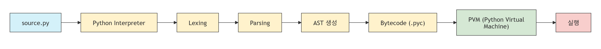
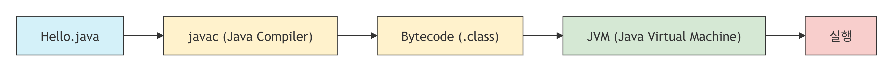

# Python 코드 실행과 메모리에 올라가기까지 
[velog-원문](https://velog.io/@qlgks1/python-%EB%A9%94%EB%AA%A8%EB%A6%AC-%EA%B4%80%EB%A6%AC-memory-optimization) 참조하여 학습 내용 정리

> python은 인터프리터 언어로, 파이썬 인터프리터가 설치되어 있다면 [compiler $\rarr$ byte code $\rarr$ pvm $\rarr$ running] 까지 다 알아서 해준다.

- 우리가 만든 `.py` 파일은 python interpreter에 의해 compile 되고, bytecode로 바뀐 뒤에 PVM(Python Virtual Machine) 위에서 구동(running)된다.
- 여기서 이 "python interpreter"의 종류는 CPython, PyPy, IronPython 등이 있으며, 가장 많이 사용되는 것은 기본 제공되는 CPython이다.

## 1. Byte-code가 되어 실행되기까지 과정
> 인터프리터 종류에 따라 상이하지만, 아래와 같은 과정을 거친다고 간략히 이해하자.

특징
- Python Interpreter 내부에 컴파일러가 포함되어 있음
- 실행 시 소스코드를 읽어 Bytecode로 변환
- 생성된 Bytecode를 PVM이 실행
- 개발자는 보통 컴파일 과정을 의식하지 않음

### 1. Lexing
- 전달된 code를 가지고 line을 쪼개 코드를 Token으로 generate 한다.

### 2. Parsing
- Lexing을 통해 생성된 토큰이 parser에게 전달되어 파싱된다. token을 가지고 Abstract Syntax Tree(A.S.T)라는 token 사이의 관계를 나타내는 트리 구조를 만든다. 해당 단계는 프로그래밍 언어를 구축하는 데 있어서 중요한 개념이다. 참조 : [위키피디아-Abstract syntax tree](https://en.wikipedia.org/wiki/Abstract_syntax_tree)
- AST를 제어 흐름 그래프(Control Flow Graph)로 변환한다. 참조: [AST 관련 강의 자료](https://www.cs.columbia.edu/~suman/secure_sw_devel/Basic_Program_Analysis_CF.pdf)

### 3. Compiling
- 위와 같은 과정을 거치면 Bytecode 라는 `.pyc` 형태의 intermediate language code가 생성된다.
- `.pyc` 파일은 파이썬 버전 3.2 이전에는 `.py`와 같은 경로에 생성되고, 3.2 이후 버전에서는 `__pycache__` 디렉터리 아래에 생성된다.
- 무조건 `.pyc` 파일을 생성하는 것이 아니라, `.py` 파일이 다른 스크립트에 의해 `import` 되었을 경우에만 생성된다.
- `import` 문이 호출되었을 때는 다음과 같은 확인을 한다.
    1. 파이썬은 import 되는 스크립트의 컴파일된 파일이 존재 하는지 확인한다. 없다면, `.pyc` 파일을 생성하고 불러 온다.
    2. 있다면, 내부 `timestamp` 에서 `.py` 파일보다 `.pyc` 파일이 더 오래 되었는지 확인한다. 즉, 소스코드가 변경되면 자동으로 새 `.pyc` 파일을 생성한다.
    3. 대화형 프롬프트(REPL) 환경에서 입력한 코드에 대해서는 `.pyc` 파일을 생성하지 않는다.
- 컴파일 언어인 자바와 차이가 나는 부분은 자바코드는 interpreter(해석기)에게 소스가 전달되기 전에 컴파일러에 의해 컴파일된다. 즉, compiler가 interpreter 밖에 존재한다.

특징
- 컴파일러(javac)가 JVM 밖에 존재
- 실행 전에 `.class` 파일 생성
- JVM은 이미 생성된 Bytecode만 실행
- 컴파일 단계와 실행 단계가 명확히 분리됨

|Python|Java|
|-|-|
|인터프리터 내부에 컴파일러 포함|컴파일러(javac)와 JVM 분리|
|.py $\rarr$ bytecode $\rarr$ PVM을 인터프리터가 처리|.java $\rarr$ .class을 먼저 생성 후 JVM 실행|
|실행 시 컴파일|실행 전 컴파일|
|CPython, PyPy 등의 구현체 존재|OpenJDK, Oracle JDK 등의 JVM 구현체 존재|

**"Python은 인터프리터 언어, Java는 컴파일 언어**라고 단순히 구분하기보다는, 
> 둘 다 중간 코드(Bytecode)를 생성하여 가상 머신 위에서 실행된다.
단지 Python은 컴파일 과정이 인터프리터 내부에 숨겨져 있고, Java는 개발자가 `javac`를 통해 명시적으로 컴파일을 수행한다.

### 4. PVM
- `.pyc`가 전달되어져서 python 코드가 실행되며 파이썬의 런타임 엔진이다. 파이썬 시스템의 일부이기 때문에 별도의 설치가 필요하지 않고, "존재"한다.
- 컴파일러가 생성한 Python Bytecode를 읽어 실행하는 가상 머신으로, 생성된 Bytecode를 해석(interpret)하여 실행한다.
- CPython에서는 일반적으로 Bytecode를 미리 Machine code로 변환하지 않고 Opcode를 하나씩 수행한다.
- 추가로 "프로즌 바이너리"는 작성한 파이썬 프로그램을 실행 파일(.exe)로 변환 하는 것 또한 가능하다.
    - PyInstaller, py2exe, py2app 등을 통해서 "실행 가능한 바이너리"로 만들 수 있다.
- 프로즌 바이너리를 만들 때에는 바이트 코드와, 실행 환경(PVM), 그리고 의존성 모듈을 단일 패키지로 만들고 결과물은 실행 가능한 형태(.exe)가 된다.