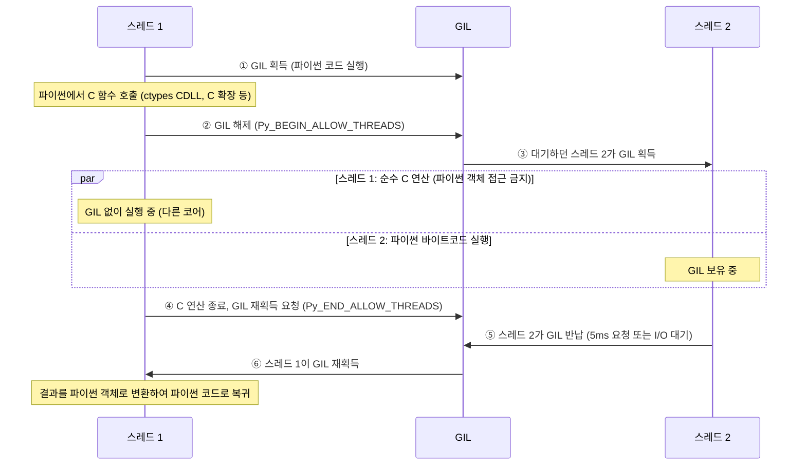

# 3. Python 메모리 관리(2) : GC, reference counter and GIL

> 이 장에서는 CPython이 메모리를 해제하는 방법과 그 때문에 발생하는 GIL에 대해 알아보자.

- 파이썬을 사용하면 메모리의 할당과 해제를 프로그래머가 직접 할 필요가 없다. 오히려 올바르지 않게 직접 하면 역효과가 날 수 있다.
- 객체가 더 이상 사용되지 않으면 알아서 메모리에서 해제해야 한다. "더 이상 사용되지 않는" 객체를 구분하기 위해 **CPython**은 레퍼런스 카운팅과 가비지 컬렉션(순환 GC) 두 가지를 함께 사용한다.
  - 대부분의 객체는 레퍼런스 카운팅만으로 해제되고, 이것으로 해제할 수 없는 **순환 참조**를 GC가 보완한다.
  - 넓은 의미에서는 레퍼런스 카운팅도 GC에 포함시키지만, 여기서는 `gc` 모듈이 담당하는 순환 GC와 구분해서 본다.
  - 이는 CPython의 구현 방식이며 언어 명세가 강제하는 것이 아니다. (예: PyPy는 참조 카운팅을 쓰지 않는다)


## 3.1 레퍼런스 카운팅(reference counting)
- 모든 객체는 헤더(`PyObject`)의 `ob_refcnt` 필드에 자신이 참조되는 횟수를 기록하고, 0이 되면 객체를 해제한다.
- 해제 직전에 `__del__(self)`가 호출된다. 공식 문서 용어로는 finalizer이며(destructor라고 부르기도 하나 엄밀히는 부정확), 메모리를 해제하는 함수가 아니라 정리 작업용 훅이다. 인터프리터 종료 시점의 호출은 보장되지 않는다.

### 3.1.1 작동 방법
- 참조가 생기면(대입, 인자 전달, 컨테이너에 담기 등) 카운트 +1, 참조가 사라지면(`del`, 재대입, 스코프 종료, 컨테이너에서 제거 등) 카운트 -1.
- `del x`는 `__del__`을 직접 호출하는 것이 아니라 이름 `x`를 지워 카운트를 줄일 뿐이다. 다른 참조가 남아 있으면 객체는 살아 있다.
- 카운트가 0이 되면 즉시 해제된다.
- `sys.getrefcount(obj)`로 확인한다. 인자로 넘기는 동안 임시 참조가 하나 생기므로 실제보다 1 크게 나온다.
- 3.12+부터 `None`, 작은 정수 등은 immortal 객체여서 카운트가 고정된 큰 값으로 나온다. (3.13: 4294967295)
- CPython 내부(C)에서는 `Py_INCREF`로 카운트를 올리고 `Py_DECREF`로 내린다. 0이 되면 `_Py_Dealloc`이 객체 타입의 해제 함수(`tp_dealloc`)를 호출하고, 이 함수가 `__del__` 실행, 내부 객체 참조 해제, 메모리 반환을 수행한다. [참조 횟수 - 공식문서](https://docs.python.org/ko/3/c-api/refcounting.html)
  - 과거에는 매크로였고, 현재는 `static inline` 함수로 구현되어 있다.

#### 매크로란?

> **매크로란?** C 전처리기가 컴파일 전에 코드 속 이름을 정의된 텍스트로 단순 치환하는 규칙이다. `#define 이름(매개변수) 치환될_텍스트` 형태로 정의하며, 인수를 받는 것을 함수형 매크로라고 한다.
> 함수 호출 오버헤드가 없는 대신 타입 검사가 없고, 인자가 여러 번 평가될 수 있다. (`#define SQUARE(x) ((x)*(x))` 에 `SQUARE(i++)`를 쓰면 `i++`가 두 번 실행된다)

```c
int square(int x) {
    return x * x;
}

int a = square(5);
```
실행 시 대략 아래와 같은 함수 호출 과정이 있음.
1. square 함수로 이동
2. x=5 저장
3. 계산
4. 원래 위치로 복귀

매크로
```c
#define SQUARE(X) ((X) * (X))

int a = SQUARE(5);
```
매크로는 컴파일 전에 전처리기가 그냥 글자를 바꿔버림
```c
int a = ((5) * (5));
```
로 변환 된 뒤 컴파일된다.
즉, `SQUARE(5)`라는 함수가 호출되는 것이 아니라 `((5) * (5))`라는 코스가 복사 붙여넣기 된 것과 같음.

#### Py_INCREF를 매크로로 생각해보기
- 예전 CPython은 대략 이런 식
```c
#define PY_INCREF(op) ((op)->ob_refnct++)
```
- `Py_INCREF(obj);`를 쓴 순간 전처리기가 `(obj)->ob_refcnt++;`로 바꿔버림

#### 매크로 사용 이유
- 참조 카운트 증감은 엄청 자주 일어나는데, 만약 매번 진짜 함수 호출을 하면 함수 진입-복귀 비용이 계속 생김
    - CPU 관점에서는 대략:
    - 현재 실행 위치 저장
    - 인자 전달 및 스택 프레임 생성
    - 함수로 점프
    - 계산
    - 원래 위치로 복귀
- 그래서 과거 CPython 개발자들은 `#define Py_INCREF(op) ((op)->ob_refcnt++)`처럼 만들어서 그냥 한 줄 코드로 치환되게 함.
- 장점: 함수 호출 비용 없음
- 단점:
    - 타입 검사 없음
    - 디버깅 어려움
    - 인자가 여러 번 평가될 수 있음
```c
#define SQUARE(x) ((x)*(x))

int y = SQUARE(i++);
// 전처리 후:
int y = ((i++)*(i++));
```

#### 왜 static inline 함수를 쓰나?
```c
static inline void Py_INCREF(PyObject *op)
{
    op->ob_refcnt++;
}
// 사용은 똑같음
Py_INCREF(obj);
// 컴파일러는 이를 보고
obj->ob_refcnt++; // 로 최적화해 버림
```

```c
static inline int add(int a, int b)
{
    return a + b;
}

int x = add(1,2);
```

- inline 함수는 문법상 함수
- 즉, 컴파일러는 먼저 다음을 수행
    1. 함수 선언 확인
    2. 타입 검사
    3. 문법 검사
- 그런 다음 최적화 과정(컴파일 과정 중)에서:
    `int x = add(1,2);`를 `int x = 1 + 2;`로 바꿔버릴 수 있음.
- 이것을 인라이닝(inlining)이라고 함.
- 원래, `result = add(10, 20);` -> `CALL add` -> `RET` 가 필요함
- 하지만, 인라이닝을 하면 `result = 10 + 20;`이 되므로 `CALL` 없음 + `RET` 없음


### 3.1.2 한계: 순환 참조
- 레퍼런스 카운팅은 메커니즘도 간단하고 사용되지 않을 때 바로바로 회수가 가능한 장점이 있다.
- 하지만 "자기 자신을 참조하는 순환 참조" 형태를 해결할 수 없다.
- 서로를 참조하는 객체는 외부 참조가 모두 사라져도 카운트가 0이 되지 않아 레퍼런스 카운팅만으로는 해제할 수 없다.

```python
li = list()
li.append(li)
...
del li
```

- `li`는 리스트 객체이고, 자기 자신을 append하면 `li`를 가리키는 참조가 리스트 내부에 하나 더 생겨 카운트가 +1 된다. 이후 `del li`로 이름 `li`를 지워도 내부 참조 1이 남아 카운트가 0이 되지 않는다. (`del`은 객체를 삭제하는 것이 아니라 이름을 제거해 카운트를 1 줄일 뿐이다.)
- 이 객체는 코드에서 접근할 수 없지만 카운트가 0이 아니므로, 레퍼런스 카운팅만으로는 해제되지 않는다. GC가 회수하기 전까지 메모리에 남는다.


```python
a = Human()
b = Human()
a.friend = b # 이 순간 b의 레퍼런스 카운팅 2
b.friend = a # 이 순간 a의 레퍼런스 카운팅 2
del a
del b
```
단계별 과정

| 시점 | a의 RC | b의 RC |
|---|---|---|
| `a = Human()`, `b = Human()` | 1 (이름 `a`) | 1 (이름 `b`) |
| `a.friend = b` | 1 | 2 (이름 `b` + `a.friend`) |
| `b.friend = a` | 2 (이름 `a` + `b.friend`) | 2 |
| `del a` | **1** (`b.friend`만 남음) | 2 |
| `del b` | 1 | **1** (`a.friend`만 남음) |

`del`로 이름(변수)은 모두 사라졌지만, 남은 카운트 1은 **두 객체가 서로 들고 있는 참조**. 이 상태는 서로 기다리는 교착 상태이다.

- `a`가 해제되려면 `b.friend`가 먼저 풀려야 하고, 그러려면 `b`가 먼저 해제돼야 합니다.
- `b`가 해제되려면 `a.friend`가 먼저 풀려야 하고, 그러려면 `a`가 먼저 해제돼야 합니다.

그래서 코드에서는 두 객체에 더 이상 접근할 수 없는데도 카운트가 0이 되지 않는다.

- 특정 class의 instance로 만든 경우도 동일하다. 역시 `del` 이후 `a` 와 `b`의 RC는 각 1 값으로 남아 해제되지 않게 된다. 
- 순환 참조는 웹 애플리케이션뿐 아니라 어떤 프로그램에서도 생길 수 있다. 짧게 실행되는 스크립트는 종료 시 메모리가 정리되어 드러나지 않지만, 장기 실행 프로세스에서는 누적되어 문제가 된다. 그래서 순환 참조를 찾아 회수하는 G.C가 필요하다.

## 3.2 가비지 컬렉션(Garbage Collection)
- [GC 공식 설명](https://docs.python.org/ko/3/c-api/gcsupport.html) 참조.
- [GC 인터페이스](https://docs.python.org/ko/3/library/gc.html#gc.disable)를 통해서 GC를 제어할 수 있다.
- GC 모듈은 사실 오로지 "순환 참조 해결"을 위해 존재한다. 그래서 official docs에서도 `Cyclic Garbage Collection`이라고 부른다. 그리고 GC 모듈 문서에서는 수거기는 파이썬에서 이미 사용된 참조 횟수 추적을 보충하므로, 프로그램이 참조 순환을 만들지 않는다고 확신한다면 GC를 비활성화(`gc.disable()`)할 수 있다고 언급되어 있다. 

### 3.2.1 작동 방법
- GC는 내부적으로 `generation`과 `threshold`로 수집 주기와 대상을 관리한다.
- 세대는 `0~2`세대. 새 객체는 0세대에서 시작하고, 수집에서 살아남으면 다음 세대로 이동한다. 한 객체는 하나의 세대에만 속하며, 2세대 객체는 계속 2세대에 남는다. 어린 세대일수록 더 자주 수집하는데, 이는 아래 generational hypothesis에 근거한다.

> [Memory Management Glossary(용어사전)](https://memory-pool-system.readthedocs.io/en/latest/glossary/g.html)

>Infant mortality or the generational hypothesis is the observation that, 
in most cases, young objects are much more likely to die than old objects.

> Strictly, the hypothesis is that the probability of death as a function of age 
falls faster than exponential decay (inverse hyper-exponential), 
but this strict condition is not always required for techniques 
such as generational garbage collection to be useful.

- `gc.get_threshold()`는 `(threshold0, threshold1, threshold2)`를 반환한다. 기본값은 버전에 따라 다르다.
  - 3.13, 3.14.5 이상: `(2000, 10, 10)`
  - 3.14.0~3.14.4: 증분 GC로 threshold2가 무시되어 `(2000, 10, 0)`

```python
>>> import gc
>>> gc.get_threshold()
(2000, 10, 0)
```
- 카운터가 세는 대상
  - 0세대: GC가 추적하는 컨테이너 객체의 (할당 − 해제) 횟수
  - 1·2세대: 바로 아래 세대가 수집된 횟수
- `count > threshold`인 세대가 있으면 수집하며, 여러 세대가 조건을 만족하면 가장 오래된 세대를 수집한다. 그 세대보다 어린 세대도 함께 수집한다.
- 수집이 끝나면 살아남은 객체는 다음 세대로 이동하고, 다음 세대 카운터가 +1 되며, 수집한 세대 이하의 카운터는 0으로 초기화된다.
- 2세대(전체) 수집은 임계값 외에 `long_lived_pending > long_lived_total / 4` 조건도 만족해야 한다. (오래 사는 객체가 늘어날수록 전체 수집이 갈수록 느려지는 것을 막기 위한 장치)
- 대략적으로 0세대는 컨테이너 객체가 순증가 2,000개를 넘을 때마다, 1세대는 0세대 수집이 10회를 넘을 때마다 일어난다. 2세대는 이보다 드물다.
- 3.12부터 GC는 객체 할당 시점이 아니라 바이트코드 평가 루프(eval breaker)에서 실행된다.


### 3.2.2 순환 참조 감지
- GC의 목적은 순환 참조 감지이며, 순환 참조는 다른 객체에 대한 참조를 담을 수 있는 **컨테이너 객체**에서만 생길 수 있다. 정수, 실수, 문자열(str)처럼 다른 객체를 참조하지 않는 객체는 GC 대상이 아니다.
- 컨테이너는 상속 관계가 아니라, 타입이 `Py_TPFLAGS_HAVE_GC` 플래그를 가지고 `tp_traverse`(보유한 참조를 GC에 알려 주는 함수)를 구현했는지로 결정된다. list, dict, set, tuple, 클래스 인스턴스, 함수 등이 해당한다.
- 컨테이너라도 모든 원소가 원자적이면 추적에서 빠지기도 한다. (`gc.is_tracked()`로 확인 가능. 예: `{'a': 1}`은 미추적, `{'a': []}`는 추적)
- [CPython GC 소스코드](https://github.com/python/cpython/blob/main/Include/internal/pycore_gc.h)

```c
/* GC information is stored BEFORE the object structure. */
typedef struct {
    // Pointer to next object in the list.
    // 0 means the object is not tracked
    uintptr_t _gc_next;

    // Pointer to previous object in the list.
    // Lowest two bits are used for flags documented later.
    uintptr_t _gc_prev;
} PyGC_Head;

#define NUM_GENERATIONS 3

struct gc_generation {
    PyGC_Head head;
    int threshold; /* collection threshold */
    int count; /* count of allocations or collections of younger
                  generations */
};

/* Running stats per generation */
struct gc_generation_stats {
    /* total number of collections */
    Py_ssize_t collections;
    /* total number of collected objects */
    Py_ssize_t collected;
    /* total number of uncollectable objects (put into gc.garbage) */
    Py_ssize_t uncollectable;
};

struct _gc_runtime_state {
    /* List of objects that still need to be cleaned up, singly linked
     * via their gc headers' gc_prev pointers.  */
    PyObject *trash_delete_later;
    /* Current call-stack depth of tp_dealloc calls. */
    int trash_delete_nesting;

    /* Is automatic collection enabled? */
    int enabled;
    int debug;
    /* linked lists of container objects */
    struct gc_generation generations[NUM_GENERATIONS];
    PyGC_Head *generation0;
    /* a permanent generation which won't be collected */
    struct gc_generation permanent_generation;
    struct gc_generation_stats generation_stats[NUM_GENERATIONS];
    /* true if we are currently running the collector */
    int collecting;
    /* list of uncollectable objects */
    PyObject *garbage;
    /* a list of callbacks to be invoked when collection is performed */
    PyObject *callbacks;
    /* This is the number of objects that survived the last full
       collection. It approximates the number of long lived objects
       tracked by the GC.
       (by "full collection", we mean a collection of the oldest
       generation). */
    Py_ssize_t long_lived_total;
    /* This is the number of objects that survived all "non-full"
       collections, and are awaiting to undergo a full collection for
       the first time. */
    Py_ssize_t long_lived_pending;
};
```

**용어**
- **reachable** : 프로그램(변수, 스택, 전역 등 수집 대상 바깥)에서 참조를 따라가 닿을 수 있는 객체. 순환 참조가 있어도 바깥에서 들어오는 길이 있으면 reachable이다.
- **unreachable** : 바깥에서 닿을 방법이 전혀 없는 객체. 서로 참조하고 있어도 바깥과 끊겨 있으면 unreachable이다.

**과정** (수집 대상 세대 안의 컨테이너 객체만 대상)
1. `PyGC_Head`의 더블 링크드 리스트로 수집 대상 세대의 컨테이너 객체를 순회하며, 각 객체의 실제 참조 카운트를 `gc_refs`로 복사한다.
2. 각 객체가 가리키는 대상(수집 대상 안의 객체)의 `gc_refs`를 1씩 감소시킨다. 실제 `ob_refcnt`는 건드리지 않는다. 결과적으로 `gc_refs`는 "수집 대상 바깥에서 들어오는 참조 수"가 된다.
    - 최종 gc_refs = ob_refcnt − (수집 대상 안의 객체들이 이 객체를 가리키는 참조 수)
3. 객체를 순서대로 훑는다. `gc_refs > 0`이면 reachable로 확정하고, 그 객체가 가리키는 객체를 따라가며 reachable로 표시한다. `gc_refs == 0`이면 일단 unreachable 후보로 옮긴다(`NEXT_MASK_UNREACHABLE` 비트).
4. 후보에 들어 있어도 reachable 객체가 가리키고 있으면(0이어도 도달 가능) 후보에서 꺼내 reachable로 되돌린다.
5. 끝까지 후보로 남은 객체가 unreachable로 확정된다. GC는 곧바로 해제하지 않고 다음 순서로 처리한다. 약참조 정리 → `__del__` 호출 → 부활 여부 재확인 → `tp_clear`로 내부 참조 끊기. 참조가 끊겨 카운트가 0이 되면 평소처럼 해제된다.

>섬과 육지로 비유하면, 객체는 섬, 참조는 다리. 육지(프로그램의 변수들)에서 다리가 닿은 섬과 거기서 다리로 걸어갈 수 있는 섬은 reachable입니다. 섬들끼리 다리로 촘촘히 이어져 있어도 육지와 끊겨 있으면 전부 unreachable입니다.

>**GC가 이를 알아내는 방법.** 파이썬에는 "지금 쓰이는 객체 목록"이 따로 없습니다. 그래서 참조 카운트에서 "수집 대상 안의 객체끼리 가리키는 몫"을 빼서 **"바깥에서 직접 들어오는 참조 수"**(`gc_refs`)를 구합니다. 소스 주석도 같은 설명입니다.

**예제.** 변수 `x`가 `A`를 잡고 있고, `C`와 `D`는 서로 참조하며 `D`는 `E`도 가리킵니다. 나머지 `B`, `C`, `D`, `E`는 이름이 없는 상태입니다.

```
변수 x ──▶ A ⇄ B           (A→B, B→A)

           C ⇄ D ──▶ E     (C→D, D→C, D→E)   ← 바깥에서 오는 참조 없음
```

| 객체 | 들어오는 참조 | ① `gc_refs` = `ob_refcnt` 복사 | ② 내부 참조를 뺀 `gc_refs` |
|---|---|---|---|
| A | 변수 x, B | 2 | **1** |
| B | A | 1 | 0 |
| C | D | 1 | 0 |
| D | C | 1 | 0 |
| E | D | 1 | 0 |

②는 `A→B`, `B→A`, `C→D`, `D→C`, `D→E`의 다섯 참조를 각각 대상에서 1씩 뺀 결과입니다. 남은 값이 바깥에서 오는 참조 수입니다. `A`의 1은 변수 `x` 몫입니다.

③ 이제 객체를 차례로 훑습니다. `gc_refs > 0`이면 reachable로 확정하고, 그 객체가 가리키는 객체를 따라가며 reachable로 표시합니다. `gc_refs == 0`이면 **일단 unreachable 후보로 옮깁니다.** 훑는 순서에 따라 두 경우가 있습니다.

- **A, B, C, D, E 순**: A는 1이라 reachable이고 B에도 표시합니다. B도 reachable입니다. C, D, E는 0이라 후보로 옮깁니다.
- **B, A, C, D, E 순**: B는 0이라 일단 후보로 옮깁니다(아직 A를 못 본 상태입니다). 이어서 A가 reachable로 확정되고 A→B를 따라가 보니 B가 후보 목록에 있습니다. 그러면 B를 후보에서 꺼내 reachable로 되돌립니다. 이것이 107행의 "0이어도 도달 가능"입니다.

어느 순서든 결과는 같습니다. reachable은 **{A, B}**, unreachable은 **{C, D, E}**입니다. 실제 GC에서도 두 순서 모두 이렇게 나오는지 `weakref`로 확인했습니다. `gc.collect()` 뒤에 C, D, E만 사라졌습니다.

이 예제에서 짚어 둘 점은 세 가지입니다.
- `gc_refs == 0`은 "바깥에서 **직접** 오는 참조가 없다"는 뜻일 뿐입니다. reachable한 객체가 가리키고 있으면 `B`처럼 살아남습니다. 그래서 "후보로 옮겼다가 되돌리는" 2단계 판정이 필요합니다.
- `A↔B`처럼 순환이 있어도 바깥 참조가 하나라도 있으면 통째로 살아남습니다.
- `E`는 순환 안에 있지 않지만, 순환(`D`)에만 매달려 있어서 함께 unreachable이 됩니다.

3.13 소스(`gc_collect_main`)의 순서는 다음과 같습니다. GC가 직접 메모리를 해제하지 않습니다.
1. 약참조(weakref)를 정리하고 콜백을 호출합니다.
2. finalizer(`__del__`)를 호출합니다.
3. finalizer가 객체를 되살렸는지 다시 확인하고, 되살아난 객체는 제외합니다.
4. `tp_clear`로 객체 내부의 참조를 끊습니다. 순환이 풀려 카운트가 0이 되면, 평소처럼 레퍼런스 카운팅 경로로 해제됩니다.


## 3.3 GIL (Global Interpreter Lock)

> GIL은 CPython의 메모리 관리, 특히 스레드 안전하지 않은 참조 카운팅 때문에 존재한다. GIL에 대한 ([참조 동영상](https://www.youtube.com/watch?v=hj8BnSAalEs)) 내용을 참조하자.


### 3.3.1 GIL은 왜 존재하는가?
- GIL은 한 인터프리터 안에서 한 번에 한 스레드만 파이썬 객체를 다루고(바이트코드를 실행하고) C API를 호출할 수 있게 하는 Lock이다. 프로세스 전체가 아니라 **인터프리터 단위**로 존재한다. (3.12부터 서브인터프리터는 자신만의 GIL을 가질 수 있다)
- 왜 락이 필요한가? 참조 카운트를 생각해보자. 파이썬은 "사용하지 않는 객체를 찾기 위해 참조 횟수를 카운팅"하고, 이 값은 객체의 `ob_refcnt` 필드로 메모리에 존재한다. 멀티 스레드 환경에서 이 값의 갱신은 **critical section** 안에서 보호되어야 한다.
- 두 스레드가 같은 객체의 참조 카운트를 +1 한다고 하자. (원래 값 0)
  - T1이 값을 읽고(`LOAD`) **context switching** → T2가 `LOAD`, `INCR` → 다시 T1이 `INCR`, `STORE` 하여 1 저장 → T2가 `STORE` 하여 또 1 저장.
  - 의도는 2인데 1이 저장되는 **lost update**가 발생한다. 이런 **race condition**을 막는 대표적인 방법이 Mutex(상호배제)이다.
- 참조 카운트가 실제보다 작아지면 사용 중인 객체가 해제되어 크래시가 나고, 커지면 해제되지 않아 메모리 누수가 생긴다.
- CPython은 이를 인터프리터 전체에 락 하나(GIL)를 두는 방식으로 해결했다.
- 주의: GIL은 인터프리터 **내부**를 보호할 뿐, 우리 코드의 `x += 1`을 원자적으로 만들어 주지 않는다. 인터프리터는 바이트코드 사이에서 스레드를 전환하므로, 공유 데이터를 수정하는 파이썬 코드에는 `threading.Lock`이 필요하다.
  - 실험(3.13, 4스레드): LOAD와 STORE 사이에 GIL을 놓는 지점이 있으면 80,000 중 약 20,000만 남았고, `Lock`을 쓰면 80,000이 나왔다. (`counter += 1`만 쓴 경우는 이 환경에서 손실이 재현되지 않았는데, 이는 보장이 아니라 구현 세부사항이다)


### 3.3.2 GIL이 일어나는 CPython 코드
- 실제로 CPython의 take_gil 함수 구현 부분을 보자 ([깃허브](https://github.com/python/cpython/blob/4ed00be98f5b7dbac3ab71159dda907c931de486/Python/ceval_gil.c#L343))

```c
/* Take the GIL.
   The function saves errno at entry and restores its value at exit.
   tstate must be non-NULL. */
static void
take_gil(PyThreadState *tstate)
{
	// ... //
    /* Check that _PyEval_InitThreads() was called to create the lock */
    assert(gil_created(gil));
    MUTEX_LOCK(gil->mutex);

	// ... //
    
    while (_Py_atomic_load_relaxed(&gil->locked)) {
        unsigned long saved_switchnum = gil->switch_number;
        unsigned long interval = (gil->interval >= 1 ? gil->interval : 1);
        int timed_out = 0;
        COND_TIMED_WAIT(gil->cond, gil->mutex, interval, timed_out);

        /* If we timed out and no switch occurred in the meantime, it is time
           to ask the GIL-holding thread to drop it. */
        if (timed_out &&
            _Py_atomic_load_relaxed(&gil->locked) &&
            gil->switch_number == saved_switchnum)
        {
            if (tstate_must_exit(tstate)) {
                MUTEX_UNLOCK(gil->mutex);
                // gh-96387: If the loop requested a drop request in a previous
                // iteration, reset the request. Otherwise, drop_gil() can
                // block forever waiting for the thread which exited. Drop
                // requests made by other threads are also reset: these threads
                // may have to request again a drop request (iterate one more
                // time).
                if (drop_requested) {
                    RESET_GIL_DROP_REQUEST(interp);
                }
                PyThread_exit_thread();
            }
            assert(is_tstate_valid(tstate));

            SET_GIL_DROP_REQUEST(interp);
            drop_requested = 1;
        }
    }

	// ... //
    MUTEX_UNLOCK(gil->mutex);
    errno = err;
}
```

- `MUTEX_LOCK(gil->mutex)`는 GIL 자체가 아니라 **GIL의 상태(`locked` 플래그, 조건변수)를 보호하는 내부 뮤텍스**를 잡는 것이다. GIL의 실체는 `gil->locked` 플래그다.
- `while (gil->locked)` 루프는 바쁜 대기가 아니라 조건변수에서 최대 `interval`(기본 5ms, `sys.getswitchinterval()`)만큼 자며 기다리는 구조다.
- 타임아웃 후에도 GIL이 잠겨 있고 그동안 전환이 없었다면, GIL을 보유한 스레드에게 "내놓으라"는 요청 비트(`drop request`)를 세운다. 보유 스레드는 평가 루프에서 이를 확인하고 GIL을 놓는다.
- 루프 끝에서 `locked = 1`로 바꾸면(= GIL 획득) 내부 뮤텍스를 푼다. 즉 `MUTEX_UNLOCK`은 GIL 해제가 아니다. GIL 해제는 `drop_gil`에서 `locked = 0`과 조건변수 시그널로 이뤄진다.
- (위 코드는 3.12 무렵 형태다. 3.13부터는 스레드별 eval breaker에 요청 비트를 세우는 방식으로 바뀌었다)


### 3.3.3 성능
- Mutex(GIL)에 의해 한 번에 한 스레드만 파이썬 코드를 실행하므로 오버헤드가 발생한다. 하지만 항상 문제가 되는 것은 아니며, **작업의 성격(CPU bound / I/O bound)**에 따라 다르다.

#### (1) CPU bound, I/O bound
- **CPU bound**: 실행 시간 대부분을 CPU 연산에 쓰는 작업. 수치 계산, 이미지·영상 처리, 압축, 해시, 순수 파이썬 반복문 등. 성능이 CPU 속도와 코어 수에 좌우된다.
- **I/O bound**: 실행 시간 대부분을 I/O 완료를 기다리는 데 쓰는 작업. 네트워크 요청, DB 응답 대기, 파일 읽기, `time.sleep` 등. 기다리는 동안 CPU는 논다.
- 판별: 경과 시간(`time.perf_counter()`)과 CPU 시간(`time.process_time()`)을 비교한다. 두 값이 비슷하면 CPU bound, CPU 시간이 훨씬 작으면 I/O bound이다.

#### (2) Burst
- 프로세스(스레드)의 실행은 "CPU 사용 → I/O 대기 → CPU 사용 → …"을 반복하며, 각 구간을 burst라 한다.
- **CPU burst**: CPU를 연속해서 쓰는 구간. I/O를 요청하거나 종료하면 끝난다.
- **I/O burst**: I/O 완료를 기다리는 구간. 이때는 CPU가 필요 없다.
- I/O bound 프로세스는 짧은 CPU burst가 자주, I/O burst가 길게 나타나고, CPU bound 프로세스는 긴 CPU burst가 드물게 나타난다.

#### (3) GIL과의 관계
- 파이썬 바이트코드를 실행하는 CPU burst 동안 GIL을 쥐고, 블로킹 호출을 기다리는 I/O burst 동안 GIL을 **놓는다(release)**. (GIL을 "사용하지 않는" 것이 아니다)
- 그래서 I/O bound는 스레드로 대기 시간을 겹칠 수 있지만, CPU bound는 스레드가 GIL을 번갈아 쥐므로 빨라지지 않는다.

```
█ CPU burst(GIL 보유)   ~ I/O burst(GIL 해제)   . GIL 대기

[I/O bound] 스레드 2개
T1: █~~~~~~~~█~~~~~~~~█~~~~~~~~
T2: .█~~~~~~~~█~~~~~~~~█~~~~~~~

[CPU bound] 스레드 2개
T1: ██████......██████......
T2: ......██████......██████
```

| 작업 (4개, 코어 2개, 3.13) | 순차 | 스레드 4개 | 프로세스 4개 |
|---|---|---|---|
| CPU bound (파이썬 루프 6,000,000회) | 0.91s | 0.99s | 0.53s |
| I/O bound (0.5초 대기) | 2.00s | 0.50s | - |


#### (4) 어떻게 GIL의 한계를 극복하는가?
**① Multi-thread 대신 Multi-processing**
- 프로세스마다 별도의 인터프리터와 GIL, 그리고 독립된 메모리 공간(code(text), data, heap, stack)을 가지므로 코어 수만큼 진짜 병렬이 된다.
- 대신 프로세스 생성과 메모리가 무겁고, 프로세스 간 데이터 전달에 직렬화(pickle)가 필요하다. 작업이 작으면 오히려 느려질 수 있다.
- 3.14부터 Unix(macOS 제외)의 기본 시작 방식이 `fork`에서 `forkserver`로 바뀌었다(Windows/macOS는 `spawn`). 따라서 `if __name__ == "__main__":` 가드와 최상위 함수(pickle 가능)가 필수다.


```python
import time
from concurrent.futures import ProcessPoolExecutor

def cpu_task(n):                       # 최상위 함수여야 다른 프로세스로 전달(pickle)할 수 있다
    s = 0
    for i in range(n):
        s += i * i
    return s

if __name__ == "__main__":             # spawn/forkserver에서는 필수
    work = [6_000_000] * 4

    t = time.perf_counter()
    [cpu_task(n) for n in work]
    print("순차    ", time.perf_counter() - t)

    t = time.perf_counter()
    with ProcessPoolExecutor(max_workers=4) as ex:   # 프로세스마다 별도의 GIL
        list(ex.map(cpu_task, work))
    print("프로세스", time.perf_counter() - t)
# 측정(코어 2개, 3.13): 순차 0.91s / 스레드 0.99s / 프로세스 0.53s
```

**② C-Bindings**
- CPython은 C로 되어 있어 C 코드를 호출할 수 있다. 파이썬 객체를 만지거나 C API를 호출하는 구간에는 GIL이 필요하지만, **파이썬 객체를 건드리지 않는 순수 C 연산 구간에서는 GIL을 놓을 수 있다.** 그동안 다른 스레드가 파이썬 코드를 실행하고, C 연산끼리도 여러 코어에서 동시에 돈다.
- ctypes의 `CDLL`은 호출하는 동안 GIL을 자동으로 해제하고 돌아올 때 재획득한다. `PyDLL`은 해제하지 않는다.
- C 확장 모듈은 `Py_BEGIN_ALLOW_THREADS` / `Py_END_ALLOW_THREADS`로 직접 해제한다.



예시 1) ctypes (C 라이브러리를 파이썬에서 호출)

```c
// busy.c   (빌드: gcc -O2 -shared -fPIC -o libbusy.so busy.c)
#include <stdint.h>
uint64_t busy(uint64_t n) {
    uint64_t x = 88172645463325252ULL;
    for (uint64_t i = 0; i < n; i++) { x ^= x << 13; x ^= x >> 7; x ^= x << 17; }
    return x;
}
```

```python
import ctypes
from concurrent.futures import ThreadPoolExecutor

lib = ctypes.CDLL("./libbusy.so")          # 호출하는 동안 GIL 해제
lib.busy.argtypes = [ctypes.c_uint64]
lib.busy.restype = ctypes.c_uint64

with ThreadPoolExecutor(4) as ex:
    list(ex.map(lib.busy, [400_000_000] * 4))   # C 연산이 여러 코어에서 동시에 실행
# ctypes.PyDLL("./libbusy.so")로 바꾸면 GIL을 쥔 채 호출하므로 사실상 순차 실행
```

예시 2) C 확장 모듈에서 직접 해제

```c
static PyObject *heavy_nogil(PyObject *self, PyObject *args) {
    unsigned long long n;
    if (!PyArg_ParseTuple(args, "K", &n))   // 인자 변환: 파이썬 객체 접근 → GIL 필요
        return NULL;
    unsigned long long result;
    Py_BEGIN_ALLOW_THREADS                  // GIL 해제
    result = busy_c(n);                     // 순수 C 연산 (파이썬 객체/API 호출 금지)
    Py_END_ALLOW_THREADS                    // GIL 재획득
    return PyLong_FromUnsignedLongLong(result);   // 반환값 변환: GIL 필요
}
```

| 4개 호출 (스레드 4개, 코어 2개) | ctypes | C 확장 |
|---|---|---|
| 순차 | 2.75s | 3.04s |
| GIL 유지 | 2.74s (`PyDLL`) | 2.90s (`heavy_gil`) |
| GIL 해제 | 1.51s (`CDLL`) | 1.31s (`heavy_nogil`) |

- 단점: C 코드 작성·빌드·배포 부담이 있고, 인자/반환값 변환은 여전히 GIL 아래에서 이뤄진다.

### 3.3.4 최신 동향 (3.12 ~ 3.15)
- 3.12: 인터프리터별 GIL(PEP 684). C API로 만든 서브인터프리터는 자신만의 GIL을 가질 수 있다.
- 3.13: GIL을 끈 **free-threaded 빌드**가 실험적으로 제공된다. (`--disable-gil`)
- 3.14: free-threaded 빌드가 공식 지원된다. (PEP 779) 확인은 `sys._is_gil_enabled()`, `sysconfig.get_config_var("Py_GIL_DISABLED")`로 한다.
  - free-threading을 지원하지 않는 확장 모듈을 import하면 GIL이 다시 켜진다.
  - 단일 스레드 오버헤드는 평균 약 1%(macOS aarch64) ~ 8%(x86-64 Linux)이다. (pyperformance 기준)
  - 이 빌드에서도 공유 데이터에는 `threading.Lock` 등 동기화 도구를 쓰는 것이 권장된다.
- 3.14: `concurrent.interpreters`(PEP 734)와 `InterpreterPoolExecutor`가 추가되어, 인터프리터마다 자기 GIL을 가지는 병렬 실행이 가능하다.
- 3.14: multiprocessing 기본 시작 방식이 Unix(macOS 제외)에서 `forkserver`로 변경되었다.
- 3.15: 공식 macOS 바이너리가 free-threading 지원을 기본으로 설치한다.
