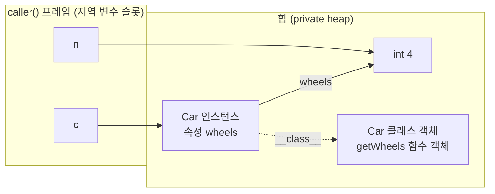
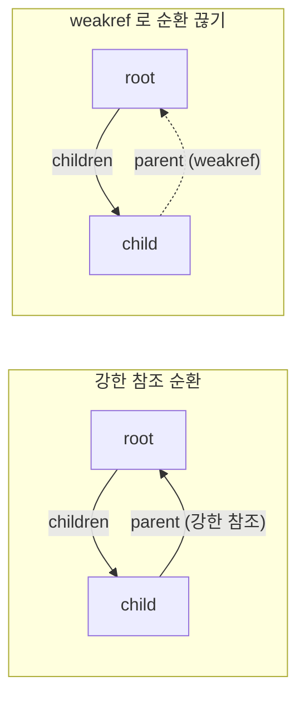

# 3. Python 메모리 관리(3)

> 파이썬 객체와 변수가 메모리 어디에 놓이는지(stack, heap)를 `dis`로 직접 확인하고, 앞 장에서 다룬 참조 횟수와 GC를 바탕으로 메모리를 아끼는 코드 습관을 살펴보자.

- 이 장의 코드와 수치는 CPython 3.13.18(Linux x86_64) 에서 직접 실행해 확인했다. 속도 비교는 3.11, 3.12에서도 함께 측정했다.
- 수치는 환경과 버전에 따라 달라지므로 "대략 이 정도 차이가 난다"는 감을 잡는 용도로 보자.

---

## Python object - stack, heap

### 먼저 정리: "변수는 스택, 객체는 힙"은 어디까지 맞나?

입문 자료에서 흔히 쓰는 설명은 "지역 변수는 스택에, 객체는 힙에 저장된다"이다. 이해를 돕는 **단순화된 그림**으로는 쓸 만하지만, CPython의 실제 구조와는 다르다.

| 구분 | 흔한 설명 | CPython의 실제 |
|---|---|---|
| 객체 (`int`, `str`, `list`, 인스턴스, 함수, 클래스 ...) | 힙 | **전부 힙(private heap)** 이다. 공식 문서도 파이썬의 메모리 관리가 모든 파이썬 객체와 데이터 구조를 담은 private heap을 중심으로 이뤄진다고 설명한다. |
| 변수 | 스택에 값이 저장됨 | 변수는 값이 아니라 **객체를 가리키는 이름(참조)** 이다. 함수 안의 지역 변수는 **프레임의 슬롯**에, 모듈/클래스 최상위 변수는 **네임스페이스 딕셔너리**에 참조가 저장된다. |
| 함수 호출 | 스택에 쌓임 | 호출마다 **프레임**이 만들어진다. 3.11부터 프레임은 힙의 객체가 아니라 인터프리터가 관리하는 스레드별 스택 영역에 만들어지고, 프레임 *객체*(`sys._getframe()` 등)는 필요할 때만 만들어진다. |
| 연산 중간값 | (언급 없음) | 바이트코드가 **평가 스택**에 객체 참조를 push/pop 하며 계산한다. |

> 정리하면 **스택에 있는 것은 객체가 아니라 객체를 가리키는 참조**이고, 객체 본체는 항상 힙에 있다. 반대로 "힙에서 해제된다"는 것은 그 객체를 가리키는 참조가 모두 사라져 참조 횟수가 0이 되었다는 뜻이다(→ 3.1 참조 횟수).

### `dis.dis()` 로 직접 확인하기

`dis` 모듈은 파이썬 코드가 컴파일된 **바이트코드**를 보여 준다. 바이트코드는 스택 머신용 명령이라서, "어디에서 객체 참조를 꺼내 어디에 저장하는가"가 그대로 드러난다.

```python
import dis

def assign():
    a = 3
    b = 5
    a = 5
    c = 5
    return a, b, c

dis.dis(assign)
print(assign.__code__.co_consts)    # (None, 3, 5)
print(assign.__code__.co_varnames)  # ('a', 'b', 'c')
```

```text
  7           RESUME                   0

  8           LOAD_CONST               1 (3)
              STORE_FAST               0 (a)

  9           LOAD_CONST               2 (5)
              STORE_FAST               1 (b)

 10           LOAD_CONST               2 (5)
              STORE_FAST               0 (a)

 11           LOAD_CONST               2 (5)
              STORE_FAST               2 (c)

 12           LOAD_FAST_LOAD_FAST      1 (a, b)
              LOAD_FAST                2 (c)
              BUILD_TUPLE              3
              RETURN_VALUE
```

> 출력은 3.13 기준이다. 버전마다 명령 이름이 조금씩 다르다(예: `LOAD_FAST_LOAD_FAST`는 3.13의 합쳐진 명령으로, 3.12 이하에서는 `LOAD_FAST` 두 개로 나온다).

읽는 법:

- `LOAD_CONST 2 (5)` : 코드 객체의 상수 테이블(`co_consts`)에서 **5 객체의 참조**를 꺼내 평가 스택에 올린다.
- `STORE_FAST 0 (a)` : 스택에서 참조를 꺼내 **지역 변수 슬롯 0번(`a`)** 에 저장한다.
- `a = 5` 와 `c = 5` 는 같은 `co_consts[2]` 를 쓴다. 즉 **a와 c는 같은 5 객체를 가리킨다.**

#### 이름이 어디에 있느냐에 따라 바이트코드가 달라진다

```python
G = 10

def local_global_builtin(n):
    t = n + 1                      # 지역 변수
    return t + G + len("ab")       # G: 전역, len: 빌트인

dis.dis(local_global_builtin)
```

```text
 27           LOAD_FAST                0 (n)
              LOAD_CONST               1 (1)
              BINARY_OP                0 (+)
              STORE_FAST               1 (t)

 28           LOAD_FAST                1 (t)
              LOAD_GLOBAL              0 (G)
              BINARY_OP                0 (+)
              LOAD_GLOBAL              3 (len + NULL)
              LOAD_CONST               2 ('ab')
              CALL                     1
              BINARY_OP                0 (+)
              RETURN_VALUE
```

| 이름의 종류 | 바이트코드 | 참조가 저장된 곳 |
|---|---|---|
| 함수의 지역 변수, 매개변수 | `LOAD_FAST` / `STORE_FAST` | 프레임의 지역 변수 슬롯(번호로 접근) |
| 바깥 함수의 변수를 쓰는 클로저 | `LOAD_DEREF` (`COPY_FREE_VARS`) | cell 객체 (바깥/안쪽 함수가 공유) |
| 전역 변수 | `LOAD_GLOBAL` | 모듈의 전역 딕셔너리 |
| 빌트인 (`len`, `print` ...) | `LOAD_GLOBAL` | 전역에 없으면 builtins 딕셔너리 |
| 모듈/클래스 본문 최상위 변수 | `LOAD_NAME` / `STORE_NAME` | 해당 네임스페이스 딕셔너리 |

```python
dis.dis("x = 3\ny = x")     # 모듈 최상위: LOAD_SMALL_INT / STORE_NAME / LOAD_NAME / STORE_NAME

def outer():
    k = 7
    def inner():
        return k            # 클로저
    return inner

dis.dis(outer())            # COPY_FREE_VARS 1 / LOAD_DEREF 0 (k)
```

- `LOAD_DEREF` : Cell 객체를 따라가 값을 읽기
- `LOAD_FAST` : locals 배열에서 읽기
- `LOAD_GLOBAL` : globals dict에서 읽기
- `LOAD_NAME` : 이름공간 검색
- `COPY_FREE_VARS 1`: 함수 시작 시 free variable을 현재 프레임에서 사용할 수 있게 복사
    - `1` 은 free variable 개수 = 1


#### 호출 깊이와 C 스택

- 3.11 이전에는 파이썬 함수가 다른 파이썬 함수를 호출할 때마다 C의 인터프리터 함수가 재귀 호출되었다. 3.11부터는 새 프레임을 만들고 그 코드로 "점프"하므로 C 함수 호출을 거치지 않는다.
- 그래도 재귀 깊이 제한은 남아 있다. 기본값은 `sys.getrecursionlimit() == 1000` 이고, 넘으면 `RecursionError` 가 발생한다.

```python
import sys
def rec(n):
    return rec(n + 1)

try:
    rec(0)
except RecursionError as e:
    print(e)    # maximum recursion depth exceeded
```

### 함수와 변수
함수를 호출하면 **프레임**이 생기고, 매개변수와 지역 변수는 그 프레임의 슬롯에 **참조**로 들어간다. 함수가 끝나면 프레임이 사라지면서 지역 변수가 가리키던 객체의 참조 횟수가 1씩 줄어든다.

```python
import sys

a = [1, 2, 3]
b = a                      # 같은 리스트 객체에 이름이 하나 더 붙음
print(a is b)              # True
print(sys.getrefcount(a))  # 3  (a, b, getrefcount 인자의 임시 참조)
b = [1, 2, 3]
print(a is b, a == b)      # False True  (값은 같지만 서로 다른 객체)
```

#### 인자는 "참조가 복사되어" 전달된다

```python
def mutate(lst):
    lst.append(99)         # 같은 객체를 직접 수정

def rebind(lst):
    lst = [0]              # 지역 이름 lst를 새 객체에 다시 연결할 뿐

x = [1]
mutate(x);  print(x)       # [1, 99]
rebind(x);  print(x)       # [1, 99]  (바뀌지 않음)
```

- 호출자의 `x` 와 함수 안의 `lst` 는 **같은 리스트를 가리키는 서로 다른 이름**이다.
- 객체를 수정하면(`append`) 호출자도 변경을 보고, 이름을 새 객체에 다시 연결하면(`lst = [0]`) 호출자는 영향을 받지 않는다.

#### 기본 인자는 함수가 정의될 때 한 번만 만들어진다

```python
def add(v, acc=[]):
    acc.append(v)
    return acc

print(add(1), add(2))      # [1, 2] [1, 2]   (같은 리스트 객체를 두 번 반환)
print(add.__defaults__)    # ([1, 2],)
```

기본값 `[]` 는 호출할 때마다 새로 만들어지지 않고 **함수 객체에 매달려 있는 하나의 리스트**다. 호출 사이에 상태가 남는 메모리 누수/버그의 흔한 원인이므로 `acc=None` 으로 받고 함수 안에서 새로 만든다.


### class, instance, self


```python
class Car:
    wheels_default = 4          # 클래스 변수

    def __init__(self, w):
        self.wheels = w         # 인스턴스 변수

    def getWheels(self):
        return self.wheels

def caller():
    c = Car(4)
    n = c.getWheels()
    return n
```



- **클래스** : `class` 문이 실행될 때 만들어지는 **객체**(힙)다. 메서드는 클래스에 붙어 있는 **함수 객체**다.
- **인스턴스** : `Car(4)` 로 만들어진 객체(힙)다. 인스턴스 변수는 인스턴스에 저장된다.
- **변수 `c`, `n`** : 객체가 아니라 참조다. `c` 는 인스턴스를, `n` 은 `self.wheels` 가 가리키던 `4` 를 가리킨다. (앞서 정리했듯 `int` 도 객체이므로 힙에 있다. 다만 4는 작은 정수라 미리 만들어진 객체를 재사용한다.)

```python
c1, c2 = Car(4), Car(6)
print(c1.__dict__)                                  # {'wheels': 4}
print([k for k in Car.__dict__ if not k.startswith("__")])
                                                    # ['wheels_default', 'getWheels']
print(c1.getWheels.__func__ is c2.getWheels.__func__ is Car.getWheels)   # True
print(c1.getWheels.__self__ is c1)                  # True
print(Car.getWheels(c1) == c1.getWheels())          # True
```

- 속성은 인스턴스마다 따로 보관하지만(`c1.__dict__`) **메서드(함수 객체)는 클래스에 하나만 있고 모든 인스턴스가 공유(`Car.getWheels()`)**한다.
- `c1.getWheels` 는 함수와 `c1` 을 묶은 **bound method** 이고, 호출하면 `self` 자리에 `c1` 의 참조가 자동으로 전달된다. `Car.getWheels(c1)` 과 같은 호출이다.
- 그래서 **`self` 는 예약어가 아니라 "첫 번째 매개변수에 인스턴스 참조가 들어온 것"** 이다. 즉, self를 스택에서 힙의 객체에 접근하기 위한 참조자라고 이해하면 된다.

```text
# dis.dis(Car.__init__)
LOAD_FAST_LOAD_FAST   16 (w, self)
STORE_ATTR             0 (wheels)      ← self.wheels = w
RETURN_CONST           0 (None)

# dis.dis(caller)
LOAD_GLOBAL   1 (Car + NULL)           ← 전역 이름 Car(클래스 객체)를 찾음
LOAD_CONST    1 (4)
CALL          1                        ← 인스턴스 생성 (__init__ 실행)
STORE_FAST    0 (c)
LOAD_FAST     0 (c)
LOAD_ATTR     3 (getWheels + NULL|self)
CALL          0                        ← 메서드 호출 (self = c)
STORE_FAST    1 (n)
```

#### 인스턴스가 쓰는 메모리 줄이기: `__slots__` (원 목차에는 없던 보충)

인스턴스가 아주 많을 때는 속성 저장 방식이 메모리에 영향을 준다. 기본 클래스는 속성을 `__dict__` 로 관리하고, `__slots__` 를 선언하면 속성 이름을 미리 고정해 `__dict__` 없이 저장한다.

```python
class P:
    def __init__(self, x, y):
        self.x = x
        self.y = y

class S:
    __slots__ = ("x", "y")
    def __init__(self, x, y):
        self.x = x
        self.y = y
```

| 인스턴스 100,000개 (x=1, y=2) | 유지되는 메모리 (tracemalloc) |
|---|---|
| 일반 클래스 `P` | 약 9.6 MB |
| `__slots__` 클래스 `S` | 약 5.6 MB |

- `hasattr(P(1, 2), "__dict__")` 는 `True`, `hasattr(S(1, 2), "__dict__")` 는 `False` 다.
- 대가: 선언하지 않은 속성을 나중에 붙일 수 없고, 약한 참조를 쓰려면 `__weakref__` 도 슬롯에 넣어야 하며, 상속 때 규칙이 복잡해진다. 인스턴스가 수만 개 이상일 때만 고려하자.
- 참고: `sys.getsizeof(obj)` 는 객체 **자기 자신의 크기(얕은 크기)** 만 알려 준다. 인스턴스가 들고 있는 값이나 `__dict__` 크기는 따로 더해야 하므로, 전체 사용량 비교에는 `tracemalloc` 이 낫다.

---

## memory 관점 좋은 코드

### 먼저 측정하자

"메모리를 아끼는 코드"는 추측으로 판단하면 틀리기 쉽다. 아래처럼 **최고 사용량(peak)** 을 재 보고 판단하자. 임시 리스트처럼 잠깐 커졌다가 사라지는 메모리는 최종 사용량이 아니라 peak에 드러난다.

```python
import tracemalloc

tracemalloc.start()
total = sum([i * i for i in range(1_000_000)])
cur, peak = tracemalloc.get_traced_memory()
tracemalloc.stop()
print(f"현재 {cur / 1e6:.2f} MB, 최고 {peak / 1e6:.2f} MB")
```

### mutable vs immutable

| 구분 | 타입 | 특징 |
|---|---|---|
| immutable (불변) | `int`, `float`, `bool`, `str`, `tuple`, `bytes`, `frozenset` | 객체를 만든 뒤 **값을 바꿀 수 없다.** 바꾸는 것처럼 보이는 연산은 새 객체를 만든다. |
| mutable (가변) | `list`, `dict`, `set`, `bytearray`, `collections.deque` | 같은 객체의 **내용을 제자리에서 수정**할 수 있다. |

```python
l = [1, 2]; i0 = id(l); l += [3]
print(id(l) == i0)          # True   같은 리스트를 제자리 수정
l = l + [4]
print(id(l) == i0)          # False  새 리스트를 만들고 이름 l을 다시 연결

t = (1, 2); i0 = id(t); t += (3,)
print(id(t) == i0)          # False  튜플은 새 객체
v = 1000; i0 = id(v); v += 1
print(id(v) == i0)          # False  int도 새 객체
```

| `+=` 실행 후 `id` 가 같은가 | 결과 |
|---|---|
| `list` (`l += [3]`) | 같음 (제자리 수정) |
| `list` (`l = l + [4]`) | 다름 (새 객체) |
| `tuple`, `int`, `str` | 다름 (새 객체) |

주의할 점 세 가지.

1. **`id` 가 바뀐다는 것은 불변 객체가 변했다는 뜻이 아니다.** 이름이 **새 객체에 다시 연결**되었다는 뜻이다. 원래 객체는 그대로이고, 참조하는 이름이 없어지면 참조 횟수가 0이 되어 해제된다. (참고 블로그는 이 현상을 "interning"이라고 불렀는데, 아래 interning과는 다른 개념이다.)
2. **불변 컨테이너 안의 가변 객체는 바뀔 수 있다.** `t = ([1], 2)` 에서 `t[0].append(9)` 는 가능하다(`([1, 9], 2)`). 반면 `t[1] += 1` 은 `TypeError: 'tuple' object does not support item assignment` 이다.
3. **불변 객체를 반복해서 "수정"하면 그때마다 새 객체가 만들어진다.** 문자열을 반복문에서 이어 붙일 때가 대표적이다.

```python
# 비권장: 매번 새 문자열 생성
s = ""
for _ in range(200_000):
    s += "x"

# 권장: 조각을 모아 한 번에 합치기
s = "".join(["x" for _ in range(200_000)])
```

3.13에서 측정하면 `+=` 반복이 약 6.2 ms, `join` 이 약 3.4 ms 였다. CPython이 `+=` 를 일부 최적화해 주기 때문에 차이가 극단적이지는 않지만, 이 최적화는 언어 규칙이 아니라 CPython의 구현 세부사항이므로 다른 구현체에서도 같다고 가정하면 안 된다.

#### python object interning

앞서 언급한 **interning** 은 "값이 같은 불변 객체를 새로 만들지 않고 이미 있는 객체를 **재사용**하는 것"이다. 메모리를 아끼고, 문자열은 동일성 비교(`is`)를 빠르게 하는 효과가 있다. CPython에서 "같은 객체가 된다"고 말할 수 있는 경우는 세 가지로 나뉜다.

| 구분 | 대상 | 조건 | 확인 |
|---|---|---|---|
| ① 작은 정수 캐시 | `int` | **-5 ~ 256** 은 인터프리터가 미리 만들어 두고 재사용 | `int("-5") is int("-5")` → True, `int("-6") is int("-6")` → False, 256 → True, 257 → False |
| ② 문자열 interning | `str` | 컴파일 시점에 소스에 적힌 **식별자 모양(영문자·숫자·`_` 만으로 구성)** 의 문자열 리터럴. 프로그램에 쓰인 이름과, 모듈·클래스·인스턴스의 속성을 담는 딕셔너리의 키도 intern 되어 있다(공식 문서). | `'a_b'`, `'a1'` 은 interned, `'a b'`, `'a-b'`, `'한글'` 은 아님 (`sys._is_interned`, 3.13+) |
| ③ 상수 합치기 | 같은 컴파일 단위의 같은 상수 | 한 번에 컴파일되는 코드(한 파일, 한 `exec`) 안의 **같은 값의 상수**는 하나로 합쳐짐 | 같은 파일에서 `x = 257; y = 257` → `x is y` True |

```python
# ① 작은 정수
a = int("256"); b = int("256")
print(a is b)               # True
a = int("257"); b = int("257")
print(a is b)               # False

# ② 식별자 모양 문자열은 런타임에 만든 것도 intern 후 같은 객체가 된다
x = "".join(["hel", "lo"])
print(x == "hello", x is "hello")     # 실제 코드에서는 is 대신 == 를 쓸 것 (아래 경고 참고)
import sys
print(sys.intern(x) is "hello")       # True
```

> `x is "hello"` 처럼 `is` 에 리터럴을 쓰면 `SyntaxWarning: "is" with 'str' literal. Did you mean "=="?` 경고가 난다. 위 코드는 설명용이고, **값 비교는 항상 `==`** 로 한다.

##### `sys.intern()` 으로 직접 intern 하기

```python
import sys

N = 200_000
a = [str(i % 100) for i in range(N)]               # 값은 100종류, 객체는 200,000개
b = [sys.intern(str(i % 100)) for i in range(N)]   # 같은 값은 하나의 객체를 공유
```

| 중복이 많은 문자열 200,000개 (종류 100개) | 유지되는 메모리 |
|---|---|
| 일반 `str` 리스트 | 약 10.2 MB |
| `sys.intern` 한 리스트 | 약 1.6 MB |

- 공식 문서의 취지는 딕셔너리 키를 intern 해 두면 **해시 후 키 비교를 문자열 내용 비교 대신 포인터 비교로** 할 수 있다는 것이다.
- **intern 된 문자열은 immortal이 아니다.** 반환값에 대한 참조를 어딘가에 유지해야 효과가 있다. (3.12.7 이후 `sys.intern` 문자열은 다시 GC 대상이 되었다. C API `PyUnicode_InternInPlace` 로 intern 한 문자열은 3.12에서 여전히 immortal 이다.) 참고로 free-threaded 빌드(3.14 기준)에서는 `sys.intern` 문자열이 immortal로 처리된다고 문서에 적혀 있다.
- 이 이득은 **같은 값이 매우 많이 반복되는 경우**(로그 레벨, 카테고리 이름 등)에 해당한다. 값이 거의 다 다르면 intern 테이블 조회 비용만 늘어난다.
- `sys._is_interned()` 는 3.13에서 추가된 CPython 구현 세부사항이다. 학습용으로만 쓰자.


#### 순환 참조 피하기

앞 장(3.1.2, 3.2)에서 본 것처럼 순환 참조가 있으면 `del` 로 이름을 지워도 참조 횟수가 0이 되지 않아 **GC가 돌 때까지 메모리가 남는다.** GC가 결국 회수해 주지만, 그 사이 메모리 점유가 늘고 `__del__` 호출 시점을 예측하기 어렵다. 가능하면 **순환을 처음부터 만들지 않는 것**이 좋다.

##### ① 부모-자식 구조: 부모는 약한 참조로

```python
import gc, weakref

class Node:
    def __init__(self, name, strong):
        self.name, self.strong = name, strong
        self.parent, self.children = None, []

    def add(self, child):
        self.children.append(child)
        child.parent = self if self.strong else weakref.ref(self)   # 부모 참조만 다름
```



`root`, `child` 이름을 `del` 한 직후의 상태를 확인한 결과:

| 부모 참조 방식 | `del` 직후 객체가 살아 있는가 | `gc.collect()` 로 회수된 수 |
|---|---|---|
| 강한 참조 | 둘 다 살아 있음 | 4 |
| `weakref.ref` | 둘 다 즉시 해제됨 | 0 (이미 해제되어 할 일이 없음) |

약한 참조를 쓰면 **참조 횟수만으로 즉시 해제**되므로 GC에 기대지 않는다. 약한 참조로 대상을 꺼낼 때는 `parent()` 처럼 호출해야 하고, 이미 해제되었다면 `None` 이 나온다.
- 약한 참조는 `weakref.ref(root)` 라는 별도의 객체를 만들고, weakref 객체 -> root 링크는 참조 카운트에 포함되지 않음

##### ② 메서드를 콜백으로 저장할 때: bound method는 `self` 를 참조한다

```python
class Button:
    def __init__(self, weak):
        if weak:
            self.handler = weakref.WeakMethod(self.on_click)
        else:
            self.handler = self.on_click      # bound method → self 를 참조 → 순환

    def on_click(self):
        pass
```

| 핸들러 보관 방식 | `del` 직후 | `gc.collect()` 후 |
|---|---|---|
| `self.on_click` 그대로 저장 | 살아 있음 | 해제됨 |
| `weakref.WeakMethod` | 즉시 해제됨 | - |

`self.handler = self.on_click` 은 인스턴스가 자기 자신을 가리키는 bound method를 속성으로 들고 있는 형태라 순환이 된다. 옵저버/콜백 패턴에서 자주 나온다.

```text
self
  ↓
handler
  ↓
(bound method)
  ↓
self
```

##### ③ 예외 객체

```python
try:
    1 / 0
except ZeroDivisionError as e:
    pass
print(e)        # NameError: name 'e' is not defined
```

`except ... as e` 의 `e` 는 **except 블록이 끝날 때 자동으로 삭제**된다. 공식 문서에 따르면 예외에 붙은 traceback이 프레임과 순환을 이루어, 지역 변수가 다음 GC 때까지 살아 있게 되는 것을 막기 위해서다. 그러므로 예외를 블록 밖에서 쓰려고 다른 변수에 담거나 traceback을 저장해 두면 순환이 생길 수 있다. 꼭 필요하면 필요한 정보(메시지 문자열 등)만 저장하거나, 사용을 마친 뒤 `frame.clear()` 등으로 참조를 끊는다.

##### 그 밖의 주의점

- 자기 자신을 컨테이너에 넣는 코드(`li.append(li)`), 서로를 속성으로 가리키는 객체 쌍(3.1.2의 `Human` 예시), 캐시가 값 객체를 강하게 붙들고 값 객체가 캐시를 가리키는 구조도 같은 문제를 만든다.
- 객체 수명에 맞춰 알아서 비워지는 캐시가 필요하면 `weakref.WeakValueDictionary` 같은 약한 참조 컨테이너를 쓴다.
- 순환 참조 클래스에 `__del__` 을 정의하는 것은 가급적 피하고, 정리 작업은 `with`(컨텍스트 매니저)나 `weakref.finalize` 로 한다.

### 제너레이터 사용

리스트는 모든 요소를 **한꺼번에 메모리에 만든다.** 제너레이터는 요소를 **필요할 때 하나씩 계산**하므로, 한 번 훑고 마는 용도라면 메모리를 거의 쓰지 않는다.

```python
N = 1_000_000
print(sum([i * i for i in range(N)]))   # 리스트 컴프리헨션: 100만 개를 모두 만든 뒤 합산
print(sum(i * i for i in range(N)))     # 제너레이터 표현식: 하나씩 만들어 바로 합산
```

| N = 1,000,000 (3.13, tracemalloc) | 최고 메모리 |
|---|---|
| `sum([i*i for i in range(N)])` | 약 40.5 MB |
| `sum(i*i for i in range(N))` | 약 0 MB (0.00 MB로 표시) |

- `sys.getsizeof` 로 보면 리스트는 8,448,728 bytes, 제너레이터 객체는 200 bytes 다. 다만 리스트의 8.4 MB는 **참조를 담는 배열의 크기일 뿐**이고, 요소로 들어 있는 `int` 객체들은 별도로 더해야 한다. 그래서 `tracemalloc` 의 peak(약 40 MB)가 훨씬 크다.

#### 함수로 만드는 제너레이터

```python
def read_lines(path):
    with open(path, encoding="utf-8") as f:
        for line in f:                 # 파일 객체도 한 줄씩 읽는 이터레이터
            yield line.rstrip("\n")

for line in read_lines("big.log"):     # 파일 전체를 메모리에 올리지 않고 처리
    ...
```

#### 제너레이터의 한계

- **한 번만 순회할 수 있다.** 다 소비하면 비어 있다.

```python
g = (i for i in range(3))
print(list(g), list(g))     # [0, 1, 2] []
```

- `len(g)`, `g[0]` 처럼 길이 확인이나 인덱스 접근을 할 수 없다.
- 여러 번 써야 하거나 정렬(`sorted`)처럼 전체가 필요한 작업이면 어차피 리스트가 필요하다.
- 디버깅할 때 중간 값을 보기 어렵다.

### 로컬 함수 및 로컬 변수 사용

여기서 말하는 "로컬 함수"는 전역 함수/빌트인을 **지역 이름에 다시 바인딩해서 쓰는 것**이다.

```python
def work(data):
    _len = len                  # 빌트인 len을 지역 이름으로 바인딩
    total = 0
    for x in data:
        total += _len(x)
    return total
```

#### 로컬이 더 빠른 이유?

바이트코드가 다르기 때문이다.

| | 바이트코드 | 하는 일 |
|---|---|---|
| 지역 변수 | `LOAD_FAST` | 프레임의 슬롯을 **번호로 바로 접근** |
| 전역 / 빌트인 | `LOAD_GLOBAL` | 전역 딕셔너리를 찾고, 없으면 builtins 딕셔너리를 찾음 |
| 모듈 속성 (`math.sqrt`) | `LOAD_GLOBAL` + `LOAD_ATTR` | 전역에서 모듈을 찾은 뒤 모듈의 속성을 한 번 더 조회 |


**하지만 3.11 이후에는 이 차이가 크게 줄었다.** 3.11부터 인터프리터가 자주 실행되는 명령을 실행 중에 **특수화(specializing adaptive interpreter, PEP 659)** 해서 조회 결과를 캐시하기 때문이다. 자주 도는 함수를 `dis.dis(func, adaptive=True)` 로 보면 이를 확인할 수 있다.

```text
# 워밍업 후 dis.dis(hot, adaptive=True) 일부 (3.13)
LOAD_GLOBAL_BUILTIN   3 (len + NULL)       ← 일반 LOAD_GLOBAL이 특수화됨
CALL_LEN              1
LOAD_GLOBAL_MODULE    4 (G)
BINARY_OP_ADD_INT     0 (+)
```

실제로 100만 번 반복 루프에서 **전역 방식 / 지역 별칭 방식의 시간 비율**(중앙값, 15회 반복, 1.00보다 크면 지역이 빠름)을 재 보면:

| 비교 | 3.11 | 3.12 | 3.13 |
|---|---|---|---|
| 전역 변수 읽기 vs 지역 변수 읽기 | 1.10 | 1.12 | 1.03 |
| `len(x)` vs `_len = len` 별칭 | 1.00 | 1.04 | 1.00 |
| `math.sqrt(i)` vs `sqrt = math.sqrt` 별칭 | 1.09 | - | 1.12 |
| `out.append(i)` vs `append = out.append` 별칭 | **0.85** | **0.85** | **0.89** |

- 변수 읽기는 지역이 **수 %~10% 정도** 빠르고, 모듈 속성(`math.sqrt`)을 지역 별칭으로 바꾸면 약 10% 정도 이득이 있었다. 빌트인(`len`)은 거의 차이가 없다.
- 오히려 **`append = out.append` 별칭은 더 느렸다(약 12~18%).** 인터프리터가 `out.append(i)` 를 리스트 append 전용 명령(`CALL_LIST_APPEND`)으로 특수화하기 때문에, 별칭으로 만든 bound method 호출이 그 최적화를 못 받는다. 예전에 효과가 있던 "메서드를 지역 변수에 담기" 요령이 최신 버전에서는 역효과가 될 수 있다.
- 처음 한 번 측정했을 때 `len` 이 1.26배 차이로 나왔지만 15회 반복 중앙값에서는 사라졌다. **한 번의 측정으로 결론 내리지 말고 반복해서, 해당 버전에서 직접 재 보자.** (3.10 이하는 측정하지 못했다.)

메모리 관점에서 더 중요한 이유는 따로 있다.

- **지역 변수는 함수가 끝나면 사라지고, 전역 변수는 프로그램이 끝날 때까지(또는 `del` 할 때까지) 참조가 남는다.** 큰 리스트나 DataFrame을 전역에 두면 더 이상 쓰지 않아도 메모리가 반환되지 않는다.
- 그러므로 임시 큰 객체는 **함수 안의 지역 변수**로 만들어 쓰고 함수가 끝나면 해제되게 하는 편이 낫다.


## 이미 좋은 구현체, 함수, 라이브러리 사용

## 이미 좋은 구현체, 함수, 라이브러리 사용

표준 라이브러리와 내장 함수는 대부분 **C로 구현**되어 있어서, 같은 일을 파이썬 반복문으로 직접 짜는 것보다 빠르고 메모리 면에서도 낫다. 먼저 이미 있는지 찾아보자.

```python
nums = list(range(1_000_000))

s = 0
for v in nums:          # 직접 반복
    s += v

s = sum(nums)           # 내장 함수
```

3.13에서 100만 개 기준 측정 결과:

| 작업 | 직접 구현 | 내장/라이브러리 |
|---|---|---|
| 합계 | `for` + `+=` 약 19.0 ms | `sum(nums)` 약 6.0 ms (약 3배) |
| 100만 개 문자열 `lower()` | `for` + `append` 약 57 ms / 컴프리헨션 약 57 ms | `list(map(str.lower, words))` 약 55 ms |
| 숫자 100만 개 저장 | `list` of float: 약 32.5 MB | `array.array("d")`: 약 8.2 MB |

- `sum` 처럼 반복 자체를 C가 처리하는 경우는 차이가 크다. 반면 `lower()` 같이 요소마다 하는 일 자체가 무거우면 `map` 도, 컴프리헨션도, 직접 반복도 거의 같다(차이가 4% 이내). 참고 블로그의 `map` 예시는 반복문 쪽에서 `upper()`, `map` 쪽에서 `str.lower` 를 써서 두 코드가 서로 다른 일을 하고 있어 그대로 비교할 수 없다.
- 숫자를 대량으로 저장할 때는 `list` 대신 `array`(또는 NumPy)로 객체 오버헤드를 줄일 수 있다. `list` 의 float은 요소마다 파이썬 객체이기 때문이다.
- 그 밖에 자주 쓰는 도구: `str.join`, `collections.Counter` / `defaultdict` / `deque`, `bisect`, `heapq`, `functools.lru_cache`, `any` / `all` / `min` / `max` / `sorted`.


### itertools 사용

`itertools` 는 **이터레이터를 조합하는 도구 모음**이다. 결과를 리스트로 만들지 않고 필요할 때 하나씩 내보내기 때문에, 앞의 제너레이터와 같은 장점이 있다.

```python
from itertools import chain, product, islice, batched, pairwise, groupby, tee

# chain.from_iterable : 중첩 리스트 펼치기
rows = [[1, 2], [3], [4, 5, 6]]
print(list(chain.from_iterable(rows)))          # [1, 2, 3, 4, 5, 6]

# product : 중첩 for 문 대체
print(list(product(range(2), "ab")))            # [(0, 'a'), (0, 'b'), (1, 'a'), (1, 'b')]

# islice : 일부만 꺼내기 (무한 제너레이터에도 사용 가능)
def naturals():
    n = 0
    while True:
        yield n
        n += 1
print(list(islice(naturals(), 5)))              # [0, 1, 2, 3, 4]

# batched (3.12+), pairwise (3.10+)
print(list(batched(range(7), 3)))               # [(0, 1, 2), (3, 4, 5), (6,)]
print(list(pairwise([1, 4, 9, 16])))            # [(1, 4), (4, 9), (9, 16)]
```

| 도구 | 용도 |
|---|---|
| `chain`, `chain.from_iterable` | 여러 시퀀스/이터레이터를 이어 붙이거나 한 단계 펼치기 |
| `product` | 중첩 `for` 를 한 줄로 (데카르트 곱) |
| `islice` | 슬라이싱처럼 앞부분/구간만 꺼내기 (이터레이터는 `[:n]` 이 안 됨) |
| `batched` (3.12+) | n개씩 묶어서 처리 |
| `pairwise` (3.10+) | 연속한 두 요소씩 짝짓기 |
| `groupby` | 같은 키가 **연속된** 요소끼리 묶기 |
| `tee` | 이터레이터 하나를 여러 개로 복제 |


#### 메모리 관점에서 확인한 것

```python
from itertools import product
# 1000 x 1000 = 100만 개의 쌍
len(list(product(range(1000), range(1000))))      # 전부 리스트로 만들기: 최고 약 64.5 MB
sum(1 for _ in product(range(1000), range(1000))) # 하나씩 소비:        최고 약 0.06 MB
```

속도 면에서는 1000 x 100 중첩 리스트를 펼칠 때 이중 `for` + `append` 약 1.2 ms, 리스트 컴프리헨션 약 0.6 ms, `list(chain.from_iterable(...))` 약 0.4 ms 였다. 즉 `itertools` 의 가장 큰 장점은 속도보다 **리스트를 중간에 만들지 않는 지연 평가**다. `list(...)` 로 전부 만들어 버리면 이 장점이 사라진다.

#### itertools를 쓸 때 주의할 점

- **`groupby` 는 정렬되어 있지 않으면 같은 키라도 따로 묶는다.**

```python
data = ["a1", "a2", "b1", "a3"]
print([(k, list(g)) for k, g in groupby(data, key=lambda s: s[0])])
# [('a', ['a1', 'a2']), ('b', ['b1']), ('a', ['a3'])]
print([(k, list(g)) for k, g in groupby(sorted(data), key=lambda s: s[0])])
# [('a', ['a1', 'a2', 'a3']), ('b', ['b1'])]
```

- **`tee` 로 복제한 이터레이터를 서로 다른 속도로 소비하면 그 차이만큼 내부에 버퍼링한다.** 50만 개를 `a` 는 끝까지 먼저 소비하고 `b` 를 나중에 소비하면 최고 약 20.5 MB, 두 개를 `zip` 으로 나란히 소비하면 약 0 MB 였다.
- 이터레이터는 **한 번만 순회**할 수 있다(`map`, `filter`, `chain` 의 결과도 마찬가지). 여러 번 써야 하면 `list` 로 바꾸거나 새로 만든다.
- 참고 블로그의 `chain.from_iterable` + `product` 예시는 루프 변수 순서와 함수 인자 순서가 서로 맞지 않아 그대로 동작이 일치하지 않는다. 위 예시처럼 순서를 맞춰 확인해 보자.


---

## 정리: 메모리 관점 좋은 코드 체크리스트

| 습관 | 효과 (3.13에서 측정) | 주의 |
|---|---|---|
| 제너레이터/이터레이터로 한 번 훑고 끝내기 | 임시 리스트 40.5 MB → 약 0 MB | 한 번만 순회, 길이/인덱스 없음 |
| 순환 참조 만들지 않기 (`weakref`) | `del` 직후 즉시 해제 | 약한 참조는 `None` 확인 필요 |
| 같은 값이 많이 반복되는 문자열은 `sys.intern` | 약 10.2 MB → 약 1.6 MB | 값이 다양하면 이득 없음, 반환값 참조 유지 |
| 인스턴스가 아주 많으면 `__slots__` | 약 9.6 MB → 약 5.6 MB | 동적 속성 추가 불가 |
| 숫자 대량 저장은 `array`/NumPy | list of float 약 32.5 MB → 약 8.2 MB | 단일 타입만 저장 |
| 임시 큰 객체는 지역 변수로 | 함수 종료 시 해제 | 전역에 두면 계속 남음 |
| 이미 있는 내장 함수/`itertools` 사용 | `sum` 약 3배 빠름, `product` 64.5 MB → 0.06 MB | `list()` 로 다 만들면 이점 사라짐 |
| 지역 별칭으로 전역/속성 조회 줄이기 | 3.11+ 에서는 **수 % ~ 10%** 수준 | `list.append` 별칭은 오히려 느려짐 |

> 정리하면, "메모리/속도 최적화 팁"의 상당수는 **어떤 버전의 인터프리터인지**에 따라 효과가 달라진다. 코드를 읽기 어렵게 만드는 최적화는 측정으로 효과가 확인된 곳에만 적용하자.

출처

- 참고 블로그
  - https://hkim-data.tistory.com/183
  - http://pythonstudy.xyz/python/article/512-%ED%8C%8C%EC%9D%B4%EC%8D%AC-Object-Interning
  - https://yomangstartup.tistory.com/105?category=963706
- 공식 문서
  - Memory Management (private heap): https://docs.python.org/3/c-api/memory.html
  - `sys.intern`: https://docs.python.org/ko/3/library/sys.html
  - `dis` (`adaptive`, `show_caches`): https://docs.python.org/3/library/dis.html
  - What's New In Python 3.11 (lazy frames, inlined calls, specializing adaptive interpreter): https://docs.python.org/3/whatsnew/3.11.html
  - `try` 문과 `except` 절의 변수 삭제: https://docs.python.org/3/reference/compound_stmts.html
  - 프레임 객체 `frame.clear()`: https://docs.python.org/3/reference/datamodel.html
  - Free-threaded 빌드와 intern 문자열: https://docs.python.org/3/howto/free-threading-python.html
  - 3.12 changelog (gh-113993, intern 문자열의 GC): https://docs.python.org/release/3.12.10/whatsnew/changelog.html