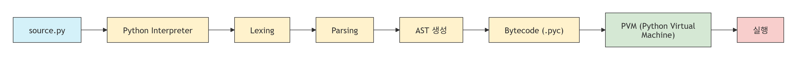
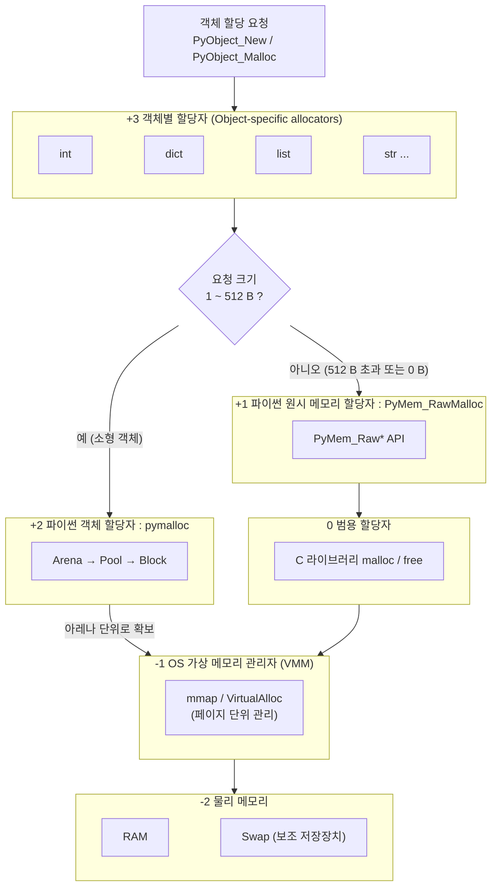
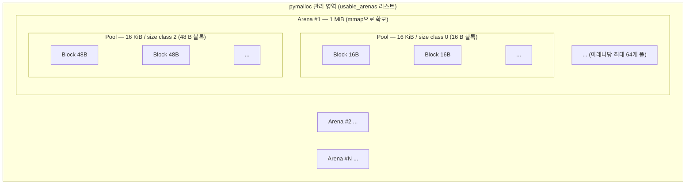
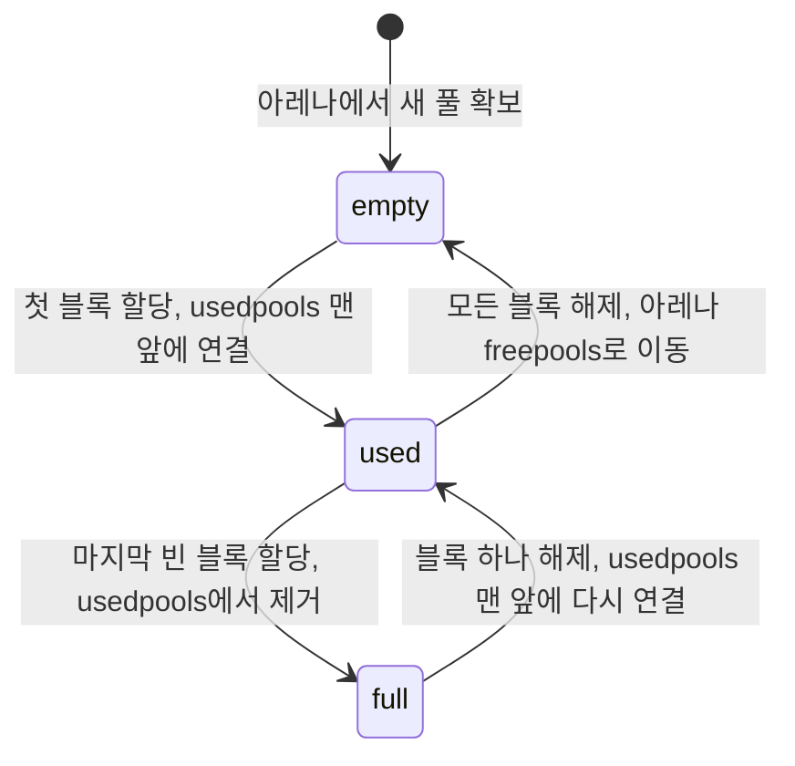
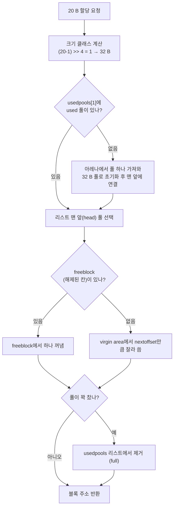
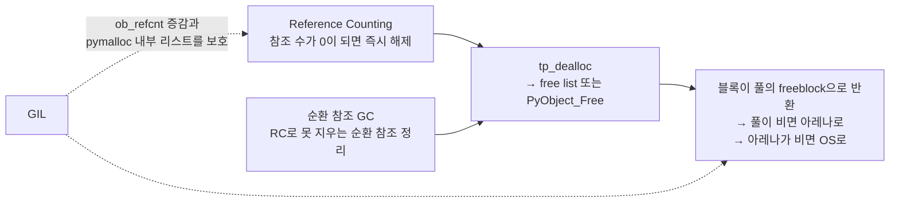

# Python 코드 실행과 메모리에 올라가기까지 
[velog-원문](https://velog.io/@qlgks1/python-%EB%A9%94%EB%AA%A8%EB%A6%AC-%EA%B4%80%EB%A6%AC-memory-optimization) 참조하여 학습 내용 정리

> python은 인터프리터 언어로, 파이썬 인터프리터가 설치되어 있다면 [compiler $\rarr$ byte code $\rarr$ pvm $\rarr$ running] 까지 다 알아서 해준다.

- 우리가 만든 `.py` 파일은 python interpreter에 의해 compile 되고, bytecode로 바뀐 뒤에 PVM(Python Virtual Machine) 위에서 구동(running)된다.
- 여기서 이 "python interpreter"의 종류는 CPython, PyPy, IronPython 등이 있으며, 가장 많이 사용되는 것은 기본 제공되는 CPython이다.


## 1. Byte-code가 되어 실행되기까지 과정
> 인터프리터 종류에 따라 상이하지만, 아래와 같은 과정을 거친다고 간략히 이해하자.



특징
- Python Interpreter 내부에 컴파일러가 포함되어 있음
- 실행 시 소스코드를 읽어 Bytecode로 변환
- 생성된 Bytecode를 PVM이 실행
- 개발자는 보통 컴파일 과정을 의식하지 않음

### 1. Lexing
- 전달된 code를 가지고 line을 쪼개 코드를 Token으로 generate 한다.

### 2. Parsing
- Lexing을 통해 생성된 토큰이 parser에게 전달되어 파싱된다. token을 가지고 Abstract Syntax Tree(A.S.T)라는 token 사이의 관계를 나타내는 트리 구조를 만든다. 해당 단계는 프로그래밍 언어를 구축하는 데 있어서 중요한 개념이다. 참조 : [위키피디아-Abstract syntax tree](https://en.wikipedia.org/wiki/Abstract_syntax_tree)
- AST를 제어 흐름 그래프(Control Flow Graph)로 변환한다. 참조: [AST 관련 강의 자료](https://www.cs.columbia.edu/~suman/secure_sw_devel/Basic_Program_Analysis_CF.pdf)

### 3. Compiling
- 위와 같은 과정을 거치면 Bytecode 라는 `.pyc` 형태의 intermediate language code가 생성된다.
- `.pyc` 파일은 파이썬 버전 3.2 이전에는 `.py`와 같은 경로에 생성되고, 3.2 이후 버전에서는 `__pycache__` 디렉터리 아래에 생성된다.
- 무조건 `.pyc` 파일을 생성하는 것이 아니라, `.py` 파일이 다른 스크립트에 의해 `import` 되었을 경우에만 생성된다.
- `import` 문이 호출되었을 때는 다음과 같은 확인을 한다.
    1. 파이썬은 import 되는 스크립트의 컴파일된 파일이 존재 하는지 확인한다. 없다면, `.pyc` 파일을 생성하고 불러 온다.
    2. 있다면, 내부 `timestamp` 에서 `.py` 파일보다 `.pyc` 파일이 더 오래 되었는지 확인한다. 즉, 소스코드가 변경되면 자동으로 새 `.pyc` 파일을 생성한다.
    3. 대화형 프롬프트(REPL) 환경에서 입력한 코드에 대해서는 `.pyc` 파일을 생성하지 않는다.
- 컴파일 언어인 자바와 차이가 나는 부분은 자바코드는 interpreter(해석기)에게 소스가 전달되기 전에 컴파일러에 의해 컴파일된다. 즉, compiler가 interpreter 밖에 존재한다.


특징
- 컴파일러(javac)가 JVM 밖에 존재
- 실행 전에 `.class` 파일 생성
- JVM은 이미 생성된 Bytecode만 실행
- 컴파일 단계와 실행 단계가 명확히 분리됨

|Python|Java|
|-|-|
|인터프리터 내부에 컴파일러 포함|컴파일러(javac)와 JVM 분리|
|.py $\rarr$ bytecode $\rarr$ PVM을 인터프리터가 처리|.java $\rarr$ .class을 먼저 생성 후 JVM 실행|
|실행 시 컴파일|실행 전 컴파일|
|CPython, PyPy 등의 구현체 존재|OpenJDK, Oracle JDK 등의 JVM 구현체 존재|

**"Python은 인터프리터 언어, Java는 컴파일 언어**라고 단순히 구분하기보다는, 
> 둘 다 중간 코드(Bytecode)를 생성하여 가상 머신 위에서 실행된다.
단지 Python은 컴파일 과정이 인터프리터 내부에 숨겨져 있고, Java는 개발자가 `javac`를 통해 명시적으로 컴파일을 수행한다.

### 4. PVM
- `.pyc`가 전달되어져서 python 코드가 실행되며 파이썬의 런타임 엔진이다. 파이썬 시스템의 일부이기 때문에 별도의 설치가 필요하지 않고, "존재"한다.
- 컴파일러가 생성한 Python Bytecode를 읽어 실행하는 가상 머신으로, 생성된 Bytecode를 해석(interpret)하여 실행한다.
- CPython에서는 일반적으로 Bytecode를 미리 Machine code로 변환하지 않고 Opcode를 하나씩 수행한다.
- 추가로 "프로즌 바이너리"는 작성한 파이썬 프로그램을 실행 파일(.exe)로 변환 하는 것 또한 가능하다.
    - PyInstaller, py2exe, py2app 등을 통해서 "실행 가능한 바이너리"로 만들 수 있다.
- 프로즌 바이너리를 만들 때에는 바이트 코드와, 실행 환경(PVM), 그리고 의존성 모듈을 단일 패키지로 만들고 결과물은 실행 가능한 형태(.exe)가 된다.


## 2. Python 메모리 관리

[파이썬 메모리 관리 공식 문서](https://docs.python.org/ko/3/c-api/memory.html)

> 모든 파이썬 객체와 데이터 구조를 포함하는 비공개 힙(private heap)은 python memory manager가 비공개적으로 알아서 관리한다.
- 파이썬은 메모리를 관리하기 위해 숨겨진 힙 공간(heap space)를 사용한다. 모든 객체와 자료 구조들이 이 곳에 저장된다. 인터프리터가 스페이스를 관리하기 때문에 심지어 프로그래머 조차도 이 공간에 대해 접근하지 못한다. 
- 추가로, 파이썬은 사용되지 않은 메모리를 재활용하고 메모리를 지원 힙 공간에서 사용 가능하게 하는 빌트인 가비지 콜렉터(garbage collector)를 소유하고 있다.
- 메모리 관리가 코어에서 어떻게 되는지 알아야 쓸모 없는 메모리 낭비 코드를 줄일 수 있다. 즉, 파이썬의 메모리 관리가 어떻게 구현되는지 알아야 좋은 코드를 작성하려는 시도와 노력을 할 수 있다.

### 2.1 파이썬의 메모리 구조

#### 2.1.1 프로그래밍에서 정적 메모리
- 필요한 메모리의 **크기와 위치가 컴파일 시점에 결정** 된다. C/C++의 예로, 고정 크기 배열이나 전역/`static` 변수가 여기에 해당된다.
    - 전역·`static` 변수는 **데이터/BSS 세그먼트**에 놓이고 프로그램이 끝날 때까지 유지된다.
    - 함수의 지역(자동) 변수는 **스택**에 놓인다. 프레임 크기는 컴파일 때 정해지지만 실제 할당은 함수 호출 시점(런타임)에 일어나고, 함수가 반환되면 자동으로 해제되어 다음 호출이 그 영역을 재사용한다.

#### 2.1.2 프로그래밍에서 동적 메모리
- 프로그램 **"런타임"** 에 필요한 크기만큼 메모리를 할당한다. C의 `malloc()`, C++의 `new` 연산자가 대표적이며, **힙(heap)** 이 동적 할당에 사용된다. 필요 없어진 메모리는 `free()` / `delete`로 해제해 재사용할 수 있다.
- 파이썬의 **모든 객체는 힙에 할당**되고, 변수는 그 객체를 가리키는 이름(참조)일 뿐이다.

#### 2.1.3 python에서 메모리에 할당 되는 것
- python의 전체 메모리 할당 시스템은 아래와 같이 **계층(+3 ~ -2)의 순서**로 볼 수 있다. (`Objects/obmalloc.c` 상단 주석의 계층도 기반)




- 그리고 pymalloc이 관리하는 영역은 아래와 같은 **포함 관계(집합)** 를 갖는다. (64비트, Python 3.10+ 기준)



> 집합 관계: **Arena ⊃ Pool ⊃ Block**
> - 하나의 풀은 **한 가지 크기 클래스**의 블록만 담는다.
> - 풀 상태: `used`(일부 사용) / `full`(가득 참) / `empty`(비어 있음)
> - 해제된 블록은 풀의 free list로 돌아가 재사용되고, 모든 풀이 빈 **아레나만 OS에 반납**된다.

- 파이썬에서 할당되는 메모리는 용도에 따라 크게 **AST 객체와 일반 데이터 객체** 로 나누어 볼 수 있다.
    - AST 객체는 `Python/pyarena.c`의 **PyArena**에 저장된다. (PyArena도 내부적으로는 `PyMem_Malloc`으로 메모리를 받는다.)
    - 일반 데이터 객체는 `Objects/obmalloc.c`의 `PyObject_*`, `PyMem_*` API를 통해 할당된다. (일반 데이터 객체를 중점으로 살펴보자)
    - 참고: C API 차원에서는 할당자가 **RAW(`PyMem_Raw*`) / MEM(`PyMem_*`) / OBJ(`PyObject_*`)** 세 도메인으로 구분되며, 3.6부터 MEM 도메인도 기본적으로 pymalloc을 사용한다.
- 파이썬에는 "Vladimir Marangozov"가 작성한 `pymalloc`이라는 커스텀 메모리 관리자가 있다. 메모리에 **아레나(arena)** 라는 큰 블럭을 만들고, 그 안에 **풀(pool)** 을, 풀 안에 다시 **블록(block)** 을 만들어 관리한다.
- 파이썬은 객체를 `PyObject_New` 매크로나 `PyObject_Malloc`, `PyObject_Calloc` 객체 할당자로 힙에 할당한다. 이 할당자들은 최종적으로 `malloc`, `mmap`, `VirtualAlloc` 등 범용 메모리 할당자를 이용하는데, 파이썬은 메모리를 효율적으로 관리하기 위해 범용 할당자와 객체 할당자 사이에 `pymalloc` 계층을 두었다.
- 최적화의 일환으로 `pymalloc`은 할당하려는 **객체의 크기에 따라 다른 전략** 을 취한다. `SMALL_REQUEST_THRESHOLD` 전처리기 상수로 정의된 **512바이트 이하의 객체는 pymalloc 할당자를 사용** 하고, 512바이트를 초과하는 객체(및 0바이트 요청)는 **`malloc` 등 범용 할당자를 사용하는 `PyMem_RawMalloc` 저수준 할당자** 로 할당한다.
- 512바이트 이하의 객체에 수명이 짧은 작은 객체에 최적화된 `pymalloc`을 쓰는 이유는, 자주 생성되고 파괴되는 수많은 객체마다 `malloc()`, `free()`를 호출하면 오버헤드가 너무 크기 때문이다.
    - 모기를 잡으려고 도끼를 사용하지 않는 것처럼
- 이를 피하기 위해 `pymalloc`은 **아레나(Arena)** 단위로 메모리를 크게 확보한다. 아레나는 **풀(Pool)** 로 나뉘고, 풀은 다시 **고정 크기 블록(Block)** 으로 세분화된다. 할당 요청이 오면 해당 크기 클래스 풀에서 블록 하나를 꺼내 요청자에게 넘겨준다.

| 구분 | 64비트 (3.10+, radix tree 사용) | 32비트 또는 3.9 이하 |
|---|---|---|
| Arena | 1 MiB | 256 KiB |
| Pool | 16 KiB | 4 KiB (= 시스템 페이지) |
| Block 정렬 | 16 B (3.8+) | 8 B |
| 소형 객체 임계값 | 512 B (3.8+) | 256 B (3.7 이하) |

> 참고: Python 3.13의 free-threaded(No-GIL) 빌드는 pymalloc 대신 **mimalloc**을 사용한다.


### 2.2 블록 < 풀 < 아레나

> **비유 : 사물함 창고**
> - **아레나(Arena)** = 창고 건물 한 동 (OS한테 한 번에 크게 빌려온 공간)
> - **풀(Pool)** = 창고 안의 사물함 벽 하나. **한 벽에는 같은 크기 칸만** 있다. (16 B 칸 벽, 32 B 칸 벽 …)
> - **블록(Block)** = 사물함 한 칸. 객체 하나가 들어간다.
>
> 짐(객체)이 오면 크기에 맞는 벽을 찾아 빈 칸에 넣기만 하면 된다.
> 매번 건물주(OS, `malloc`)한테 공간을 새로 빌리러 갈 필요가 없어서 빠르다.

#### 2.2.1 Block(블록)
- 블록은 `pymalloc` 이 다루는 **가장 작은 단위** 로, 할당 요청 하나(작은 객체 하나)가 블록 하나에 들어간다.
- 요청 크기는 **정렬 단위로 올림** 해서 블록 크기가 정해진다. 이 블록 크기 하나하나를 **크기 클래스(size class)** 라고 부른다.

| 환경 | 정렬 단위 | 블록 크기 | 크기 클래스 수 |
|---|---|---|---|
| 64비트, Python 3.8+ | 16 B | 16, 32, 48, …, 512 B | 32개 |
| 32비트 (또는 3.7 이하) | 8 B | 8, 16, 24, …, 512 B | 64개 |                                                 

- 예시 (64비트 기준)
    - 7바이트 요청 → **16 B** 블록
    - 20바이트 요청 → **32 B** 블록
    - 500바이트 요청 → **512 B** 블록
    - 513바이트 요청 → pymalloc을 쓰지 않음 (`PyMem_RawMalloc` → `malloc`)


```python
# 크기 클래스 계산을 파이썬으로 흉내 내면 (64비트 기준)
ALIGNMENT_SHIFT = 4          # 2**4 = 16바이트 단위

def size_class(nbytes):      # 몇 번째 크기 클래스인가
    return (nbytes - 1) >> ALIGNMENT_SHIFT

def block_size(idx):         # 그 클래스의 블록 크기
    return (idx + 1) << ALIGNMENT_SHIFT

size_class(7),   block_size(size_class(7))     # (0, 16)
size_class(500), block_size(size_class(500))   # (31, 512)
```

> 💡 왜 올림하나? 크기를 몇 가지로 고정해두면 "딱 맞는 빈칸 찾기"가 계산 한 번(비트 시프트)으로 끝나고,
> 빈칸들 사이에 애매하게 남는 자투리(외부 단편화)도 줄어든다. 대신 7바이트에 16바이트를 쓰는 낭비(내부 단편화)는 감수한다.

#### 2.2.2 Pool(풀)
- **같은 크기 클래스의 블록만 모아 놓은 묶음** 이 풀이다.
- 풀 크기
    - 64비트 3.10+: **16 KiB** (페이지 4장)
    - 32비트 / 3.9 이하: **4 KiB** (x86 페이지 크기 1장)
- 풀 맨 앞에는 관리 정보(`pool_header`, 64비트에서 48 B)가 있고, 나머지를 블록으로 나눈다. 그래서 **블록이 클수록 한 풀에 들어가는 블록 수가 적다.**

| 블록 크기 | 16 KiB 풀 | 4 KiB 풀 |
|---|---|---|
| 16 B | 1,021개 | 253개 |
| 512 B | 31개 | 7개 |

##### 풀 내부 모습

```
 Pool (16 KiB, size class = 32 B)
 +-------------+-------+-------+-------+-------+---------------------------+
 | pool_header | used  | FREE  | used  | FREE  |  virgin area (never used) |
 |   (48 B)    | 32 B  | 32 B  | 32 B  | 32 B  |                           |
 +-------------+-------+---+---+-------+---^---+---------------------------+
                           |               |   ^
              freeblock ---+---------------+   nextoffset
              (해제된 칸들을 단일 연결 리스트로 연결)   (여기부터 아직 안 쓴 칸)
```

##### pool_header 구조체

```c
struct pool_header {
    union { pymem_block * _padding;
            unit count; } ref; /* number of allocated blocks : 이 풀에서 사용 중인 블록 수 */ 
    pymem_block *freeblock        /* pool's free list head : 해제된 빈 블록 리스트의 head */
    struct pool_header *nextpool; /* next pool of this size class : 같은 크기 클래스의 다음 풀 */
    struct pool_header *prevpool; /* prev pool of this size class : 같은 크기 클래스의 이전 풀 */
    uint arenaindex; /* index into arenas of base adr : 이 풀이 속한 아레나 번호 */
    uint szidx; /* block size class index : 크기 클래스 번호 */
    uint nextoffset; /* bytes to virgin block : 아직 안 쓴 영역의 시작 위치 */
    uint maxnextoffset; /* largest valid nextoffset : nextoffset이 갈 수 있는 끝 */
};

typeof struct pool_header *poolp;
```
> 3.11 이하에서는 `pymem_block` 대신 `block` 이라는 이름을 쓴다.

##### usedpools: 크기 클래스별 "쓰는 중인 풀" 목록

```c
/* 개념적으로는 "크기 클래스 번호 → 풀 이중 연결 리스트의 head" 배열 (64비트 기준) */
 usedpools
 +-----+
 |  0  | -> [16 B pool] <-> [16 B pool]
 +-----+
 |  1  | -> [32 B pool] <-> [32 B pool] <-> [32 B pool]
 +-----+
 |  2  | -> [48 B pool]
 +-----+
 | ... | -> ...
 +-----+
 | 31  | -> [512 B pool] <-> [512 B pool]
 +-----+
```

> 실제 선언은 `usedpools[2 * ((NB_SMALL_SIZE_CLASSES + 7) / 8) * 8]`로, 크기 클래스 하나에 슬롯 2개를 써서
> 배열 자체를 가짜 리스트 헤더처럼 쓰는 트릭(`usedpools[idx + idx]`)을 쓴다. 이해할 때는 위 그림처럼 보면 충분하다.

- **주의:** `usedpools`에는 **used 상태인 풀만** 연결된다. 꽉 찬 풀과 텅 빈 풀은 여기에 없다.

##### 풀의 3가지 상태

| 상태 | 의미 | 어디에 연결되나 |
|---|---|---|
| **used** | 일부만 사용 중 (neither empty nor full) | `usedpools[크기 클래스]` 리스트 |
| **full** | 모든 블록이 사용 중 | 어디에도 연결되지 않음 |
| **empty** | 모든 블록이 비어 있음 | 아레나의 `freepools` 리스트 (어떤 크기 클래스로든 재사용 가능) |



##### 할당 흐름 (예: 20바이트 객체)



- 정리하면 pymalloc은
    1. 크기 클래스를 계산하고 → 2. `usedpools`에서 그 클래스의 **맨 앞 풀**을 꺼내 → 3. 그 풀의 빈 칸 하나를 준다.
    - 대부분의 경우 반복문이나 검색 없이 **O(1)** 로 끝난다. 이게 `malloc`보다 빠른 이유다.
- 해제할 때는 블록을 그 풀의 `freeblock` 리스트 맨 앞에 끼워 넣는다. 블록을 OS에 돌려주지 않고, 다음 할당 때 바로 재사용한다.
- 풀과 블록은 스스로 메모리를 할당하지 않는다. 이미 **아레나가 OS에서 확보해 둔 공간**을 나눠 쓸 뿐이다.

> 🔍 직접 확인해보기: 파이썬 셸에서 `import sys; sys._debugmallocstats()`를 실행하면
> 크기 클래스별 풀 개수, 사용 중인 블록 수, 아레나 개수가 출력된다.

```python
>>> import sys
>>> sys._debugmallocstats()
Small block threshold = 512, in 32 size classes.

class   size   num pools   blocks in use  avail blocks
-----   ----   ---------   -------------  ------------
    0     16           1             228           793
    1     32           7            2740           830
    2     48          35            9612          2288
    3     64          91           22515           690
    4     80          50           10029           171
    5     96          14            2318            62
    6    112           9            1199           106
    7    128          13            1601            50
    8    144           5             406           159
    9    160           7             643            71
   10    176          39            3517            71
   11    192           3             202            53
   12    208           9             695             7
   13    224           9             636            12
   14    240          10             617            63
   15    256           8             443            61
   16    272           8             440            40
   17    288           9             475            29
   18    304           6             271            47
   19    320           5             245            10
   20    336           6             245            43
   21    352           4             140            44
   22    368           4             141            35
   23    384           3             118             8
   24    400          12             441            39
   25    416           3             100            17
   26    432           3              93            18
   27    448           3              81            27
   28    464           2              65             5
   29    480           3              69            33
   30    496           3              72            24
   31    512           4              94            30

# arenas allocated total           =                    7
# arenas reclaimed                 =                    0
# arenas highwater mark            =                    7
# arenas allocated current         =                    7
7 arenas * 1048576 bytes/arena     =            7,340,032

# bytes in allocated blocks        =            5,813,008
# bytes in available blocks        =              493,520
60 unused pools * 16384 bytes      =              983,040
# bytes lost to pool headers       =               18,624
# bytes lost to quantization       =               31,840
# bytes lost to arena alignment    =                    0
Total                              =            7,340,032

arena map counts
# arena map mid nodes              =                    1
# arena map bot nodes              =                    1

# bytes lost to arena map root     =              262,144
# bytes lost to arena map mid      =              262,144
# bytes lost to arena map bot      =              131,072
Total                              =              655,360

           69 free PyDictObjects * 48 bytes each =                3,312
       77 free PyDictKeysObjects * 32 bytes each =                2,464
           6 free PyFloatObjects * 24 bytes each =                  144
           73 free PyListObjects * 40 bytes each =                2,920
 244 free 1-sized PyTupleObjects * 40 bytes each =                9,760
 376 free 2-sized PyTupleObjects * 48 bytes each =               18,048
  26 free 3-sized PyTupleObjects * 56 bytes each =                1,456
  21 free 4-sized PyTupleObjects * 64 bytes each =                1,344
  17 free 5-sized PyTupleObjects * 72 bytes each =                1,224
   1 free 6-sized PyTupleObjects * 80 bytes each =                   80
  12 free 7-sized PyTupleObjects * 88 bytes each =                1,056
   6 free 8-sized PyTupleObjects * 96 bytes each =                  576
  8 free 9-sized PyTupleObjects * 104 bytes each =                  832
 3 free 10-sized PyTupleObjects * 112 bytes each =                  336
 2 free 11-sized PyTupleObjects * 120 bytes each =                  240
 2 free 12-sized PyTupleObjects * 128 bytes each =                  256
 0 free 13-sized PyTupleObjects * 136 bytes each =                    0
 3 free 14-sized PyTupleObjects * 144 bytes each =                  432
 3 free 15-sized PyTupleObjects * 152 bytes each =                  456
 3 free 16-sized PyTupleObjects * 160 bytes each =                  480
 1 free 17-sized PyTupleObjects * 168 bytes each =                  168
 2 free 18-sized PyTupleObjects * 176 bytes each =                  352
 1 free 19-sized PyTupleObjects * 184 bytes each =                  184
 4 free 20-sized PyTupleObjects * 192 bytes each =                  768
>>> 
```

1. 헤더

```
Small block threshold = 512, in 32 size classes.
```
- 512바이트 이하 요청은 pymalloc이 처리하고, 크기 클래스는 **32개** 다.
- 32개라는 것은 **16바이트 정렬**(16, 32, …, 512)이라는 뜻이고, 곧 64비트에 Python 3.8 이상이라는 의미

2. 크기 클래스별 표

| 컬럼 | 의미 |
|---|---|
| `class` | 크기 클래스 번호 (`usedpools` 인덱스) |
| `size` | 블록 크기 |
| `num pools` | 이 크기 클래스로 쓰이고 있는 풀 개수 (used + full) |
| `blocks in use` | 현재 객체가 들어 있는 블록 수 |
| `avail blocks` | 그 풀들 안에서 아직 비어 있는 블록 수 (freeblock + virgin area) |

**검산하면 풀 크기와 헤더 크기가 확인됩니다.** 한 풀에 들어가는 블록 수는 `(16,384 − 48) ÷ 블록 크기`입니다.

| class | 계산 | 풀당 블록 | 풀 수 × 풀당 블록 | in use + avail |
|---|---|---|---|---|
| 0 (16 B) | 16,336 ÷ 16 | 1,021 | 1 × 1,021 = 1,021 | 228 + 793 = **1,021** ✅ |
| 2 (48 B) | 16,336 ÷ 48 | 340 | 35 × 340 = 11,900 | 9,612 + 2,288 = **11,900** ✅ |
| 3 (64 B) | 16,336 ÷ 64 | 255 | 91 × 255 = 23,205 | 22,515 + 690 = **23,205** ✅ |
| 31 (512 B) | 16,336 ÷ 512 | 31 | 4 × 31 = 124 | 94 + 30 = **124** ✅ |

모든 행이 이 식으로 맞아떨어지는 것을 알 수 있다. 따라서 **풀 = 16 KiB, pool_header = 48 B**가 확인된다.

**표에서 읽을 수 있는 것**
- 가장 많이 쓰이는 크기는 **64 B (91개 풀, 약 2.2만 개 블록)**와 **48 B**, **80 B** 클래스다. 짧은 문자열, 작은 튜플, 함수·코드 관련 객체처럼 작은 객체가 대부분이라는 뜻. `pymalloc`이 "작은 객체에 최적화"된 이유
- `sys.getsizeof()` 값에는 GC 헤더(16 B)가 포함되기도 한다. 예를 들어 `sys.getsizeof([])`는 56이고, 이 요청은 64 B 블록에 들어갑니다.
- 400 B 이상의 큰 클래스는 풀이 2~4개뿐입니다. 이런 크기의 객체는 드물다.

3. 아레나 통계

```
# arenas allocated total   = 7    ← 지금까지 OS에서 받은 아레나 수
# arenas reclaimed         = 0    ← OS에 돌려준 아레나 수
# arenas highwater mark    = 7    ← 동시에 가장 많았던 아레나 수
# arenas allocated current = 7    ← 현재 보유 중
7 arenas * 1048576 bytes/arena = 7,340,032
```
- 아레나 하나가 **1,048,576 B = 1 MiB**입니다. 2.1절 표의 64비트 값과 일치합니다.
- `reclaimed = 0`은 아직 아레나를 하나도 OS에 반납하지 않았다는 뜻입니다. 아레나는 **안의 풀이 전부 비어야** 반납되는데, 그런 아레나가 아직 없었습니다.

4. 7 MiB가 어디에 쓰였나 (내역서)

| 항목 | 바이트 | 비율 | 의미 |
|---|---|---|---|
| allocated blocks | 5,813,008 | 79.2% | **실제 객체가 들어 있는 블록** |
| available blocks | 493,520 | 6.7% | used 풀 안의 빈 블록 (바로 재사용 가능) |
| unused pools (60개) | 983,040 | 13.4% | 통째로 빈 empty 풀 (어떤 크기 클래스로든 전환 가능) |
| pool headers | 18,624 | 0.25% | `pool_header` 48 B × 388개 풀 |
| quantization | 31,840 | 0.43% | 풀 끝에 블록 하나가 안 들어가서 남는 자투리 |
| arena alignment | 0 | 0% | 아레나 정렬 때문에 버린 공간 (mmap이 정렬해 줘서 0) |
| **합계** | **7,340,032** | 100% | = 아레나 7개 × 1 MiB ✅ |

- 위 표의 `num pools`를 모두 더하면 **388개**입니다. 388 × 48 = 18,624로 pool headers 값과 정확히 같습니다.
- 388(사용 중) + 60(빈 풀) = **448 = 7 아레나 × 64 풀**입니다. 1 MiB ÷ 16 KiB = 64와도 맞습니다.
- quantization 예시: 64 B 풀은 16,336 − 255×64 = **16 B**가 남고, 이것이 91개 풀이면 1,456 B입니다.
- 결론적으로 pymalloc이 확보한 7 MiB 중 **약 79%에 실제 객체가 있고**, 관리 비용(헤더 + 자투리)은 **0.7%도 안 됩니다.** 나머지 약 20%는 빈 칸으로 대기 중이며, 다음 할당 때 OS를 거치지 않고 바로 쓰입니다.

5. arena map (radix tree)

```
# bytes lost to arena map root = 262,144
# bytes lost to arena map mid  = 262,144
# bytes lost to arena map bot  = 131,072
Total                          = 655,360
```
- 3.10에서 도입된 **radix tree**의 메모리 비용입니다. `free()`가 들어왔을 때 "이 주소가 pymalloc 아레나에 속한 것인가?"를 빠르게 판별하는 데 씁니다. 이 구조 덕분에 풀을 페이지보다 크게(16 KiB) 잡을 수 있습니다.
- 약 640 KiB이고, **위 7 MiB와는 별도**로 듭니다. 대부분 고정 비용이라 아레나가 늘어도 크게 증가하지 않습니다.

6. free list (객체별 할당자, +3 계층)

```
69 free PyDictObjects * 48 bytes each
73 free PyListObjects * 40 bytes each
244 free 1-sized PyTupleObjects * 40 bytes each
...
```
- 2.1절 계층도의 **+3 "객체별 할당자"**가 바로 이것입니다.
- `dict`, `list`, `float`, `tuple` 같은 자주 쓰는 타입은 객체가 해제되어도 pymalloc에 블록을 바로 돌려주지 않습니다. **타입별 재고 목록(free list)에 보관**해 두었다가 같은 타입을 만들 때 재사용합니다. pymalloc보다 한 단계 더 빠른 경로입니다.
- 튜플은 **크기(원소 수)별로 1~20까지** 따로 보관합니다. 예를 들어 `(a, b)` 같은 2-튜플은 376개가 대기 중입니다. 함수 인자나 다중 반환값으로 짧은 튜플이 계속 생겼다 사라지기 때문입니다.
- 여기 표시된 바이트 수에는 GC 헤더가 빠져 있어서, `sys.getsizeof()` 값보다 작게 나옵니다.
- `int`는 이 목록에 없습니다. 작은 정수(−5 ~ 256)는 free list가 아니라 미리 만들어 둔 싱글턴 캐시를 쓰기 때문입니다.


### 2.2.3 Arena(아레나)

> 아레나 = 창고 건물 한 동.
> 건물 안을 같은 크기의 사물함 벽(풀) 64개로 나눠 쓰고, **벽이 전부 비어야 건물을 건물주(OS)에게 돌려줄 수 있다.**

- 아레나는 pymalloc이 **OS에 한 번에 요청하는 큰 메모리 덩어리**이고, 그 안을 풀 단위로 나눠 쓴다.

| 환경 | 아레나 크기 | 풀 크기 | 아레나당 풀 수 |
|---|---|---|---|
| 64비트, Python 3.10+ | 1 MiB | 16 KiB | 64개 |
| 32비트 / 3.9 이하 | 256 KiB | 4 KiB | 64개 |

> 아레나 시작 주소가 풀 경계에 정렬되지 않으면 앞부분을 버리므로 63개가 될 수 있다.


#### 아레나를 관리하는 구조체

```c
struct arena_object {
    uintptr_t address;              /* 아레나 메모리의 시작 주소 (0이면 OS에 반납된 상태) */
    pymem_block* pool_address;      /* 다음에 새로 잘라낼 풀의 위치 */
    uint nfreepools;                /* 쓸 수 있는 풀 수 = 비워진 풀 + 아직 안 잘라낸 풀 */
    uint ntotalpools;               /* 이 아레나의 전체 풀 수 (보통 64) */
    struct pool_header* freepools;  /* 한 번 쓰다 비워진 풀들의 단일 연결 리스트 */
    struct arena_object* nextarena; /* 리스트상 다음 아레나 */
    struct arena_object* prevarena; /* 리스트상 이전 아레나 */
};
```
> 3.11 이하에서는 `pymem_block` 대신 `block`이라는 이름을 쓴다.

- `arena_object`는 아레나 **안**에 있지 않고, 별도의 배열 `arenas[]`에 모여 있다. 풀 헤더의 `arenaindex`가 이 배열의 인덱스다.
- `arena_object`는 두 리스트 중 하나에 속한다.
    - **`usable_arenas`** (이중 연결 리스트): 빈 풀이 하나라도 남아 있는 아레나들
    - **`unused_arena_objects`** (단일 연결 리스트): 메모리를 OS에 반납해서 "빈 껍데기"만 남은 `arena_object`들. 새 아레나가 필요할 때 재활용된다.


#### 아레나에서 풀을 꺼내는 순서
1. `usable_arenas`의 **맨 앞 아레나**(가장 꽉 찬 아레나)를 고른다.
2. 그 아레나의 `freepools`(비워진 풀)가 있으면 그것부터 재사용한다.
3. 없으면 `pool_address` 위치에서 새 풀을 하나 잘라내고 `pool_address`를 풀 크기만큼 뒤로 옮긴다.
4. `usable_arenas`가 비어 있으면 OS에서 새 아레나를 받아온다.

> 💡 **왜 꽉 찬 아레나부터 쓸까?**
> 할당을 꽉 찬 아레나로 몰아주면 여유 있는 아레나는 점점 비게 되고, 결국 완전히 비어서 OS에 돌려줄 수 있다.
> 여러 아레나에 골고루 나눠 쓰면 어느 아레나도 완전히 비지 않아서 하나도 반납하지 못한다.

#### 아레나는 언제 OS로 돌아가나
- 아레나 안의 **64개 풀이 전부 empty** 가 되어야만 OS에 반납된다 (`nfreepools == ntotalpools`).
- 그래서 이런 상황에서는 메모리가 줄지 않는다.
    1. 작은 객체(예: 작은 dict 수백만 개)를 대량으로 만든다 → 아레나 수백 개 확보
    2. 대부분 해제하지만, **일부 객체가 살아남아 여러 아레나에 흩어져 있다**
    3. 각 아레나에 살아 있는 블록이 몇 개씩 있으므로 어느 아레나도 반납되지 않는다
- 오래 실행되는 서버 프로세스에서 "객체는 지웠는데 RSS(실제 메모리 사용량)가 안 줄어든다"는 현상의 대표적인 원인이다.
- 참고로 512 B를 넘는 큰 객체는 아레나를 거치지 않고 `malloc`으로 할당되므로 이 문제와 무관하다. (다만 `malloc` 쪽에도 비슷한 단편화가 있을 수 있다.)

#### 아레나 메모리는 어디서 오나
- `pymalloc`은 아레나를 **페이지 단위 시스템 콜**로 직접 받는다. 무엇을 쓸지는 **컴파일 시점에 결정**된다.

| 환경 | 할당 | 해제 |
|---|---|---|
| Windows | `VirtualAlloc` | `VirtualFree` |
| mmap 지원 Unix (Linux, macOS) | `mmap` | `munmap` |
| 그 외 | `malloc` | `free` |

- C API `PyObject_SetArenaAllocator()`로 아레나 할당자를 교체할 수도 있다.

[소스코드 (구버전 obmalloc.c)](https://github.com/python/cpython/blob/7d6ddb96b34b94c1cbdf95baa94492c48426404e/Objects/obmalloc.c)

> 3.12+에서는 상수·구조체 정의가 `Include/internal/pycore_obmalloc.h`로 옮겨졌고, 로직은 여전히 `Objects/obmalloc.c`에 있다.


### 2.2.4 마무리

지금까지 본 블록 < 풀 < 아레나 구조는 "메모리를 **어떻게 빌려오고 나눠 주는가**"에 대한 이야기였다.
그렇다면 "**언제 돌려주는가**"는 누가 결정할까? 여기서 Reference Counting, GC, GIL이 등장한다.

#### ① 메모리 할당 ↔ RC ↔ GC ↔ GIL



**예시 1. 참조 카운트가 0이 되는 순간 바로 해제된다**
```python
import sys

a = [1, 2, 3]
print(sys.getrefcount(a))   # 2  (a + getrefcount 인자로 넘어간 임시 참조)
b = a
print(sys.getrefcount(a))   # 3
del b
del a                       # 참조 0 → 이 줄에서 즉시 해제
                            # list 객체는 free list로, 내부 배열 블록은 풀의 freeblock으로 돌아간다
```

**예시 2. 순환 참조는 RC만으로 해제되지 않는다 → GC가 필요하다**
```python
import gc

a = []
a.append(a)        # 자기 자신을 참조 → refcount가 0이 될 수 없음
del a              # 이름은 사라졌지만 객체는 메모리에 남음
print(gc.collect())   # 1  (순환 참조 객체 1개 회수)
print(gc.get_threshold())   # GC 발동 기준값 (Python 3.13 예: (2000, 10, 10), 버전마다 다름)
```
> 순환 참조 객체가 많을수록 GC가 돌기 전까지 블록·풀·아레나가 해제되지 않고 남는다.

**예시 3. GIL은 RC와 pymalloc을 보호한다**
- `ob_refcnt += 1`은 원자적 연산이 아니다. 두 스레드가 동시에 같은 객체의 참조 수를 바꾸면 값이 꼬여서, 객체가 너무 일찍 해제(크래시)되거나 영원히 해제되지 않을 수 있다(누수).
- pymalloc의 `usedpools`, `freeblock`, `usable_arenas` 역시 락 없이 만들어진 자료구조다. **GIL이 있기 때문에** 락 없이 O(1)로 빠르게 동작할 수 있다.
- 그래서 GIL을 없앤 **Python 3.13 free-threaded 빌드**는 두 가지를 바꿨다.
    - pymalloc → 스레드 안전한 **mimalloc**
    - 일반 RC → **biased reference counting** (객체를 만든 스레드는 빠른 비원자 연산, 다른 스레드는 원자 연산)
- 관련 변화로 3.12부터는 `None`, `True`, 작은 정수 같은 객체가 **불멸(immortal) 객체**가 되어 참조 카운트를 아예 바꾸지 않는다.
```python
import sys
print(sys.getrefcount(None))   # 4294967295  (3.12+ 64비트, 고정된 큰 값)
```

#### ② 스택 vs 힙, 그리고 메모리를 아끼는 코드

**파이썬에서 스택과 힙**
- 파이썬의 **모든 객체는 힙**(`pymalloc` 또는 `malloc`)에 있다. `x = 10`에서 `10`이라는 int 객체는 힙에 있고, `x`는 그 객체를 가리키는 **이름(참조)** 일 뿐이다.
- 함수 호출 프레임 안의 지역 변수 슬롯도 결국 "힙 객체를 가리키는 포인터 배열"이다. (3.11+에서는 프레임이 스레드별 데이터 스택 청크에 연속으로 잡힌다.)
- C처럼 "이 값은 스택에 두자"는 선택지가 없다. 그래서 파이썬 메모리 최적화는 **힙에 만드는 객체의 개수와 크기를 줄이는 것**이 핵심이다.

**예시: 측정 코드**
```python
import tracemalloc, gc

def measure(func):
    gc.collect()
    tracemalloc.start()
    func()
    current, peak = tracemalloc.get_traced_memory()
    tracemalloc.stop()
    return current, peak
```

아래 수치는 Python 3.13.18(64비트)에서 실제로 측정한 값이다.

| 기법 | 비교 | 결과 | 이유 |
|---|---|---|---|
| `__slots__` | 일반 클래스 vs `__slots__` 클래스 인스턴스 10만 개 | 12.8 MB → **8.8 MB** (−31%) | 인스턴스마다 붙는 `__dict__`를 없앤다 |
| 제너레이터 | `sum([i*i for i in range(10**6)])` vs `sum(i*i for i in ...)` | 최대 40.4 MB → **464 B** | 리스트는 100만 개 객체를 동시에 들고 있지만, 제너레이터는 하나씩 만들고 바로 버린다 |
| `array` / NumPy | `list(range(...))` vs `array.array('q', range(...))` 100만 개 | 40.0 MB → **8.2 MB** (−80%) | 리스트는 "포인터 8 B + int 객체 32 B"를 원소마다 쓰고, array는 원시값 8 B만 연속으로 저장한다 |

```python
class Point:                 # 인스턴스마다 __dict__
    def __init__(self, x, y): self.x, self.y = x, y

class SlotPoint:             # __dict__ 없음
    __slots__ = ('x', 'y')
    def __init__(self, x, y): self.x, self.y = x, y

measure(lambda: [Point(i, i) for i in range(100_000)]) # (3400, 8792904)
measure(lambda: [SlotPoint(i, i) for i in range(100_000)]) # (3400, 12792904)
```

**그 밖의 습관**
- **문자열 누적은 `join`으로:** `s += piece`를 반복하면 매번 새 문자열 객체가 생긴다. 조각을 리스트에 모아 `''.join(parts)`로 한 번에 합친다.
- **순환 참조 피하기:** 부모↔자식 양방향 참조처럼 순환이 생기는 구조에서는 한쪽을 `weakref`로 두면 RC만으로 즉시 해제된다. GC를 기다릴 필요가 없다.
- **대량 임시 작업은 별도 프로세스로:** 2.2.3에서 본 아레나 단편화 때문에, 작은 객체를 수백만 개 만드는 일회성 작업은 메모리가 OS로 잘 돌아오지 않는다. `multiprocessing`이나 별도 워커 프로세스에서 처리하고 프로세스를 종료하면 메모리가 확실히 반납된다.
- **측정 먼저:** `tracemalloc`(파이썬 레벨 할당 추적), `sys._debugmallocstats()`(pymalloc 상태), `sys.getsizeof()`(객체 하나의 크기)로 확인한 뒤 최적화한다.