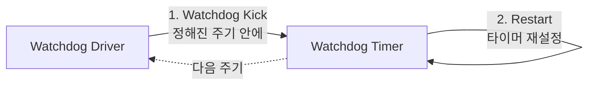
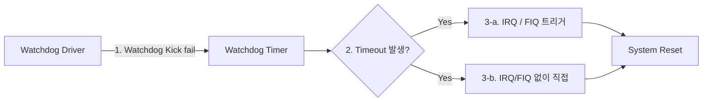
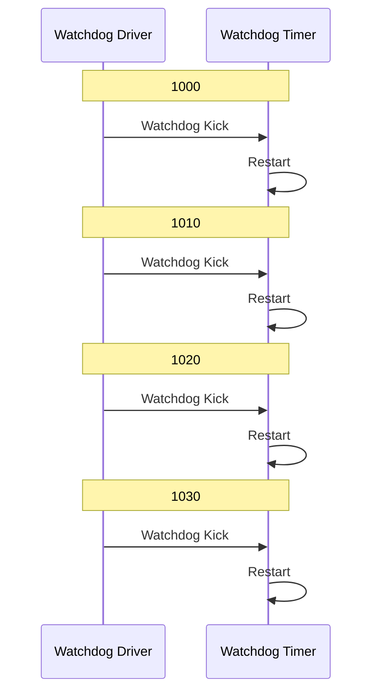
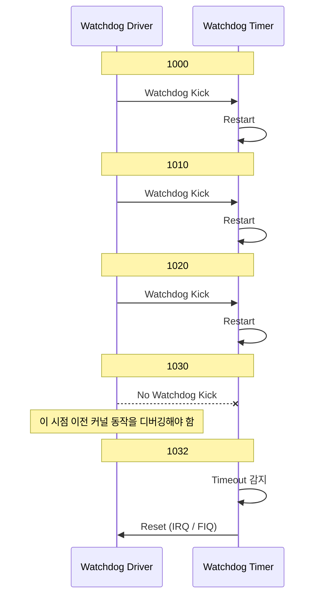

# Watchdog의 기본 개념

## Introduction to watchdog

- Example of watchdog
  화성탐사선 내부 : Watchdog timers are essential in remote, automated systems such as Mars Exploration Rover([watchdog_timer: wikipedia](https://en.wikipedia.org/wiki/Watchdog_timer))

- 하드웨어적인 타이머
  - 대부분 칩셋에서 하드웨어 와치독 타이머를 제공하고 있음
  - 하드웨어 와치독 타이머를 활용해서 거의 대부분 와치독 드라이버를 제공함.
  - 소프트웨어가 정상적으로 동작하고 있다는 것을 알려줄 수 있음
- Why system software engineer know watchdog mechanism?
  - All SoCs and MCUs support watchdog timer
  - Watchdog is key to troubleshooting

- What is watchdog?
  - Mechanism to monitor the operating system
  - Hardware watchdog timer and watchdog kernel driver
  - 운영체제나 리눅스 커널이 정상적으로 실행하고 있는지를 모니터링 하기위한 일종의 드라이버

## Watchdog terminology

- What is watchdog kick?
  - 주기적으로 와치독 드라이버는 특정 주기에 맞춰서 하드웨어적인 와치독 타이머를 리셋(혹은 다시 타이머를 설정)하게 됨. 이와 같은 동작을 와치독 킥이라고 함.
  - Restart watchdog hardware timer for a certain period
  - Monitor Linux kernel works fines(왜하냐? 리눅스 커널, RTOS 등이 정상적으로 동작하는지 모니터링하기 위해서)
  - e.g: Performs watchdog kick per 10sec

- What is the watchdog kick is not performed?
  - 와치독 킥이 제대로 작동하지 않는 경우는
  - Reset the system
  - Crash the system in case of engineering version
  - Consider to be the most critical A bug
  - Assigned to system software engineer

## Watchdog worflow(실행흐름)

- Basic mechanism
  (정상)
- 1. Watchdog driver 가 Watchdog Kick 을 수행함 (정해진 주기 안에)
- 2. Watchdog timer는 Restart를 수행함

(watchdog fail)

- 1. Watchdog driver가 Watchdog Kick fail
- 2. Watchdog timer는 내부에서 timeout 되었다는 사실을 파악한다음
- 3. Watchdog timer는 IRQ 나 FIQ를 다시 트리거를 해서 Reset을 치도록 하거나, IRQ나 FIQ 없이도 리셋을 치도록 설계되어 있음

[sequence_diagram for watchdog normal worflow]

- actor: watchdog driver, watchdog timer
- act: Watchdog Kick, Restart
- Timestamp: 1000, 1010, 1020, 1030

[sequence_diagram for watchdog kick fail worflow]

- actor: watchdog driver, watchdog timer
- act: Watchdog Kick, Restart, No Watchdog Kick, Reset
- Timestamp: 1000, 1010, 1020, 1032
- 1030 이전에 리눅스 커널에서 어떤 동작을 하고 있었는지에 대해서 디버깅을 해야지 watchdog kick을 못한 이유를 디버깅할 수 있음

- 가장 watchdog kick을 못한 케이스는 디바이스 드라이버에서 스핀락을 잘못 활용해서 특정 드라이버에서 사실상 무한 루프를 도는 케이스
- 특정 cpu 코어에서 무한 루프를 돌아서 watchdog kick을 못함
  - 스핀락은 리눅스 디바이스 드라이버에서 굉장히 많이 활용이 되는 락킹 메커니즘
  - A라는 프로세스가 스핀락을 획득하여 critical section의 코드를 실행하고 있음
  - 이때 다른 코어에서 실행하고 있는 프로세스가 스핀락을 획득하려고 시도할 때 사실상 busy wait : 무한 루프를 돌면서 스핀락 해제를 기다림
  - spin lock을 잘못 프로그램하게 되면 특정 CPU 코어에서 실행하고 있는 프로세스가 무한 루프를 돌고 그 결과 watchdog kick을 못하게 됨
  - 이밖에도 여러 케이스가 있음.
