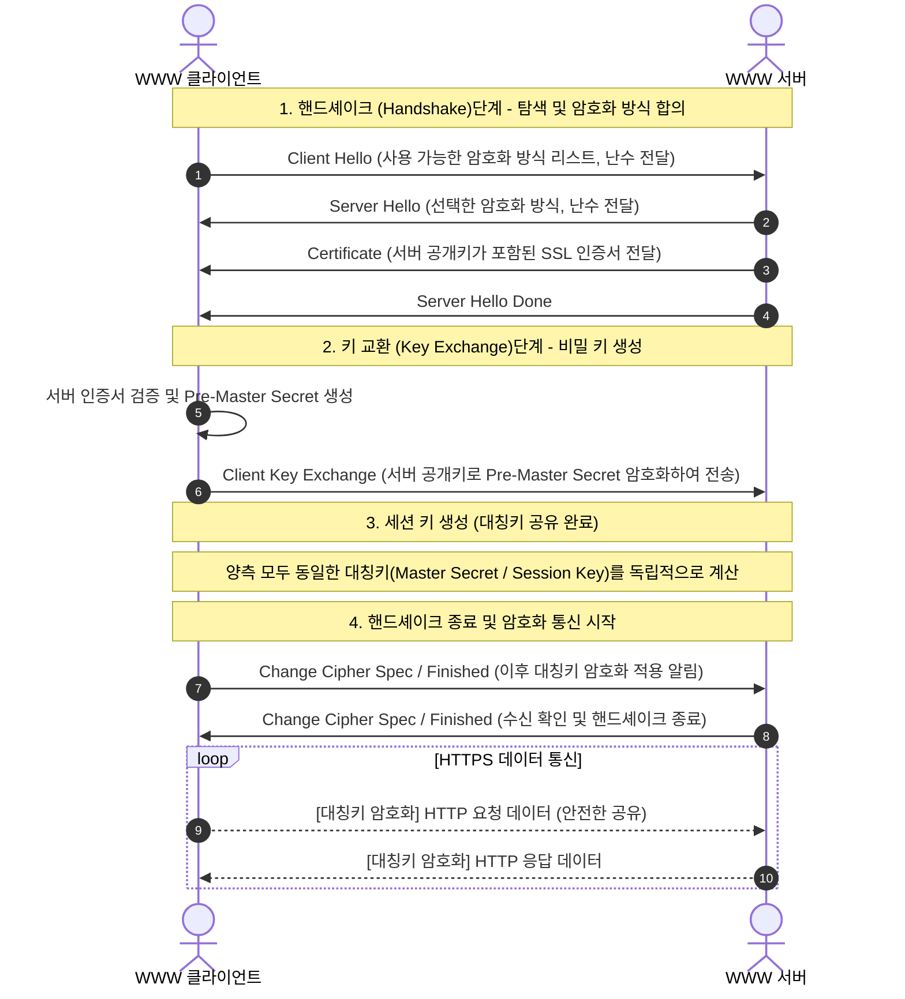
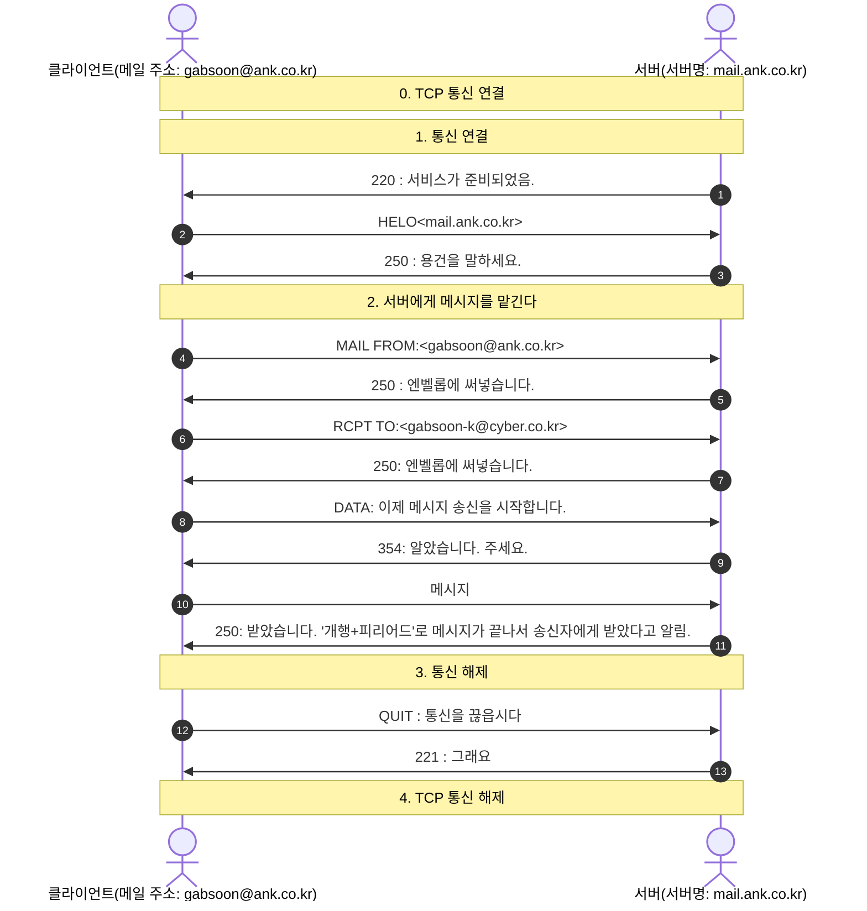
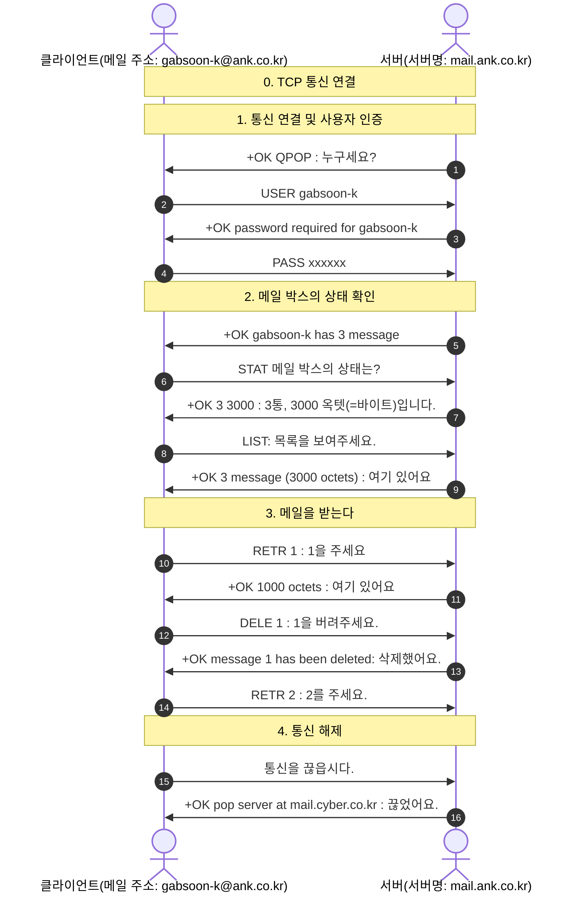

## 3. 애플리케이션 계층

> 애플리케이션 계층의 역할을 한마디로 표현하면 '통신 서비스를 실현하는 것'

[프로토콜+편리한 구조]
통신 서비스의 실현에 중요한 역할을 하는 것은 프로토콜뿐만이 아님.
예를 들면 전자메일 프로토콜인 SMTP나 POP에는 다음과 같은 원칙이 있음.

1. 전자메일로 취급할 수 있는 것은 텍스트뿐이다.
2. 전자메일의 제목(Subject)에 사용할 수 있는 것은 반각 영문자와 숫자뿐이다.

하지만 실제는 사진이나 음성 파일 등의 바이너리 데이터를 전자메일에 첨부하거나 제목에 한글을 사용하고 있음. 이런 것을 가능하게 하는 것이 MIME(Multipurpose Internet Mail Extensions)라는 구조. MIME는 일반적으로 SMTP나 POP에서는 취급할 수 없는 형식의 정보를 다룰 수 있는 형태로 변환시켜 주고받을 수 있도록 만들어줌.

### 애플리케이션 헤더

애플리케이션 계층에서 추가되는 헤더를 애플리케이션 헤더라고 하며, 여기에는 서비스를 실현하기 위해 가장 중요한 '요청과 응답'에 관한 정보가 포함된다(프로토콜에 따라 헤더를 사용하지 않는 경우도 있다).

#### 텍스트 기반과 바이너리 기반

- 애플리케이션 헤더에 무엇을 어떻게 쓸지는 프로토콜에 따라 다름. 또 사람이 읽을 수 있는 언어(텍스트 기반)로 쓰는 경우와 컴퓨터가 처리하기 쉬운 언어(바이너리 기반)로 쓰는 경우가 있음.

#### 헤더만 보내기?

- 클라이언트가 서버에 서비스를 요청할 때 구체적인 데이터를 주고받지 않고 연락만 취할 때는 데이터 부분이 비어 있는 상태로 보냄.

### HTTP 프로토콜

- HTTP 프로토콜은 하나의 요청에 대해 하나의 응답을 반환하는 아주 간단한 프로토콜. 실제로 페이지를 구성하는 파일 수만큼 이 작업을 반복함.

#### 요청 패킷과 응답 패킷

[요청 패킷]

- 클라이언트가 서버에게 보내는 패킷
- 메소드: 요청의 종류. GET, POST, PUT, ... 등
- 요청 헤더: 서버에 전달하는 클라이언트의 정보(처리 가능한 파일의 종류와 문자 코드, 언어 등). 항목명과 정보는 콜론(:)으로 구분함
- 공백 줄: 헤더와 본문의 경계를 나타냄
- 본문: 요청 시 필요한 데이터가 들어감. 메소드가 GET인 경우 비어 있게 됨.

[응답 패킷]

- 상태 줄: 클라이언트의 요청에 대한 처리 결과. 정상적으로 처리한 경우에는 200번대의 숫자가 됨.
- 응답 헤더: 클라이언트에게 전달할 데이터에 관한 정보
- 공백 줄: 헤더와 본문의 경계를 나타냄.
- 본문: 클라이언트에게 전달할 데이터가 들어감.

### 통신을 유지하는 구조

#### HTTP 프로토콜은 1회 완결

- HTTP 프로토콜은 원래 '요청된 데이터를 반환하는 것'만을 목적으로 만들어졌다.
- 한 번의 요청과 응답으로 통신은 완결되고, 과거에 수행한 통신과 관련을 맺게 되는 경우는 없다.
- 이렇게 한 번으로 끝나는 프로토콜을 상태 비보존형 프로토콜(stateless protocol)

### 쿠키

- HTTP 프로토콜의 주고받기에 관한 정보를 클라이언트측에 저장해두고, 다음 통신 때 그정보를 서버에게 제시하면 서버는 사용자를 지정하고 이전 회에서 이어진 통신으로 취급이 가능함.
- 이때 주고받는 정보를 쿠키라고 함.
- 쿠기는 HTTP 프로토콜의 정규 장치가 아님. 쿠키는 보통 CGI(Common Gateway Interface) 등 클라이언트로부터 요청에 맞게 웹 페이지를 작성하는 장치와 함께 사용함.

### 통신을 유지하는 구조 - CGI를 사용한 쿠키의 주고받기

[일반 웹페이지의 경우]

- 서버가 응답 패킷을 준비한다.
- 서버는 미리 저장하고 있는 웹 페이지를 반환한다.

[CGI를 사용한 경우]

- 서버로부터 요청을 받아서 CGI 프로그램이 응답 패킷을 준비한다.
- 이 때 쿠키를 사용하는 경우는 헤더 부분에 쿠키와 '클라이언트에서 쿠키를 저장하기 위한 명령'을 써넣는다.

#### 쿠키 주고 받기

```
[클라이언트] -> [서버] -> [CGI 프로그램]
  요청             Set-Cookie: Number = 0001
                 응답 패킷의 응답 헤더에 쿠키의 저장을 의뢰하는 명령을 씀
[클라이언트] <- [서버] <- [CGI 프로그램]
부여된 쿠키를 저장함.
```

```
[클라이언트] -> [서버] -> [CGI 프로그램]
  요청              쿠키를 보고 사용자를
요청 패킷의 헤더에        지정하여 처리한
이전 서버로부터 부여된    웹 페이지를 작성함
쿠키를 써 넣음
[클라이언트] <- [서버] <- [CGI 프로그램]
이전 통신을 근거로
웹 페이지가 표시됨.
```

- 쿠키에는 유효기간이 있으며, 기간이 지난 쿠키는 클라이언트에 의해 자동적으로 삭제됨.
- 유효기간의 설정은 쿠키 제작자가 하지만, 설정하지 않은 경우에는 '브라우저가 닫힐 때'로 제한됨.

> 과거에는 정말 `CGI`라는 기술명을 그대로 썼지만, 요청이 올 때마다 프로그램을 새로 켜야 해서 서버가 쉽게 지치는 단점이 있었다.
> 그래서 오늘날에는 `CGI`의 개념이 발전하여, 흔히 듣는 WAS(Web Application Server)나 FastCGI, 톰캣(Tomcat), Node.js, Django, Spring Boot 등이 웹 서버 뒷단에서 이 '동적 처리' 역할을 수행하고 있습니다. 명칭은 바뀌었지만 "서버 뒷단에서 동적 페이지를 만든다"는 CGI의 핵심 본질은 지금도 똑같이 유지되고 있다.

### SSL/TLS

#### Secure Socket Layer과 Transport Layer Security

> SSL은 인터넷 상에서 데이터 통신을 암호화하는 프로토콜. SSL을 바탕으로 표준화한 것이 TLS.

- SSL이라는 이름이 널리 보급되어 있어, SSL/TLS라고 병기하는 경우가 많음
- SSL3.0 다음 버전부터 TLS1.0

#### SSL/TLS의 구조

통신자끼리 어떻게 동일한 키를 안전하게 공유하는지가 핵심.



### 전자메일 주고받기

#### 메일

- 메일러를 사용하여 작성한 메일은 실제로는 다음과 같은 텍스트 데이터로 만들어져 보내짐.
  - 엔벨롭(envelop): 보내는 이와 받는 이의 주소 등이 들어감. SMTP에서 사용함
  - 메일 헤더: 서버로 전달되는 클라이언트의 정보가 들어감. 항목명과 정보는 콜론(:)으로 구분함. 중계한 메일 서버는 Received 등의 항목을 필요에 맞게 추가함.
  - 빈줄 : 빈줄로 헤더와 메시지의 경계를 나타냄.
  - 메일 본문
  - 메시지 종료 부호는 '개행+피리어드(.)'

#### 명령과 응답

- 메일을 전달하기 위해 클라이언트와 서버는 자세한 연락을 취함.
- 이때 클라이언트에서 서버로의 호출을 명령(command), 서버에서 클라이언트로의 호출을 응답(response)이라고 함.
- 명령과 응답은 '헤더+데이터'라는 형태를 취하지 않고 단독으로 트랜스포트 계층에 전달됨.

### SMTP 프로토콜

메일을 수신인의 메일 서버까지 전송하는 프로토콜

- SMTP 프로토콜에서 명령은 '4문자 알파벳'으로, 응답은 '3자리 숫자'로 나타냄.



> - MTA/MUA : 전자메일 서비스에는 메일 서버에 해당하는 프로그램을 MTA(Mail Transfer Agent), 메일 클라이언트에 해당하는 프로그램을 MUA(Mail User Agent)라고 한다.

### POP 프로토콜

> 메일 서버로부터 자기 앞으로 온 전자메일을 받을 때 사용하는 것이 POP 프로토콜.

#### POP3 프로토콜의 절차

POP3 프로토콜에서는 명령은 원칙적으로 '4문자의 알파벳'으로, 응답은 '+OK' 또는 '-ERR'로 나타낸다.



### 문자 코드

전자 메일처럼 문자를 주고받는 통신 서비스에서는 문자 그 자체가 아니라 문자 코드를 주고 받는다.

#### 인코딩과 디코딩

- 일반적으로 사람이 이해하는 언어를 컴퓨터가 이해하는 언어(문자 코드)로 변환하는 것을 인코딩(encoding)
- 컴퓨터가 이해하는 언어를 다시 사람이 이해하는 언어로 바꾸는 것을 디코딩(decoding)

#### US-ASCII

대부분의 통신 서비스에서 사용되고 있는 문자 코드는 US-ASCII

- 7비트를 사용하여 128개의 문자(로마자, 숫자, 기호, 제어 문자)를 나타낼 수 있음
- 제어문자: 개행이나 탭 등 특수한 역할을 갖고 있는 문자열
- 실제로는 한 문자를 7+1(확장분) 비트로 나타냄
- 통신 서비스에서 사용되는 한국어 문자 코드는 한글 완성형 코드 EUC-KR로 16비트로 구성됨.

### MIME

#### 전자메일의 제약

- 제목(Subject)에는 한글을 사용할 수 없다.
- 텍스트(문자)밖에 보낼 수 없다.
- 이런 제약에 구애받지 않고 현재는 한글을 사용하거나 첨부 파일이라는 형태로 텍스트 이외의 데이터를 보낼 수 있는데, 이것을 가능케하는 장치 중 하나가 MIME

> MIME는 정해진 원칙에 따라 파일을 US-ASCII 문자열로 인코딩하고 어떻게 인코딩했는지에 대한 정보를 첨부해서 수신인에게 보냄으로써 수신측이 올바른 방법으로 디코딩할 수 있도록 하는 장치

- 메시지나 파일 앞에는 경계를 가리키는 문자열 외에 파일의 종류(Content-Type)나 사용한 인코딩의 종류(Content-Transfer-Encoding) 등이 들어간다.
- MIME 중에서도 BASE64 방식이 많이 사용된다.

### 뒤에서 지원해주는 애플리케이션 프로토콜

애플리케이션 프로토콜은 크게 두 가지로 분류된다.

- 하나는 HTTP나 SMTP, TELNET 등과 같이 일반 사용자에게도 친숙한 통신 서비스를 제공하는 프로토콜
- 다른 하나는 DNS나 NAT, DHCP와 같이 네트워크 관리자 이외에는 그다지 의식할 일이 없는 뒤에서 통신을 지원하기 위한 프로토콜.

#### SNMP(Simple Network Management Protocol)

- 네트워크의 일괄 관리를 수행하는 프로토콜
- 접속되어 있는 네트워크 기기의 전원의 상태나 문제가 발생하지 않았는지를 확인할 수 있을 뿐만 아니라, 프린트의 토너 유무까지 조사해줌
- 관리하는 기기를 SNMP 매니저, 관리받는 기기를 SNMP 에이전트라고 하며, 각각 전용 소프트웨어를 설치해야 함.

#### NTP(Network Time Protocol)

- 네트워크 상에 있는 기기의 시각 대조를 수행하는 프로토콜
- 기준이 되는 시각 정보를 관리 및 제공하는 기기를 NTP 서버(또는 타임 서버)라고 하고, NTP 서버로부터 시각 정보를 얻어서 동기화되는 기기를 NTP 클라이언트라고 함.
- NTP 서버로부터 시각 정보를 얻으려면 전용 소프트웨어가 필요함.
- 시각 동기화 프로토콜에는 이 외에도 NTP를 간략화한 SNTP(Simple Network Time Protocol)가 있음.
