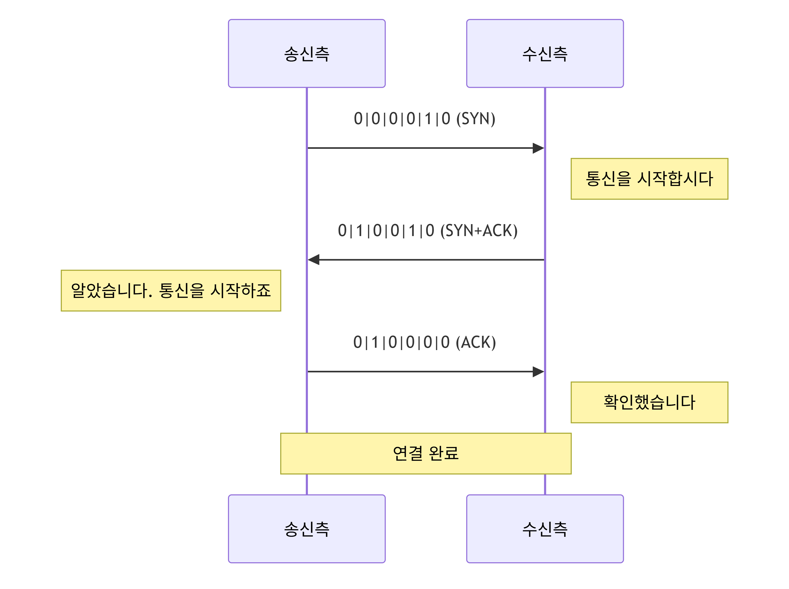
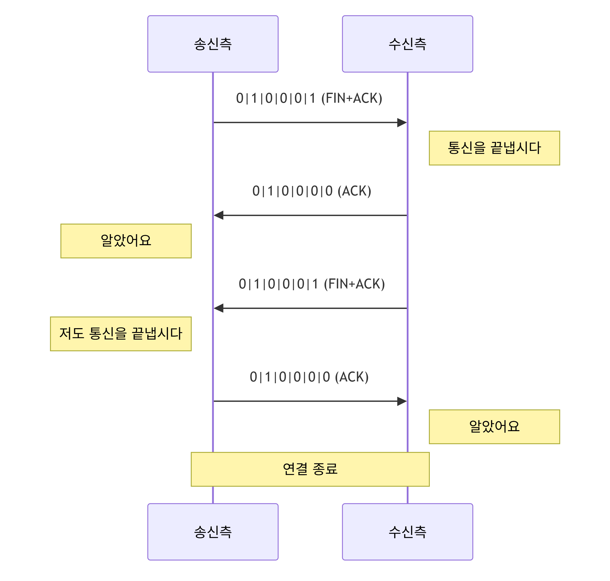
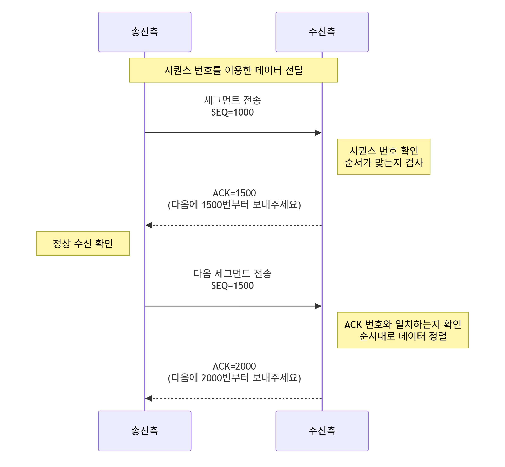

## 4. 트랜스포트 계층

> 트랜스포트 계층의 역할은 "상대 애플리케이션 계층에 있는 어떤 프로세스(소켓)에게 전달할지"까지 책임을 지고 전달하는 것

> 같은 HTTP라도 서버 프로세스가 여러 개면 포트로 구분한다. 또한 TCP 연결 하나는 5-튜플(출발지 IP, 출발지 포트, 목적지 IP, 목적지 포트, 프로토콜)로 식별됨. 그래서 서버는 443번 포트 번호 하나로 수천 명의 클라이언트와 동시에 연결할 수 있음(클라이언트 쪽 IP/포트가 서로 다르므로)

### 트랜스포트 계층의 역할

> 데이터가 항상 확실히 전달된다고는 할 수 없으므로 문제가 발생한 경우에는 뭔가 대처 방안이 필요하다. 이 때 통신 서비스에 맞는 방법으로 그것을 처리하는 것이 트랜스포트 계층의 역할

트랜스포트 계층에는 두 개의 프로토콜 존재.

- TCP(Transmission Control Protocol)
- UDP(User Datagram Protocol)

최신: QUIC

- 지금은 QUIC(RFC 9000, 2021년 표준화)이 중요함
- QUIC는 UDP 위에서 동작하면서 TCP가 하던 일(연결, 재전송, 순서 보장, 혼잡 제어)를 직접 구현하고, TLS 1.3암호화를 기본으로 내장함
- HTTP/3(RFC 9114, 2022)가 QUIC 위에서 동작하며, 주요 브라우저와 대형 서비스(Google, YouTube, Cloudflare, Meta 등)가 이미 쓰고 있음
- TCP보다 좋은 점: 연결 수립이 빠름(1-RTT, 재접속 시 0-RTT), 스트림 하나에서 손실이 나도 다른 스트림이 막히지 않음(Head-of-Line Blocking 완화), Wi-Fi에서 LTE로 바뀌어 IP가 변해도 연결이 유지됨(Connection Migration)
- 그 밖에 SCTP(통신사 시그널링, WebRTC 데이터 채널) 같은 트랜스포트 프로토콜도 있음

### 애플리케이션의 현관

- 포트: 애플리케이션 계층에는 애플리케이션 프로토콜마다 데이터의 출입구가 마련되어 있으며 이 출입구를 포트(port)라고 하며, 각 포트에는 **포트 번호** 가 붙어 있음. 통신을 수행 시 포트 번호를 사용하여 보낼 곳을 지정함
- 포트 번호: 16비트로 된 숫자로 0~65535(2^16 - 1)번까지 있음. 그 중에서 0~1023번까지는 통신 서비스마다 미리 예약되어 있으며, well-known port number라고 함.

IANA 포트 범위 (RFC 6335)
| 범위 | 이름 | 예 |
| ------------- | ----------------------------- | ------------------------------------------------------- |
| 0 ~ 1023 | Well-known (System) | 22 SSH, 25 SMTP, 53 DNS, 80 HTTP, 443 HTTPS |
| 1024 ~ 49151 | Registered (User) | 3306 MySQL, 5432 PostgreSQL, 6379 Redis, 8080 HTTP 대체 |
| 49152 ~ 65535 | Dynamic / Private (Ephemeral) | 클라이언트가 연결할 때 OS가 자동으로 고르는 임시 포트 |

- 실제 OS의 임시 포트 범위는 다를 수 있음. Linux 기본값은 32768~60999(`/proc/sys/net/ipv4/ip_local_port_range`), Windows는 49152~65535.
- Linux/Unix에서 1024 미만 포트를 열려면 원래 root 권한이 필요함. (Spring Boot를 80번에 바로 띄우기 어려운 이유. 보통 8080으로 띄우고 앞단 Nginx나 로드밸런서가 80/443을 받음)
- TCP와 UDP의 포트 공간은 별개임. TCP 53번과 UDP 53번은 서로 다른 포트(DNS는 둘 다 씀)

### TCP 프로토콜

#### 일대일 통신

> TCP는 데이터를 확실히 전달하기 위해 수신측과 일대일로 통신함. 이런 통신을 **커넥션형 통신** 이라고 하며, 대강 다음과 같은 3단계로 이루어져 있음

1. 수신측이 데이터를 받을 수 있는 상태인지를 확인한 후 통신을 개시한다. 이것을 '통신을 연결한다'라고 한다.
2. 데이터를 정해진 크기로 분할하고, TCP 헤더를 붙여서 순서대로 송신한다.

- 트랜스포트 계층에서 취급하는 데이터의 단위를 세그먼트(segment)라고 함
- 수신측은 전달된 데이터를 확인

3. 데이터를 다 보냈으면 통신을 종료합니다.

> "연결"은 논리적인 것

- TCP 연결은 전화선처럼 물리적인 회선이 생기는 것이 아님. 양 끝 호스트의 OS가 상태(시퀀스 번호, 윈도우, 버퍼 등)를 기억하고 있는 것일 뿐이고, 중간 라우터는 연결이 있다는 사실을 모름(NAT/방화벽은 예외적으로 상태를 추적함)
- 그래서 한쪽이 전원이 꺼지는 등으로 사라져도 다른 쪽은 한동안 연결이 살아 있다고 믿을 수 있음 -> Keep-Alive, 애플리케이션 레벨 heartbeat, 타임아웃 설정이 필요한 이유

> TCP는 "바이트 스트림임"

- TCP는 애플리케이션이 `send()`를 호출한 단위(메시지 경계)를 보존하지 않음. 100바이트씩 3번 보내도 받는 쪽에서는 300바이트 한 번, 또는 150+150으로 읽힐 수 있음
- 그래서 애플리케이션 프로토콜이 직접 메시지 경계를 정해야 함(HTTP의 `Content-Length`, 줄바꿈 구분, 길이 prefix 등). 소켓 프로그래밍에서 흔히 말하는 "패킷이 붙어서/쪼개져서 온다" 문제의 원인
- 반면 UDP는 데이터그램 단위로 경계가 보존됨.

#### 애플리케이션 계층에 전달

> 수신측은 전해 받은 데이터를 원래의 형태로 다시 맞춘 후 애플리케이션 계층에 전달함.

1. TCP 헤더의 정보를 보고 데이터를 순서대로 맞춥니다.

- 데이터의 순서를 가리키는 번호 외에 포트 번호나 데이터가 무사한지를 확인하기 위한 값 등이 적혀있다.

2. TCP 헤더를 가지고 데이터를 다시 맞춤
3. 애플리케이션 계층의 프로토콜에 전달함.

#### 연락 방법

> 통신 상대에게 통신 상태를 전하는 수단으로 사용되는 것이 TCP 헤더에 있는 6비트의 컨트롤 플래그(control flag)임. 상대에게 전하고 싶은 항목은 '1'로 만듦(그 이외는 0으로 만듦).
> **1이 들어간 상태를 '플래그가 설정되었다'라고 한다.**

- URG(Urgent): 1이면 세그먼트가 긴급한 데이터를 갖고 있다.
  - RFC 6093은 새 애플리케이션에서는 쓰지 말 것을 권고함. 실무에서는 거의 쓰이지 않음
- ACK(Acknowledgement): 1이면 통신 확인에 대해 알았다고 응답한 것이다(확인 응답).
  - 연결이 수립된 후 거의 모든 세그먼트에 ACK가 1로 설정됨. 처음 SYN하나만 ACK가 0
- PSH(Push): 1이면 세그먼트를 바로 애플리케이션 계층에 전달한다.
  - 애플리케이션이 직접 제어하는 경우는 드물고, OS가 `send()` 데이터의 마지막 세그먼트에 보통 자동으로 붙임.
- RST(Reset): 1이면 통신을 강제적으로 해제한다.
  - 실무에서 자주 보는 경우: 닫힌 포트에 연결 시도("Connection refused"), 이미 사라진 연결에 데이터 도착, 애플리케이션의 비정상(강제) 종료. 로그에 찍히는 `Connection reset by peer`가 바로 이것
- SYN(Synchronize): 1이면 통신 개시를 요청한다.(시퀀스 번호를 동기화한다는 뜻)
- FIN(Finish): 1이면 통신 종료를 요청한다.
  - RFC 9293: "No more data from sender"

> 최신: 플래그는 이제 6비트가 아니라 8비트

- 원래 TCP 표준(RFC 793, 1981)은 6개 플래그였지만, ECN(Explicit Congestion Notification, RFC 3168, 2001)이 CWR, ECE 두 플래그를 추가했음.
- 현재 TCP 표준은 RFC 9293(2022)으로, RFC 793을 대체함. 여기서 헤더는 `예약(4비트) + 플래그 8개` 구조
- 순서 : `|CWR|ECE|URG|ACK|PSH|RST|SYN|FIN|`

- CWR(Congestion Window Reduced): 🆕 ECE를 받고 송신 속도를 줄였음을 알린다.
- ECE(ECN-Echo): 🆕 SYN에서는 "ECN 지원함", 그 외에는 "경로 중간에서 혼잡 표시를 받았다"는 뜻. 패킷을 버리지 않고도 혼잡을 알릴 수 있음.

> 통신 세계에서는 일반적으로 상대와 서로 확인해가면서 주고받는 것을 핸드셰이크(handshake)라고 함. TCP에서는 통신을 개시할 때 다음과 같이 주고 받는 데, 이 것을 3-way handshake라고 한다.



[데이터 양의 확인]

- 실제로 통신을 시작하기 전에 양쪽 모두 다룰 수 있는 데이터 양을 확인합니다.
  - 세그먼트 사이즈: 택배 한 상자 크기
    - MSS(Maximum Segment Size)로 TCP가 한 번에 담아서 보낼 수 있는 데이터(payload)의 최대 크기
    - MSS가 1460Byte라면, 애플리케이션 데이터 5000Byte를 보내려고 할 때 1460, 1460, 1460, 620 처럼 여러 TCP 세그먼트로 나누어 전송함.
    - 보통 네트워크 MTU 때문에 결정됨
    - 이더넷 MTU = 1500 Byte (IP 헤더 20, TCP 헤더 20 => 1460 Byte MSS, IPv4 기준)
    - IPv6는 IP 헤더가 40바이트라 MSS = 1440. TCP 타임스탬프 옵션(12바이트)을 쓰면 실제 세그먼트당 데이터는 1448(IPv4)로 더 줄어듦. VPN, PPPoE 등 터널을 지나면 MTU가 더 작아짐 -> 경로 MTU(PMTUD)으로 맞춤
    - MSS는 SYN 세그먼트의 옵션 필드에만 실려 보내짐(연결 중에는 바뀌지 않음)
  - 윈도우 사이즈: 한 번에 주문받을 수 있는 상자 개수
    - 수신자가 "지금 내 버퍼에 이만큼 더 보내도 된다"고 광고하는 크기
    - 예를 들어 윈도우 사이즈 = 32KB 라면, 송신자는 `ACK`를 기다리지 않고 최대 32KB 까지 연속해서 보낼 수 있음
    - Ex. MSS = 1KB, Window = 4KB이면 총 4개 세그먼트를 보내고 나서 ACK를 기다림
  - Ex. 송신측 : 세그먼트 사이즈: 150Byte, 윈도우 사이즈: 32KB
  - 수신측: 세그먼트 사이즈: 128Byte, 윈도우 사이즈: 64KB
  - 결과: 세그먼트는 128 Byte 이하로 보냄. 송신측 -> 수신측 방향으로는 수신측이 광고한 64KB까지, 수신측 -> 송신측 방향으로는 송신측이 광고한 32KB까지 보낼 수 있음.
    - MSS: 각자 "나는 이만큼까지 받을 수 있다"고 SYN에 적어 보내고, 송신측은 상대가 알려준 MSS를 넘지 않게 보냄. 결과적으로 작은 쪽에 맞춰지는 효과가 있어서 원래 노트의 "작은 쪽으로 맞춘다"는 실무적으로는 맞음.
    - 윈도우: 방향마다 따로임. A→B 방향은 B가 광고한 윈도우, B→A 방향은 A가 광고한 윈도우를 따름. 그리고 모든 세그먼트마다 다시 광고하므로 수신 버퍼 상황에 따라 계속 바뀜(버퍼가 꽉 차면 0까지 내려감 = Zero Window).
      128Byte, 32KB 같은 숫자는 옛날 교재용 예시이고, 현재 실무 값은 MSS 1460 정도, 윈도우는 수백 KB~수 MB가 흔함.

> 🆕 최신: 윈도우 사이즈 16비트의 한계와 Window Scale

- 헤더의 윈도우 필드는 16비트라 최대 65,535바이트(약 64KB)밖에 표현하지 못함. 지금의 고속 회선(예: 1Gbps, RTT 50ms → 약 6MB가 전송 중일 수 있음)에서는 턱없이 부족함.
- 그래서 Window Scale 옵션(RFC 7323)으로 SYN 때 배율(2^n, 최대 n=14)을 정해서 최대 약 1GB까지 윈도우를 쓸 수 있음. 현재 모든 주요 OS가 기본으로 사용함.

[통신 해제]
통신을 해제할 때도 TCP 헤더의 컨트롤 플래그를 사용하여 연락을 취합니다.



#### 주고 받기의 흐름

- TCP 헤더에는 데이터의 순서를 나타내는 번호(시퀀스 번호)가 적혀 있음
- 헤더를 확실히 받기 위해서 이 번호를 사용하여 다음과 같은 주고받기를 수행함



1. 송신측이 `SEQ=1000`인 세그먼트(데이터 500바이트)를 전송
2. 수신측은 시퀀스 번호를 확인하여 순서가 맞는지 검사
3. 수신측은 다음에 받아야 할 번호인 `ACK=1500`을 응답 (1000 + 500)
4. 송신측은 정상 수신을 확인하고 다음 `SEQ=1500`인 다음 세그먼트 전송
5. 수신측은 받은 데이터를 순서대로 정렬
6. 다시 `ACK=2000`을 보내 다음에 받아야 할 번호를 알림

> 시퀀스 번호는 "몇 번째 세그먼트"가 아니라 "몇 번째 바이트"를 가리킴. 그래서 ACK = 받은 SEQ + 받은 데이터 길이. 32비트라 약 4GB마다 한 바퀴 돌아서 0으로 돌아옴(고속 회선에서는 타임스탬프 옵션의 PAWS로 혼동을 막음)

#### 모아서 보내기

- 세그먼트는 하나씩 보내는 것보다 몇 개씩 모아서 보내는 것이 효율적임.
- 통신을 시작할 때 정한 윈도우 사이즈까지라면 확인 응답을 기다리지 않고 모아서 보낼 수 있음.
  ~~- 한 번에 받은 각 세그먼트에 대해 각각 화인 응답을 한다.~~
- 윈도우 사이즈는 통신 도중에 변경할 수 있다. ~~그래서 네트워크가 비어있을 때는 크게 하고, 혼잡할 때는 작게 하는 등 상황에 맞춰 조절할 수 있다.~~

> 정정 1: ACK는 세그먼트마다 하나씩 보낼 필요가 없음 (누적 `ACK`)
>
> - TCP의 ACK는 누적(cumulative) 방식임. `ACK=3000`은 "3000 직전까지 전부 받았다"는 뜻이라, 세그먼트 여러 개를 `ACK` 하나로 확인할 수 있음.
> - 실제 구현은 지연 `ACK(Delayed ACK)` 를 씀. 보통 최대 크기 세그먼트 2개마다 ACK 1개, 또는 짧은 시간(Linux 약 40ms, Windows 기본 200ms, 표준상 최대 500ms) 기다렸다가 보내서 ACK 수를 줄임.
>   🆕 SACK(Selective ACK, RFC 2018): 중간 세그먼트 하나만 빠졌을 때 "1000~2000은 비었고 2000~5000은 받았다"고 알려서 빠진 것만 재전송하게 함. 현재 거의 모든 OS가 기본 사용.

> 정정2: "흐름 제어"와 "혼잡 제어"는 다른 것
> |흐름 제어 (Flow Control)| 혼잡 제어 (Congestion Control)|
> |-|-|
> |무엇을 보호? |수신자의 버퍼가 넘치지 않게 |네트워크(중간 라우터) 가 막히지 않게|
> |누가 정함?| 수신자가 헤더의 윈도우 필드로 광고| 송신자가 스스로 추정 (헤더에 안 실림)|
> |이름| 수신 윈도우 rwnd |혼잡 윈도우 cwnd|

- 송신자가 ACK 없이 보낼 수 있는 양 = min(rwnd, cwnd)
- 교재의 "네트워크가 비어있을 때는 크게, 혼잡할 때는 작게"는 헤더의 윈도우 사이즈가 아니라 송신측의 cwnd 이야기임. 수신자는 네트워크 상황을 모르고 자기 버퍼 상황만 알림.

혼잡 제어의 기본 동작

1. Slow Start: cwnd를 작게(현재 기본 초기값은 10 MSS, RFC 6928) 시작해서 ACK를 받을 때마다 늘림 → RTT마다 약 2배로 증가
2. Congestion Avoidance: 임계값(ssthresh)을 넘으면 천천히 증가
   손실 감지 시 cwnd를 줄임

🆕 현재 쓰이는 알고리즘

- CUBIC: Linux, Windows(10 이후), macOS의 기본값. 교재에 흔히 나오는 Reno/Tahoe는 지금은 기본값이 아님.
- BBR(Google): 손실이 아니라 대역폭과 RTT를 측정해서 속도를 정함. Google/YouTube 서버 등에서 사용.
- ECN: 라우터가 패킷을 버리는 대신 "혼잡함" 표시를 해서 알림(위의 ECE/CWR 플래그).

### 문제 발생 시의 처리

- 일정 시간을 기다려도 확인 응답이 없을 때는 이유를 불문하고 송신측은 세그먼트를 재전송한다.

> 보충: 재전송 방법은 두 가지

1. 타임아웃 재전송(RTO): "일정 시간"은 고정값이 아니라 측정한 RTT를 바탕으로 계속 계산함(RFC 6298, 최소 1초 권장. Linux는 최소 200ms). 재전송할 때마다 대기 시간을 2배로 늘림(지수 백오프).
2. 빠른 재전송(Fast Retransmit): 타임아웃까지 기다리지 않고, 같은 ACK가 3번 중복(3 duplicate ACKs) 해서 오면 "중간 것이 빠졌구나" 판단하고 바로 재전송. 실제로는 이쪽이 훨씬 자주 동작함.

- 🆕 최신 Linux는 시간 기반으로 손실을 감지하는 RACK-TLP(RFC 8985, 2021)를 기본으로 씀.

#### 세그먼트의 지연 및 분실

- 송신 도중에 세그먼트가 행방불명이 되는 경우가 있다. 세그먼트가 전달되지 않으면 수신측은 확인 응답을 보낼 수가 없다.
- 일정 시간을 기다려도 확인 응답이 없을 때는 이유를 불문하고 송신측은 세그먼트를 재전송한다.

#### 확인 응답의 지연 및 분실

- 확인 응답 자체가 네트워크 상에서 행방불명되는 경우도 생각할 수 있다.
- 이 경우에도 확인 응답이 오지 않았으니, 송신측은 다시 보낸다.
- 수신측은 세그먼트가 중복되면 하나를 남기고 파기한다.

#### 데이터의 파손

- 송신 도중에 데이터가 깨지는 경우, 수신측에서는 그 데이터를 파기하고 확인 응답을 보내지 않는다.
- 깨졌는지 아닌지는 헤더에 있는 체크섬(checksum)이라는 값을 사용하여 판단한다.

#### 재전송 횟수는 무제한?

- 일정 횟수 이상을 재전송해도 확인 응답이 돌아오지 않는 경우는 송신측이 강제적으로 통신을 해제한다.
- 통신을 해제할 때는 TCP 헤더의 컨트롤 플래그 'RST'를 1로 만든다.

### 수신측의 처리

#### 애플리케이션 계층에 전달

- 수신측에서는 TCP 헤더에 적힌 포트 번호를 보고 지정된 애플리케이션 프로토콜에 데이터를 전달한다.
- 데이터가 하나의 세그먼트로 묶여있을 때는 헤더를 제거하고 전달한다.
- 두 개 이상으로 분할되어 있는 경우는 세그먼트를 조립한 후 전달한다.
- 조립한 데이터를 지정된 애플리케이션 프로토콜에게 전달하면 TCP의 일은 끝난다.

#### TCP 헤더

- TCP 헤더는 다음과 같은 순서와 크기로 작성하도록 정해져 있다. 비트열이므로 숫자는 2진법으로 되어 있다.

```
1. 송신측 포트 번호(16비트) [송신측 작성]
  - 송신측의 포트 번호를 기록(예: 80 -> 0000 0000 0101 0000)
2. 수신측 포트 번호(16비트) [송신측 작성]
  - 수신측의 포트 번호를 기록(예: 80 -> 0000 0000 0101 0000)
3. 시퀀스 번호(32비트) [송신측 작성]
  - 전체 데이터 중 이 데이터가 몇 번째(몇 바이트째)에 해당하는지를 기록
4. 확인 응답 번호(32비트) [수신측 작성]
  - 다음에 받을 데이터가 전체 데이터 중 몇 번째(몇 바이트째) 데이터인지 기록함
5. 데이터 오프셋(4비트) [송신측 작성]
  - 맨 앞에서부터 데이터의 시작 위치까지의 비트 수를 32로 나눈 값이 들어감
6. 예약(6비트) [송신측 작성]
  - 현재는 사용하지 않음
7. 컨트롤 플래그(6비트) [송신측 작성]
  - |URG|ACK|PSH|RST|SYN|FIN|
8. 윈도우 사이즈(16비트) [수신측 작성]
  - 수신 가능한 데이터 크기를 기록함
9. 체크섬(16비트) [송신측 작성]
  - 데이터가 무사한지 아닌지를 확인하기 위한 값을 기록함
10. 긴급 포인터(16비트) [송신측 작성]
  - URG 플래그가 1인 경우 사용함
11. 옵션 [송신측 작성]
  - TCP의 기능을 확장할 때 사용함(세그먼트 사이즈를 정할 때 등)
12. 패딩 [송신측 작성]
  - 헤더가 32비트의 정수배가 되지 않을 때 0을 덧붙여서 헤더의 크기를 조정함.
```
