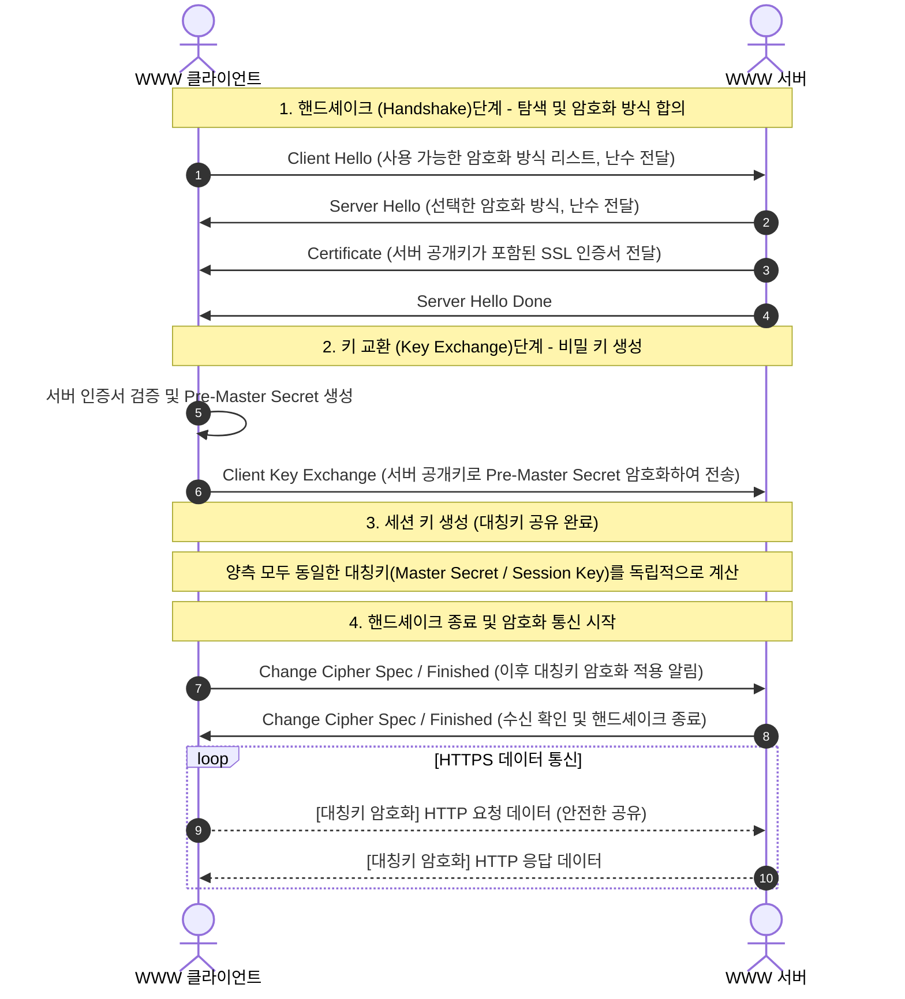
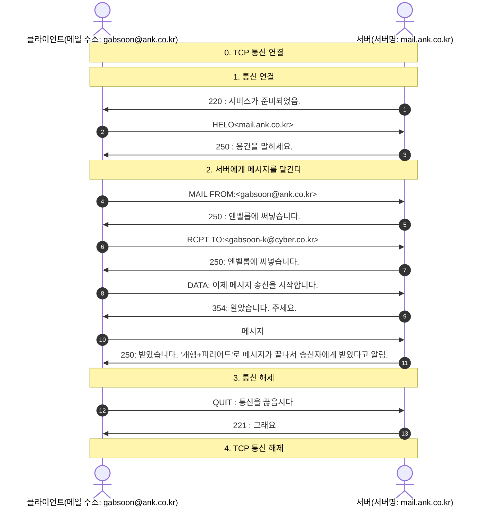
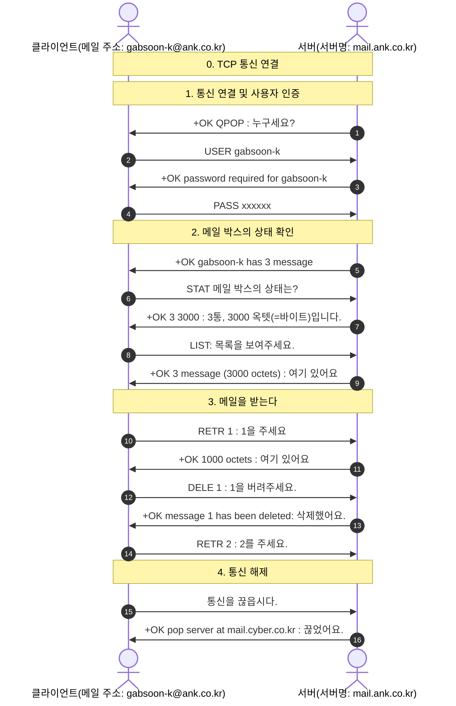
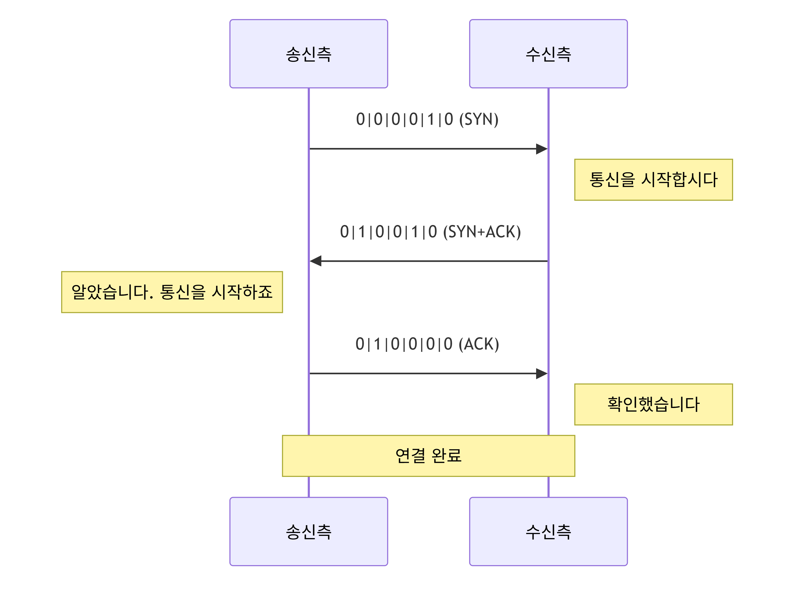
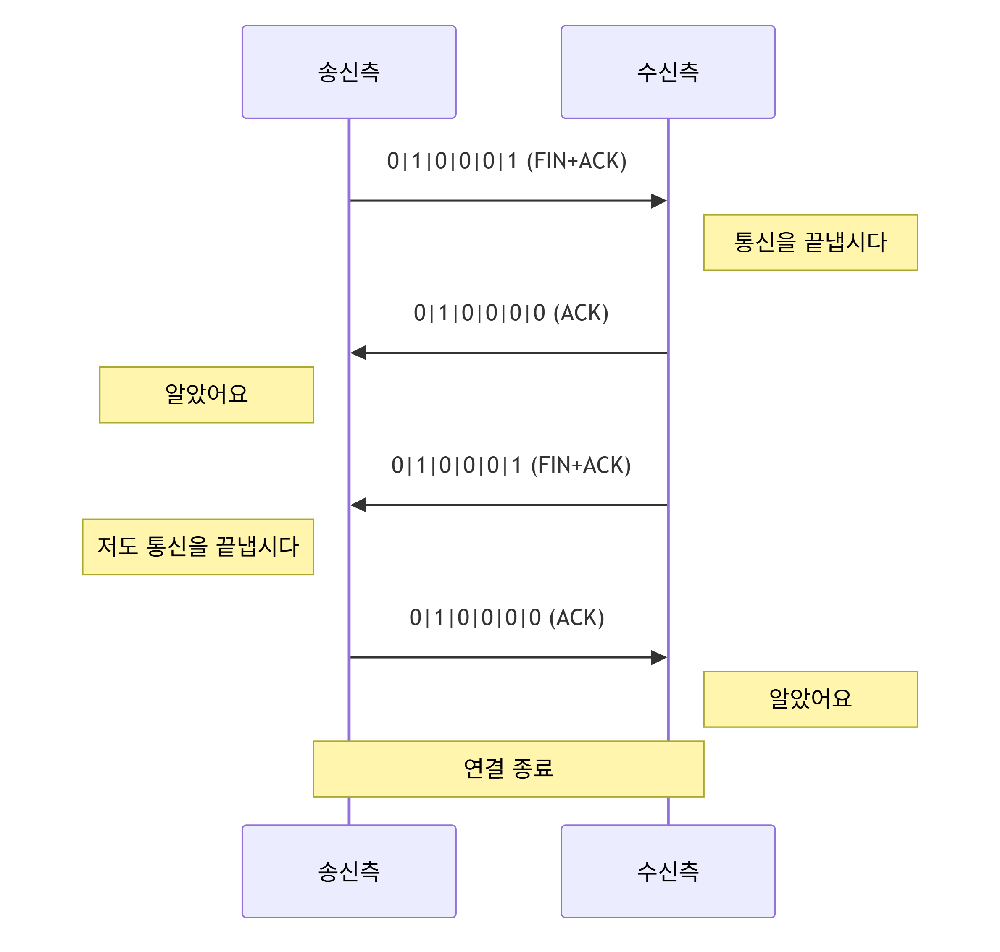

# TCP/IP 기본 책 내용 정리

## 0. TCP/IP를 시작하기 전에

### TCP/IP의 탄생 배경

- TCP/IP는 1960년대 미국 국방성에 의해 개발, 지원되던 ARPANET이라는 네트워크 상에서 사용할 프로토콜로 개발됨.
- 초기 ARPANET은 네 개의 LAN을 연결한 것으로 현재 인터넷의 원형이라고 할 수 있음.
- 컴퓨터 간 데이터를 주고 받을 때 케이블이나 전파, 적외선 등을 사용하여 데이터를 보내려면 문서든 그림이든 모든 데이터를 전기 신호나 광 신호로 변환함.
- 때문에 데이터를 받는 쪽에서는 그 신호를 다시 원래의 문서나 그림으로 변환하는 작업이 필요함.
- 그런데, 이 때 신호를 어떻게 변환했는지를 모르면 원래대로 되돌릴 수가 없음.
- 그래서 '신호로 변환 $\rarr$ 전달 $\rarr$ 데이터 재변환'이라는 일련의 흐름을 통일시킨 절차를 기본으로 하여 수행되는 TCP/IP라는 구조가 생겨난 것
- TCP/IP라는 공통된 구조로 전 세계 네트워크를 연결한 것이 바로 인터넷

## 1.TCP/IP 개요

> '데이터를 디지털 신호로 바꾼다 $\rarr$ 보낼 곳에 전달한다 $\rarr$ 디지털 신호를 데이터로 되돌린다'는 작업을 효율적으로 수행하기 위해서 TCP/IP에서는 데이터를 신호로 바꾸거나, 신호를 데이터로 되돌리는 데 5단계의 절차를 거침.

> 각 단계를 계층(Layer)이라고 하며, 위에섭터 순서대로 애플리케이션 계층, 전달(Transport) 계층, 네트워크 계층, 데이터 링크 계층, 물리 계층으로 되어 있음.
> 데이터 링크 계층과 물리 계층을 합쳐 4계층으로 취급하는 경우도 있음.

> **작게 나눠서 보내기**

- TCP/IP의 특징 중 하나는 '데이터를 일정한 크기로 분할해서 보낸다'는 것임. 작게 나눠진 데이터 하나 하나를 패킷이라고 하며, 이런 통신 방법을 '패킷 통신'이라고 함.
- 패킷 통신에서는 데이터를 세분화함으로써 하나의 회선을 사용하여 여러 데이터를 거의 동시에 송수신할 수 있음.
- 또 통신 중에 데이터의 일부가 손상되어도 해당하는 부분만 다시 보내면 된다는 장점도 있음

### 통신 프로토콜

> 데이터를 주고 받으려면 송신측과 수신측의 컴퓨터가 미리 정해놓은 공통된 매뉴얼에 따라 연락을 취해야 함. 이 매뉴얼을 **프로토콜(protocol)**이라고 함.

### TCP/IP란?

> 만일 전 세계적으로 공통된 통신 프로토콜이 있다면, 그 프로토콜만 사용하면 어떤 컴퓨터끼리든 데이터를 주고받을 수 있게 될 것임. 현재 전 세계 공통 통신 프로토콜로 채택된 것이 TCP/IP

- 데이터를 주고받는 데는 여러 가지 작업이 필요하며, 하나의 프로토콜로 그 모든 것을 처리하는 것은 힘들기 때문에, TCP/IP는 여러 개의 프로토콜로 이루어짐.

### 계층화

> TCP/IP는 5계층으로 구분할 수 있다. 데이터가 상대에게 전달될 때까지의 흐름을 따라가면서 각 계층의 역할에 대해 간략히 요약하면 다음과 같다.

| 계층            | 송신측                                                  | 수신측                                                       |
| --------------- | ------------------------------------------------------- | ------------------------------------------------------------ |
| 애플리케이션    | 수신측의 애플리케이션에서 처리할 수 있도록 만듦         | 애플리케이션에서 표시, 재생함                                |
| 전송(Transport) | 네트워크 상에서의 공통된 형태로 만듦                    | 데이터에 문제가 있으면 재전송을 요청함                       |
| 네트워크        | 수신처로 가는 경로를 정하고 보낼 수 있는 형태로 만듦    | 데이터의 수신인을 확인하고 자기 앞으로 온 것이 아니면 파기함 |
| 데이터링크      | 비트열(0과 1로 표현한 것)로 변환함                      | 비트열을 데이터로 변환함                                     |
| 물리            | 비트열을 전압의 변화나 빛의 점멸 신호로 변환하여 송신함 | 전압의 변화나 빛의 점멸 신호를 비트열로 변환함               |

### TCP/IP의 구조

[각 층의 역할과 프로토콜]
|계층|역할|프로토콜|
|-|-|-|
|애플리케이션|애플리케이션에 맞춰 통신할 수 있도록 함. 애플리케이션마다 다양한 프로토콜이 있음|HTTP, SMTP, POP3, FTP, TELNET, NNTP, RCP, ...|
|트랜스포트|송신된 데이터를 수신측 애플리케이션에 확실히 전달하기 이해 작동함|TCP, UDP|
|네트워크|수신측 컴퓨터까지 데이터를 전달하기 위해 작동함. 전달된 데이터가 손상됐는지 또는 수신측이 잘 받았는지에는 관여하지 않음.|IP|
|데이터 링크|네트워크에 직접 연결된 기기 간을 전송할 수 있도록 만듦. 네트워크 계층과 물리 계층 간의 차이를 완전히 흡수하기 위한 다양한 프로토콜 존재|Ethernet, FDDI, ATM, PPP, PPPoE, ...|
|물리|데이터를 신호로, 신호를 데이터로 변환함. 변환 방법은 통신 매체에 의존하기 때문에 특정 프로토콜이 정해져 있지 않음|

> 일반적으로 TCP/IP라고 하면 이 5계층 전체를 가리킴. TCP와 IP라는 두 개의 프로토콜만 가리키는 경우도 있으므로 그것과 구별하기 위해 5 계층 전체를 TCP/IP 프로토콜군(protocol family)이라고도 함.

[프로토콜 조합하기]

- 프로토콜 조합을 바꿈으로써 다양한 애플리케이션이나 기기를 처리할 수 있음
- 새로운 애플리케이션을 개발한 경우, 애플리케이션 계층 프로토콜만 만들면 인터넷에서 사용할 수 있게 됨.
- TCP/IP 조합이 중심이 되므로 TCP/IP라고 함.
- 새로운 기기를 개발한 경우, 데이터 링크 계층 프로토콜만 만들면 인터넷에서 사용할 수 있게 됨.

### 계층 간 연락 방법

[필요한 정보 추가하기]

> 송신측의 각 계층에서는 수신측의 동일한 계층에서 필요한 정보를 공통된 서식으로 데이터를 추가해 감. 앞에 추가한 정보를 헤더, 뒤에 추가한 정보를 트레일러(trailer)라고 함.
> 데이터와 정보를 하나로 묶어서 다루는 것을 **캡슐화**라고 함.

[헤더와 계층화의 관계]

> 송신측의 각 계층에서 추가된 헤더와 트레일러는 수신측의 동일한 계층에서만 사용됨. 이 때문에 서로 동일한 계층끼리만 연락을 취하고 있는 것처럼 보임.

> 상위 계층에서 추가된 헤더는 캡슐화되어 있으므로 다른 계층에서는 볼 수 없음.

### 계층으로 보는 데이터 송수신

[송신측 작업]
|계층|작업|
|-|-|
|애플리케이션|애플리케이션 간에 데이터를 주고받기 위해 필요한 정보를 헤더와 트레일러에 써 넣습니다.|
|트랜스포트|애플리케이션을 나타내는 번호와 데이터를 조합하기 위한 정보를 헤더와 트레일러에 써 넣습니다. 접속 환경에 맞춘 크기로 분할합니다. 분할된 하나 하나를 패킷이라고 합니다.|
|네트워크|송수신할 컴퓨터의 주소와 수신 불명인 경우 데이터를 파기하는 표시 등을 써 넣습니다|
|데이터 링크|네트워크의 종류에 맞춘 형식으로 보낼 곳의 정보 등을 써 넣습니다|
|물리|비트열을 신호로 변환합니다|

[수신측 작업]
|계층|작업|
|-|-|
|애플리케이션|데이터를 받아서 활용|
|트랜스포트|헤더를 확인하고 데이터를 순서대로 나열해서 조합합니다. 데이터에 문제가 있으면 그에 따른 처리를 합니다. 지정된 애플리케이션에게 전달합니다.|
|네트워크|헤더에 적힌 목적지가 맞는지 확인하고 지정된 프로토콜에게 전달합니다.|
|데이터 링크|헤더에 적힌 정보를 확인하고 지정된 프로토콜에게 전달합니다.|
|물리|신호를 비트열로 변환합니다|

### 패킷 통신

[송신측]

- 패킷으로 나눕니다.
- 각 패킷에 목적지나 원래대로 되돌리기 위한 번호 등 필요한 정보를 추가합니다.
- 회선을 사용하여 데이터를 송신합니다.
- 다른 네트워크로 가는 중계지점에서 다음은 어디로 가면 좋을지 등 새로운 정보가 추가됩니다.
- 하나의 회선으로 여러 개의 데이터를 거의 동시에 주고받을 수 있습니다.
  [수신측]
- 회선에 맞는 크기로 만듭니다.
- 자기 앞으로 온 화물이 아니면 아무 일도 하지 않고, 자기 앞으로 온 패킷만 수신합니다.
- 헤더 정보를 기초로 해서 데이터를 되돌립니다.
- 손상되어 있으면 해당 패킷만 다시 받습니다.
- 데이터를 원래대로 되돌립니다.

## 2. 통신 서비스와 프로토콜

> 통신 서비스는 컴퓨터끼리, 엄밀히 말하면 컴퓨터 속에 있는 프로그램끼리 정보를 주고 받아 이뤄진다.
> 이때, 서비스를 제공하는 기능을 갖고 있는 프로그램을 **서버**, 서비스를 받는 기능을 갖고 있는 프로그램을 **클라이언트**라고 한다. 대부분의 통신 서비스는 서버와 클라이언트의 주고받기라는 형태로 이뤄진다.

> 서버와 클라이언트간에 수행되는 서비스 고유의 주고받기 약속을 **애플리케이션 프로토콜**이라고 한다.

### 데이터가 어디 있지?

> 서버에게 '이 데이터가 필요해'라고 요청할 때는 데이터가 있는 곳을 확실히 표시할 필요가 있다.

#### URL이란?

네트워크 상에 있는 특정 데이터 등을 표시할 때 사용되는 것이 URL(Uniform Resource Locator).
`[scheme]://[domain]:[port번호]/[경로]/[파일명]`

#### 스킴명

- [scheme]: 스킴명은 서비스를 나타내며 다음과 같은 것들이 있음.

| 스킴명 | 서비스 종류  |
| ------ | ------------ |
| http   | WWW          |
| https  | www(SSL/TLS) |
| ftp    | 파일 전송    |
| mailto | 전자 메일    |
| telnet | 원격 로그인  |
| file   | 로컬 파일    |

#### 도메인

- [domain]: Ex. `www.cyber.co.kr`
  `[서버명].[조직명].[조직 속성].[국가 코드]` - 서버명: WWW은 WWW 서버에 많이 사용됩니다. - 조직명: 조직의 고유한 문자열 - 조직 속성: 교육 기관이나 기업 등 조직의 속성을 나타내는 문자열로 나라마다 다름. - 국가 코드: 나라마다 정해진 코드

#### gTLD(generic Top Level Domain)와 ccTLD

> `com`이나 `org` 등 나라에 관계없이 사용할 수 있는 조직 속성을 **gTLD(일반 최상위 도메인)**라고 한다. gTLD를 사용하는 경우 국가 코드는 필요없다. 한편 국내에서만 사용 가능한 조직 속성('co' 등)을 **ccTLD**라고 한다.

| 주요 gTLD | 의미                                           |
| --------- | ---------------------------------------------- |
| com       | 'commercial'의 약자로 상업용                   |
| org       | 'organization'의 약자로 비영리 단체용          |
| net       | 'network'의 약자로 네트워크 관련 기업용        |
| biz       | 'business'의 약자로 비지니스용                 |
| info      | 'information'의 약자로 정보 서비스 관련 기업용 |

> 하지만 반드시 위와 같은 의미대로 사용해야 하는 것은 아니므로 개인이 'com'을 취득할 수도 있다.

### WWW

#### WWW 브라우저

> WWW에 대한 클라이언트가 되는 것은 WWW(웹) 브라우저라는 애플리케이션임. 서버로부터 받은 데이터를 사용자가 알기 쉬운 형식으로 표시한다.

#### WWW 개요

> WWW는 WWW 서버와 WWW 브라우저의 주고받기로 이뤄진다. 주고받기는 HTTP(Hyper Text Transfer Protocol)이라는 프로토콜을 기초로 일어난다.

### 전자메일

#### 전자메일 서비스

> 사용자끼리 문자나 파일을 손쉽게 주고받을 수 있는 서비스로 전자메일 서비스가 있다. 실제 우편 시스템과 다른 점은 메일의 주고받기가 서로의 메일 박스를 사이에 두고 일어난다는 점이다.

#### 메일러

> 전자메일 서비스에 대해 클라이언트가 되는 것은 메일러(mailer)라는 애플리케이션이다. ex. Outlook, Thunderbird 등

#### 전자메일 개요

> 전자메일 서비스는 메일 서버와 메일러의 주고받기로 이뤄진다. 주고받기에는 주로 두 개의 프로토콜이 사용되며 SMTP(Simple Mail Transfer Protocol)과 POP(Post Office Protocol)이 있다.

[SMTP]

- 1. 갑돌이가 갑순이 앞으로 메일을 보냅니다.
- 2. 해당 메일은 갑돌이의 메일 서버 A로 보내집니다.
- 3. 갑순이의 메일 박스가 있는 메일 서버 B로 보내집니다.

[POP]

- 4. 메일 서버 B는 갑순이에게 온 메일을 확인하고 보관하고 있던 메일을 전달합니다.
- 5. 갑돌이로부터 온 메일을 받습니다.

SMTP를 사용하여 메일 전송을 담당하는 프로그램을 SMTP 서버, POP를 사용하여 클라이언트에게 메일 제공을 담당하는 프로그램을 POP 서버라고 하며, 일반적으로 한 대의 컴퓨터가 SMTP 서버와 POP 서버를 겸임하고 있다.

### 파일 전송

#### FTP 클라이언트

- FTP 서비스에서 클라이언트가 되는 것은 전용 애플리케이션이나 FTP 서비스를 처리하는 WWW 브라우저 등

#### FTP의 개요

- FTP 서비스는 FTP 서버와 FTP 클라이언트의 주고받기에 의해 이뤄짐. 주고 받기는 FTP라는 프로토콜을 기초로 수행됨.
- FTP에서는 데이터가 평문으로 전송되는 문제가 있으므로 현재는 데이터를 암호화해서 전송하는 FTPS(File Transfer Protocol over SSL/TLS)나 SFTP(SSH File Transfer Protocol)이 활용됨.

### 원격 로그인

#### Telnet

- Telnet 서비스에서는 클라이언트 측의 키보드를 사용하여 입력한 명령이 서버로 보내져서, 거기서 처리된 결과가 클라이언트로 반환되어 옴. 서버와 클라이언트의 주고받기는 TELNET이라는 프로토콜을 기초로 수행됨.

#### SSH(Secure Shell)

- 다른 컴퓨터에 로그인할 때 통신을 암호화하는 프로토콜

#### 데스크톱 공유(Remote Desktop Protocol)

- 네트워크 상의 다른 컴퓨터의 데스크톱 환경에 접속해 파일이나 애플리케이션을 조작하는 기술
- 원격 데스크톱 연결을 이용하려면 다음과 같은 조건이 필요함
  - 전원이 켜져 있다.
  - 네트워크에 연결되어 있다.
  - 원격 데스크톱 기능이 활성화 되어 있고, 액세스를 허가했다.

### 파일 공유

- 파일이나 애플리케이션 등을 다른 사용자와 함께 사용할 수 있도록 하는 통신 서비스
- 이 서비스에서는 공유한 애플리케이션 파일을 서로 다른 컴퓨터상에서 실행할 수도 있음
- 파일 공유에서 사용되는 프로토콜은 OS에 따라 달라짐. 예를 들어, UNIX와 Windows 간에 공유하는 경우에는 UNIX 측에 Samba라는 애플리케이션이 필요함.

#### 파일 공유의 개요

- 파일 공유는 클라이언트가 수행한 조작을 서버로 실시간으로 보냄으로써 이루어짐.
- 이 서비스에서 주로 사용되는 프로토콜은 Windows의 경우는 SMB(Server Message Block)나 CIFS(Common Internet File System), UNIX의 경우는 NFS(Network File System)

### 기타 서비스

#### IP 전화

- 상대의 전화번호나 음성 데이터를 패킷화시켜 전달하는 기술을 VoIP(Voice over IP)라고 함.
- 이 기술을 사용하여 인터넷이나 독자적인 네트워크에서 통신하는 전화 서비스를 IP 전화라고 함.
- IP 전화 서비스는 두 가지 공정으로 이뤄짐.
- 상대에게 다이얼을 돌려서 호출하기까지는 SIP(Session Initiation Protocol)
- 실제로 대화가 시작된 후로는 RTP(Real-time Transport Protocol) 또는 RTCP(RTP Control Protocol)라는 프로토콜을 기초로 주고받기를 수행함.

#### 인스턴트 메신저(IM)

- 미리 등록한 다른 클라이언트(멤버)가 통신할 수 있는 상태인지 아닌지를 확인하여 그 상태를 표시하고 실시간으로 통신할 수 있는 서비스

## 3. 애플리케이션 계층

> 애플리케이션 계층의 역할을 한마디로 표현하면 '통신 서비스를 실현하는 것'

[프로토콜+편리한 구조]
통신 서비스의 실현에 중요한 역할을 하는 것은 프로토콜뿐만이 아님.
예를 들면 전자메일 프로토콜인 SMTP나 POP에는 다음과 같은 원칙이 있음.

1. 전자메일로 취급할 수 있는 것은 텍스트뿐이다.
2. 전자메일의 제목(Subject)에 사용할 수 있는 것은 반각 영문자와 숫자뿐이다.

하지만 실제는 사진이나 음성 파일 등의 바이너리 데이터를 전자메일에 첨부하거나 제목에 한글을 사용하고 있음. 이런 것을 가능하게 하는 것이 MIME(Multipurpose Internet Mail Extensions)라는 구조. MIME는 일반적으로 SMTP나 POP에서는 취급할 수 없는 형식의 정보를 다룰 수 있는 형태로 변환시켜 주고받을 수 있도록 만들어줌.

### 애플리케이션 헤더

애플리케이션 계층에서 추가되는 헤더를 애플리케이션 헤더라고 하며, 여기에는 서비스를 실현하기 위해 가장 중요한 '요청과 응답'에 관한 정보가 포함된다(프로토콜에 따라 헤더를 사용하지 않는 경우도 있다).

#### 텍스트 기반과 바이너리 기반

- 애플리케이션 헤더에 무엇을 어떻게 쓸지는 프로토콜에 따라 다름. 또 사람이 읽을 수 있는 언어(텍스트 기반)로 쓰는 경우와 컴퓨터가 처리하기 쉬운 언어(바이너리 기반)로 쓰는 경우가 있음.

#### 헤더만 보내기?

- 클라이언트가 서버에 서비스를 요청할 때 구체적인 데이터를 주고받지 않고 연락만 취할 때는 데이터 부분이 비어 있는 상태로 보냄.

### HTTP 프로토콜

- HTTP 프로토콜은 하나의 요청에 대해 하나의 응답을 반환하는 아주 간단한 프로토콜. 실제로 페이지를 구성하는 파일 수만큼 이 작업을 반복함.

#### 요청 패킷과 응답 패킷

[요청 패킷]

- 클라이언트가 서버에게 보내는 패킷
- 메소드: 요청의 종류. GET, POST, PUT, ... 등
- 요청 헤더: 서버에 전달하는 클라이언트의 정보(처리 가능한 파일의 종류와 문자 코드, 언어 등). 항목명과 정보는 콜론(:)으로 구분함
- 공백 줄: 헤더와 본문의 경계를 나타냄
- 본문: 요청 시 필요한 데이터가 들어감. 메소드가 GET인 경우 비어 있게 됨.

[응답 패킷]

- 상태 줄: 클라이언트의 요청에 대한 처리 결과. 정상적으로 처리한 경우에는 200번대의 숫자가 됨.
- 응답 헤더: 클라이언트에게 전달할 데이터에 관한 정보
- 공백 줄: 헤더와 본문의 경계를 나타냄.
- 본문: 클라이언트에게 전달할 데이터가 들어감.

### 통신을 유지하는 구조

#### HTTP 프로토콜은 1회 완결

- HTTP 프로토콜은 원래 '요청된 데이터를 반환하는 것'만을 목적으로 만들어졌다.
- 한 번의 요청과 응답으로 통신은 완결되고, 과거에 수행한 통신과 관련을 맺게 되는 경우는 없다.
- 이렇게 한 번으로 끝나는 프로토콜을 상태 비보존형 프로토콜(stateless protocol)

### 쿠키

- HTTP 프로토콜의 주고받기에 관한 정보를 클라이언트측에 저장해두고, 다음 통신 때 그정보를 서버에게 제시하면 서버는 사용자를 지정하고 이전 회에서 이어진 통신으로 취급이 가능함.
- 이때 주고받는 정보를 쿠키라고 함.
- 쿠기는 HTTP 프로토콜의 정규 장치가 아님. 쿠키는 보통 CGI(Common Gateway Interface) 등 클라이언트로부터 요청에 맞게 웹 페이지를 작성하는 장치와 함께 사용함.

### 통신을 유지하는 구조 - CGI를 사용한 쿠키의 주고받기

[일반 웹페이지의 경우]

- 서버가 응답 패킷을 준비한다.
- 서버는 미리 저장하고 있는 웹 페이지를 반환한다.

[CGI를 사용한 경우]

- 서버로부터 요청을 받아서 CGI 프로그램이 응답 패킷을 준비한다.
- 이 때 쿠키를 사용하는 경우는 헤더 부분에 쿠키와 '클라이언트에서 쿠키를 저장하기 위한 명령'을 써넣는다.

#### 쿠키 주고 받기

```
[클라이언트] -> [서버] -> [CGI 프로그램]
  요청             Set-Cookie: Number = 0001
                 응답 패킷의 응답 헤더에 쿠키의 저장을 의뢰하는 명령을 씀
[클라이언트] <- [서버] <- [CGI 프로그램]
부여된 쿠키를 저장함.
```

```
[클라이언트] -> [서버] -> [CGI 프로그램]
  요청              쿠키를 보고 사용자를
요청 패킷의 헤더에        지정하여 처리한
이전 서버로부터 부여된    웹 페이지를 작성함
쿠키를 써 넣음
[클라이언트] <- [서버] <- [CGI 프로그램]
이전 통신을 근거로
웹 페이지가 표시됨.
```

- 쿠키에는 유효기간이 있으며, 기간이 지난 쿠키는 클라이언트에 의해 자동적으로 삭제됨.
- 유효기간의 설정은 쿠키 제작자가 하지만, 설정하지 않은 경우에는 '브라우저가 닫힐 때'로 제한됨.

> 과거에는 정말 `CGI`라는 기술명을 그대로 썼지만, 요청이 올 때마다 프로그램을 새로 켜야 해서 서버가 쉽게 지치는 단점이 있었다.
> 그래서 오늘날에는 `CGI`의 개념이 발전하여, 흔히 듣는 WAS(Web Application Server)나 FastCGI, 톰캣(Tomcat), Node.js, Django, Spring Boot 등이 웹 서버 뒷단에서 이 '동적 처리' 역할을 수행하고 있습니다. 명칭은 바뀌었지만 "서버 뒷단에서 동적 페이지를 만든다"는 CGI의 핵심 본질은 지금도 똑같이 유지되고 있다.

### SSL/TLS

#### Secure Socket Layer과 Transport Layer Security

> SSL은 인터넷 상에서 데이터 통신을 암호화하는 프로토콜. SSL을 바탕으로 표준화한 것이 TLS.

- SSL이라는 이름이 널리 보급되어 있어, SSL/TLS라고 병기하는 경우가 많음
- SSL3.0 다음 버전부터 TLS1.0

#### SSL/TLS의 구조

통신자끼리 어떻게 동일한 키를 안전하게 공유하는지가 핵심.



### 전자메일 주고받기

#### 메일

- 메일러를 사용하여 작성한 메일은 실제로는 다음과 같은 텍스트 데이터로 만들어져 보내짐.
  - 엔벨롭(envelop): 보내는 이와 받는 이의 주소 등이 들어감. SMTP에서 사용함
  - 메일 헤더: 서버로 전달되는 클라이언트의 정보가 들어감. 항목명과 정보는 콜론(:)으로 구분함. 중계한 메일 서버는 Received 등의 항목을 필요에 맞게 추가함.
  - 빈줄 : 빈줄로 헤더와 메시지의 경계를 나타냄.
  - 메일 본문
  - 메시지 종료 부호는 '개행+피리어드(.)'

#### 명령과 응답

- 메일을 전달하기 위해 클라이언트와 서버는 자세한 연락을 취함.
- 이때 클라이언트에서 서버로의 호출을 명령(command), 서버에서 클라이언트로의 호출을 응답(response)이라고 함.
- 명령과 응답은 '헤더+데이터'라는 형태를 취하지 않고 단독으로 트랜스포트 계층에 전달됨.

### SMTP 프로토콜

메일을 수신인의 메일 서버까지 전송하는 프로토콜

- SMTP 프로토콜에서 명령은 '4문자 알파벳'으로, 응답은 '3자리 숫자'로 나타냄.



> - MTA/MUA : 전자메일 서비스에는 메일 서버에 해당하는 프로그램을 MTA(Mail Transfer Agent), 메일 클라이언트에 해당하는 프로그램을 MUA(Mail User Agent)라고 한다.

### POP 프로토콜

> 메일 서버로부터 자기 앞으로 온 전자메일을 받을 때 사용하는 것이 POP 프로토콜.

#### POP3 프로토콜의 절차

POP3 프로토콜에서는 명령은 원칙적으로 '4문자의 알파벳'으로, 응답은 '+OK' 또는 '-ERR'로 나타낸다.



### 문자 코드

전자 메일처럼 문자를 주고받는 통신 서비스에서는 문자 그 자체가 아니라 문자 코드를 주고 받는다.

#### 인코딩과 디코딩

- 일반적으로 사람이 이해하는 언어를 컴퓨터가 이해하는 언어(문자 코드)로 변환하는 것을 인코딩(encoding)
- 컴퓨터가 이해하는 언어를 다시 사람이 이해하는 언어로 바꾸는 것을 디코딩(decoding)

#### US-ASCII

대부분의 통신 서비스에서 사용되고 있는 문자 코드는 US-ASCII

- 7비트를 사용하여 128개의 문자(로마자, 숫자, 기호, 제어 문자)를 나타낼 수 있음
- 제어문자: 개행이나 탭 등 특수한 역할을 갖고 있는 문자열
- 실제로는 한 문자를 7+1(확장분) 비트로 나타냄
- 통신 서비스에서 사용되는 한국어 문자 코드는 한글 완성형 코드 EUC-KR로 16비트로 구성됨.

### MIME

#### 전자메일의 제약

- 제목(Subject)에는 한글을 사용할 수 없다.
- 텍스트(문자)밖에 보낼 수 없다.
- 이런 제약에 구애받지 않고 현재는 한글을 사용하거나 첨부 파일이라는 형태로 텍스트 이외의 데이터를 보낼 수 있는데, 이것을 가능케하는 장치 중 하나가 MIME

> MIME는 정해진 원칙에 따라 파일을 US-ASCII 문자열로 인코딩하고 어떻게 인코딩했는지에 대한 정보를 첨부해서 수신인에게 보냄으로써 수신측이 올바른 방법으로 디코딩할 수 있도록 하는 장치

- 메시지나 파일 앞에는 경계를 가리키는 문자열 외에 파일의 종류(Content-Type)나 사용한 인코딩의 종류(Content-Transfer-Encoding) 등이 들어간다.
- MIME 중에서도 BASE64 방식이 많이 사용된다.

### 뒤에서 지원해주는 애플리케이션 프로토콜

애플리케이션 프로토콜은 크게 두 가지로 분류된다.

- 하나는 HTTP나 SMTP, TELNET 등과 같이 일반 사용자에게도 친숙한 통신 서비스를 제공하는 프로토콜
- 다른 하나는 DNS나 NAT, DHCP와 같이 네트워크 관리자 이외에는 그다지 의식할 일이 없는 뒤에서 통신을 지원하기 위한 프로토콜.

#### SNMP(Simple Network Management Protocol)

- 네트워크의 일괄 관리를 수행하는 프로토콜
- 접속되어 있는 네트워크 기기의 전원의 상태나 문제가 발생하지 않았는지를 확인할 수 있을 뿐만 아니라, 프린트의 토너 유무까지 조사해줌
- 관리하는 기기를 SNMP 매니저, 관리받는 기기를 SNMP 에이전트라고 하며, 각각 전용 소프트웨어를 설치해야 함.

#### NTP(Network Time Protocol)

- 네트워크 상에 있는 기기의 시각 대조를 수행하는 프로토콜
- 기준이 되는 시각 정보를 관리 및 제공하는 기기를 NTP 서버(또는 타임 서버)라고 하고, NTP 서버로부터 시각 정보를 얻어서 동기화되는 기기를 NTP 클라이언트라고 함.
- NTP 서버로부터 시각 정보를 얻으려면 전용 소프트웨어가 필요함.
- 시각 동기화 프로토콜에는 이 외에도 NTP를 간략화한 SNTP(Simple Network Time Protocol)가 있음.

## 4. 트랜스포트 계층
> 트랜스포트 계층의 역할은 "상대 애플리케이션 계층에 있는 어떤 프로토콜에게 전달할지"까지 책임을 지고 전달하는 것

### 트랜스포트 계층의 역할
> 데이터가 항상 확실히 전달된다고는 할 수 없으므로 문제가 발생한 경우에는 뭔가 대처 방안이 필요하다. 이 때 통신 서비스에 맞는 방법으로 그것을 처리하는 것이 트랜스포트 계층의 역할

트랜스포트 계층에는 두 개의 프로토콜 존재.
- TCP(Transmission Control Protocol)
- UDP(User Datagram Protocol)

### 애플리케이션의 현관

- 포트: 애플리케이션 계층에는 애플리케이션 프로토콜마다 데이터의 출입구가 마련되어 있으며 이 출입구를 포트(port)라고 하며, 각 포트에는 **포트 번호** 가 붙어 있음. 통신을 수행 시 포트 번호를 사용하여 보낼 곳을 지정함
- 포트 번호: 16비트로 된 숫자로 0~65535(2^16)번까지 있음. 그 중에서 0~1023번까지는 통신 서비스마다 미리 예약되어 있으며, well-known port number라고 함.

### TCP 프로토콜

#### 일대일 통신
>TCP는 데이터를 확실히 전달하기 위해 수신측과 일대일로 통신함. 이런 통신을 **커넥션형 통신** 이라고 하며, 대강 다음과 같은 3단계로 이루어져 있음

1. 수신측이 데이터를 받을 수 있는 상태인지를 확인한 후 통신을 개시한다. 이것을 '통신을 연결한다'라고 한다.
2. 데이터를 정해진 크기로 분할하고, TCP 헤더를 붙여서 순서대로 송신한다.
  - 트랜스포트 계층에서 취급하는 데이터의 단위를 세그먼트(segment)라고 함
  - 수신측은 전달된 데이터를 확인
3. 데이터를 다 보냈으면 통신을 종료합니다.

#### 애플리케이션 계층에 전달
>수신측은 전해 받은 데이터를 원래의 형태로 다시 맞춘 후 애플리케이션 계층에 전달함.

1. TCP 헤더의 정보를 보고 데이터를 순서대로 맞춥니다.
  - 데이터의 순서를 가리키는 번호 외에 포트 번호나 데이터가 무사한지를 확인하기 위한 값 등이 적혀있다.
2. TCP 헤더를 가지고 데이터를 다시 맞춤
3. 애플리케이션 계층의 프로토콜에 전달함.

#### 연락 방법
> 통신 상대에게 통신 상태를 전하는 수단으로 사용되는 것이 TCP 헤더에 있는 6비트의 컨트롤 플래그(control flag)임. 상대에게 전하고 싶은 항목은 '1'로 만듦(그 이외는 0으로 만듦).
**1이 들어간 상태를 '플래그가 설정되었다'라고 한다.**

- URG(Urgent): 1이면 세그먼트가 긴급한 데이터를 갖고 있다.
- ACK(Acknowledgement): 1이면 통신 확인에 대해 알았다고 응답한 것이다(확인 응답).
- PSH(Push): 1이면 세그먼트를 바로 애플리케이션 계층에 전달한다.
- RST(Reset): 1이면 통신을 강제적으로 해제한다.
- SYN(Synchronize): 1이면 통신 개시를 요청한다.
- FIN(Finalize): 1이면 통신 종료를 요청한다.

> 통신 세계에서는 일반적으로 상대와 서로 확인해가면서 주고받는 것을 핸드셰이크(handshake)라고 함. TCP에서는 통신을 개시할 때 다음과 같이 주고 받는 데, 이 것을 3-way handshake라고 한다.



[데이터 양의 확인]
- 실제로 통신을 시작하기 전에 양쪽 모두 다룰 수 있는 데이터 양을 확인합니다.
  - 세그먼트 사이즈: 택배 한 상자 크기
    - MSS(Maximum Segment Size)로 TCP가 한 번에 담아서 보낼 수 있는 데이터(payload)의 최대 크기
    - MSS가 1460Byte라면, 애플리케이션 데이터 5000Byte를 보내려고 할 때 1460, 1460, 1460, 620 처럼 여러 TCP 세그먼트로 나누어 전송함.
    - 보통 네트워크 MTU 때문에 결정됨
    - 이더넷 MTU = 1500 Byte (IP 헤더 20, TCP 헤더 20)
  - 윈도우 사이즈: 한 번에 주문받을 수 있는 상자 개수
    - 수신자가 "지금 내 버퍼에 이만큼 더 보내도 된다"고 광고하는 크기
    - 예를 들어 윈도우 사이즈 = 32KB 라면, 송신자는 `ACK`를 기다리지 않고 최대 32KB 까지 연속해서 보낼 수 있음
    - Ex. MSS = 1KB, Window = 4KB이면 총 4개 세그먼트를 보내고 나서 ACK를 기다림
  - Ex. 송신측 : 세그먼트 사이즈: 150Byte, 윈도우 사이즈: 32KB
  - 수신측: 세그먼트 사이즈: 128Byte, 윈도우 사이즈: 64KB
  - 세그먼트 사이즈: 128Byte, 윈도우 사이즈: 32KB로 통신합시다(MSS는 수치가 작은 쪽으로 맞추고, 윈도우는 수신측이 광고하는 값을 송신측이 따름)

[통신 해제]
통신을 해제할 때도 TCP 헤더의 컨트롤 플래그를 사용하여 연락을 취합니다.

