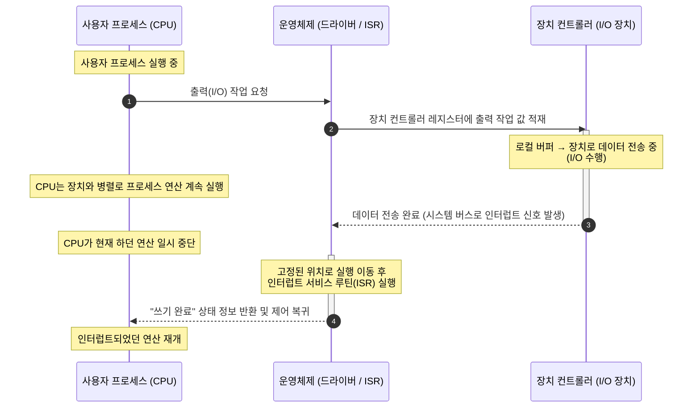

# Chapter 1 서론

## 1.1 운영체제가 할 일

> 운영체제에 포함되는 요소에 보편적인 정의는 없다. 일반적인 정의와 우리가 지지하는 것은 운영체제가 컴퓨터에서 항상 실행되는 프로그램(일반적으로 **커널** 이라고 함)이라는 것이다. 커널과 함께 두 가지 다른 유형의 프로그램이 있다. 운영체제와 관련되어 있지만 반드시 커널의 일부일 필요는 없는 시스템 프로그램과 시스템 작동과 관련되지 않은 모든 프로그램을 포함하는 응용 프로그램이다.

### 왜 운영체제를 공부하는가?

> 단순하게 생각하면 거의 모든 코드가 운영체제 위에서 실행되므로 운영체제 작동방식에 대한 지식은 적절하고 효율적이며 효과적이며 안전한 프로그래밍에 중요하기 때문이다.

> 운영체제의 기본 지식, 컴퓨터 하드웨어 구동 방식 및 응용 프로그램에 제공하는 내용을 이해하는 것은 운영체제를 작성하는 사람들에게 필수적일 뿐만 아니라 그 위에서 프로그램을 작성하고 운영체제를 사용하는 사람들에게도 매우 유용하다.

## 1.2 컴퓨터 시스템의 구성 (Computer System Organization)

- 현대의 범용 컴퓨터 시스템은 하나 이상의 CPU와 구성 요소와 공유 메모리 사이의 액세스를 제공하는 공통 버스를 통해 연결된 여러 장치 컨트롤러로 구성된다.
- 각 장치 컨트롤러는 특정 유형의 장치(예: 디스크 드라이브, 오디오 장치 또는 그래픽 디스플레이)를 담당한다.
- 장치 컨트롤러는 일부 로컬 버퍼 저장소와 특수 목적 레지스터 집합을 유지 관리한다.
- 장치 컨트롤러는 제어하는 주변 장치와 로컬 버퍼 저장소 간에 데이터를 이동한다.
- 일반적으로 운영체제에는 각 장치 컨트롤러마다 **장치 드라이버** 가 있다.
  - 장치 드라이버는 장치 컨트롤러의 작동을 잘 알고 있고 나머지 운영체제에 장치에 대한 일관된 인터페이스를 제공한다.
- CPU와 장치 컨트롤러는 병렬로 실행되어 메모리 사이클을 놓고 경쟁한다.
- 공유 메모리를 질서 있게 액세스하기 위해 메모리 컨트롤러는 메모리에 대한 액세스를 동기화한다.

### 1.2.1 인터럽트(interrupts)

일반적인 컴퓨터 작업(입출력을 수행하는 프로그램)을 고려하자.

- 입출력 작업을 시작하기 위해 장치 드라이버는 장치 컨트롤러의 적절한 레지스터에 값을 적재한다.
- 그런 다음 장치 컨트롤러는 이러한 레지스터의 내용을 검사하여 수행할 작업(예: "키보드에서 문자 읽기")을 결정한다.
- 컨트롤러는 장치에서 로컬 버퍼로 데이터 전송을 시작한다.
- 데이터 전송이 완료되면 장치 컨트롤러는 장치 드라이버에게 작업이 완료되었음을 알린다.
- 그런 다음 장치 드라이버는 읽기 요청이면 데이터 또는 데이터에 대한 포인터를 반환하며 운영체제의 다른 부분에 제어를 넘긴다.
- 다른 작업의 경우 장치 드라이버는 "쓰기 완료" 또는 "장치 사용 중"과 같은 상태 정보를 반환한다.
- 그러나 컨트롤러는 장치 드라이버에게 작업을 완료했다는 사실을 어떻게 알리는가?
- 이는 **인터럽트를 통해 이뤄진다.**

#### 1.2.1.1 개요

- 하드웨어는 어느 순간이든 시스템 버스를 통해 CPU에 신호를 보내 인터럽트를 발생시킬 수 있다.
  - 컴퓨터 시스템에는 많은 버스가 있을 수 있지만 시스템 버스는 주요 구성요소 사이의 주요 통신 경로이다.
- CPU가 인터럽트 되면, CPU는 하던 일을 중단하고 즉시 고정된 위치로 실행을 옮긴다.
- 이러한 고정된 위치는 일반적으로 인터럽트를 위한 서비스 루틴이 위치한 시작 주소를 가지고 있다. 그리고 인터럽트 서비스 루틴이 실행된다.
- 인터럽트 서비스 루틴의 실행이 완료되면, CPU는 인터럽트 되었던 연산을 재개한다.

[출력을 수행하고 있는 단일 프로세스에 대한 인터럽트 시간 일정]

흐름 요약

1. 작업 시작 (`1~2`): 사용자 프로세스가 출력을 요청하면, 장치 드라이버가 장치 컨트롤러의 레지스터에 값을 적재합니다.
2. 병렬 실행 (`3~4` 영역): 장치 컨트롤러가 실제 출력을 수행하는 동안, CPU는 멈추지 않고 병렬로 다른 연산(사용자 프로세스)을 계속 수행합니다.
3. 인터럽트 발생 (`3`): 데이터 전송이 끝나면 장치 컨트롤러가 시스템 버스를 통해 CPU에 인터럽트 신호를 보냅니다.
4. ISR 처리 및 재개 (`4~5`): CPU는 하던 일을 멈추고 고정된 주소의 **인터럽트 서비스 루틴(ISR)** 을 실행해 "쓰기 완료" 상태를 처리한 뒤, 중단되었던 연산을 다시 이어갑니다.
